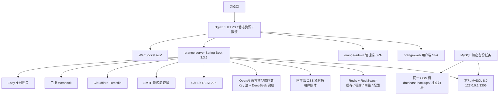
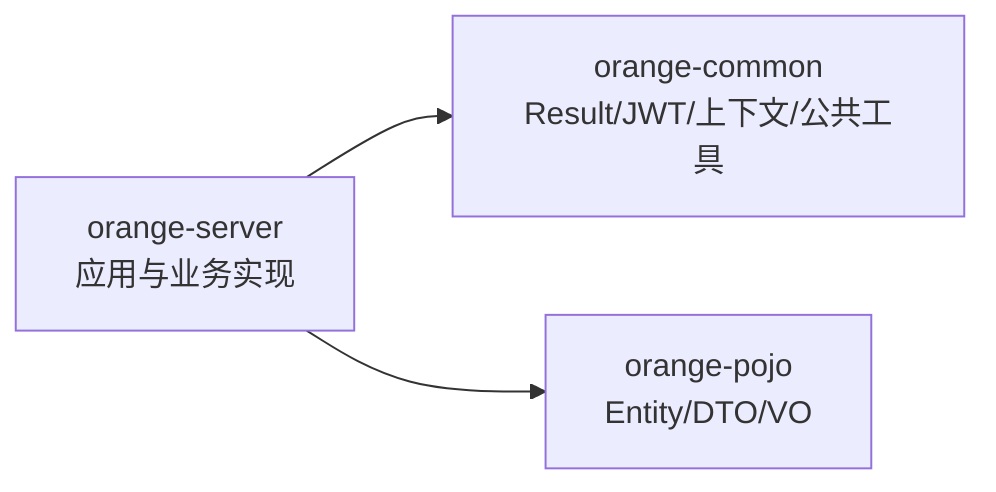
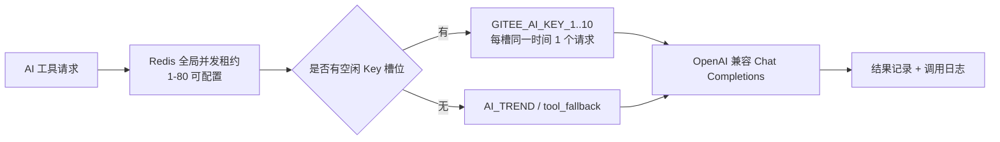

# OrangeVC 系统架构设计说明书

> **文档版本**：v2.0<br>
> **代码基线**：Git V3，提交 `68913b5`<br>
> **更新日期**：2026-08-13<br>
> **状态**：与当前代码同步，持续演进<br>
> **说明**：外部品牌统一使用 **OrangeVC**；`OrangeJD` 仅作为历史仓库名、Java 包名、数据库兼容名、systemd 服务名及服务器目录名保留。

---

## 1. 文档目的与事实边界

本文档用于技术评审、新成员入职、开发维护、生产发布、故障排查和后续架构治理。内容以当前仓库代码、Flyway 迁移、构建脚本和部署脚本为准，不以历史方案或口头规划替代事实。

本文档中的数字是 2026-08-13 基线快照：

| 指标 | 当前值 | 依据 |
|---|---:|---|
| Maven 模块 | 3 | `orange-common`、`orange-pojo`、`orange-server` |
| 后端 Controller | 59 | 25 个管理端、30 个用户端、2 个 Agent、2 个公共 Controller |
| HTTP 方法映射 | 286 | Controller 中的 Get/Post/Put/Delete/Patch Mapping 注解 |
| Mapper 接口 | 46 | `*Mapper.java` |
| Service 相关类 | 108 | `*Service*.java`，包含接口、实现和内部应用服务 |
| Flyway 迁移 | V1-V37，共 37 个文件 | `db/migration` |
| 迁移中创建的业务表 | 60 | 对全部迁移中的 `CREATE TABLE` 去重统计 |
| 用户端页面 | 36 个 Vue View，39 条路由 | `orange-web` |
| 管理端页面 | 20 个 Vue View，20 条路由 | `orange-admin` |
| 当前本地验证 | 后端 238 项、用户端 133 项、管理端 3 项测试通过 | 2026-08-13 本地验证 |

以上数量会随代码变化，更新本文档时必须重新统计。生产真实版本还应同时核对 Git SHA、发布包 SHA-256、Flyway 历史和线上健康检查。

---

## 2. 产品与业务边界

OrangeVC 是面向 Vibe Coding 用户、独立开发者、学习者、求职者和项目需求方的作品展示、项目实践、开源参与、职业成长与 AI 辅助平台。

当前主要业务域包括：

- 账号、注册登录、个人主页与用户资料；
- 作品、需求、比赛、岗位的投稿、编辑、审核和公开展示；
- 评论、收藏、浏览历史、通知、私聊和 WebSocket 消息；
- 报价、订单、支付阶段、交付、充值码和 Epay；
- 配额定价、幂等扣减、退款、奖励和流水；
- GitHub 周榜、本周新增、本周涨星、新手推荐榜和职业成长榜；
- 开源 Issue 抓取、翻译、核验、匹配和贡献指南；
- 趋势分析、方案生成、上线体检、岗位匹配和 AI 审核；
- 通用知识库、项目知识索引、README 和岗位文档向量检索；
- 橙子画像工坊、画像素材、装备、五官/手部/饰品 DIY 与形象码；
- 小智/StackChan 设备连接器及受控 Agent 动作。

系统当前采用模块化单体，而不是微服务。目标是在保持部署简单和事务一致性的同时，通过代码分层、持久化任务、幂等账本和自动化测试降低演进风险。

---

## 3. 总体架构

### 3.1 运行时拓扑



### 3.2 部署单元

| 部署单元 | 作用 | 生产形态 |
|---|---|---|
| `orange-web` | 用户端 SPA | 构建后位于 `/data/orangejd/web-dist/` |
| `orange-admin` | 管理端 SPA | 构建后位于 `/data/orangejd/web-dist/admin/` |
| `orange-server` | API、WebSocket、调度、AI、任务执行 | 单个 Spring Boot JAR，由 `orangejd.service` 管理 |
| MySQL 8.0 | 业务数据、任务、配额账本、索引状态 | 与应用同机，仅监听 `127.0.0.1` |
| Redis/RediSearch | 缓存、动态配置、限流、租约、向量索引 | 独立系统服务 |
| Nginx | TLS、域名规范化、静态资源、反向代理、限流 | `orangevf.com` 为规范域名 |

### 3.3 Maven 模块依赖



`orange-common` 与 `orange-pojo` 不承载单一业务域流程；具体业务编排位于 `orange-server`。

---

## 4. 后端架构

### 4.1 分层约束

当前稳定依赖方向为：

```text
Controller
    ↓
Application Service / 兼容门面
    ↓
领域规则、组装器、校验器、策略
    ↓
Mapper / Redis / VectorStore / 外部客户端
```

ArchUnit 已强制以下规则：

- Controller 直接依赖 Mapper 为 0；
- Spring Bean 字段注入为 0，统一使用构造器注入；
- Service 不依赖 Controller；
- Mapper 不依赖 Service 或 Controller；
- Task 不依赖 Controller 或 Mapper；
- `foundation` 不反向依赖 Controller、业务 Service 或 contribution 模块。

代码仍处于渐进模块化阶段：`identity`、`contribution`、`foundation` 已形成较清晰边界，大量历史业务仍位于 `controller/service/mapper` 包。该状态不是完整领域驱动重构，也不应被描述成已经全部迁移到 `api/application/domain/infrastructure`。

### 4.2 接入与路由

请求链如下：

```text
Nginx
  → CORS
  → RequestIdInterceptor
  → RateLimitInterceptor
  → Admin/App/Agent 对应鉴权拦截器
  → Controller
```

三类鉴权通道：

| 通道 | 路径 | 凭证 |
|---|---|---|
| 管理端 | `/admin/**` | `Admin-Token` |
| 用户端 | `/app/**` | `App-Token` |
| 设备端 | `/agent/**` | Bearer Device Token |

公开路径集中维护在 `ApiRoutePolicy`，避免 Controller 新增后在多处散落白名单。生产 CORS 只能配置明确 HTTPS Origin，禁止通配符。

### 4.3 统一响应与异常

普通 HTTP API 使用 `Result<T>` 响应外壳。全局异常处理负责把参数错误、业务异常和未知异常转换为稳定响应；请求 ID 进入 MDC 并通过 `X-Request-Id` 返回，便于日志关联。

外部供应商异常在基础设施层分类，例如 AI HTTP 状态、超时、429 和鉴权失败，不应在 Controller 中解析供应商细节。

### 4.4 业务门面与内部服务

复杂业务通过兼容门面保持原 API 不变，并把职责拆给内部组件。例如：

- `PersonaWorkshopService`：画像工坊兼容门面；
- `PersonaSnapshotAssembler`：私有、公开和头像快照组装；
- `PersonaEntryService`：画像条目；
- `PersonaMaterialService`：素材箱确认/拒绝；
- `PersonaEquipmentService`：装备、变换和蓝图；
- `PersonaSettingsService`：展示、外观、手部配置；
- `PersonaAppearanceShareService`：形象码生成、读取和应用；
- `TrendAnalysisService`：趋势分析入口；
- `TrendContextBuilder`、`TrendPromptFactory`、`TrendModelClient`、`TrendResponseParser`、`TrendResultAssembler`：上下文、提示词、模型调用、解析和组装；
- `TrendRecommendationSanitizer`：限制模型推荐链接只能来自已检索的真实项目。

写业务的事务边界位于 Service 入口；Controller 只处理鉴权上下文、参数、服务调用和响应包装。

---

## 5. 前端架构

### 5.1 双 SPA

用户端与管理端均使用 Vue 3、Vue Router、Vite、Element Plus 和 Axios。管理端构建基路径为 `/admin/`，两个构建产物由发布脚本组合到同一 Web 根目录。

用户端额外使用 Pinia、Three.js、ECharts、marked 和 DOMPurify。橙子画像场景和装备几何均在浏览器渲染，不在服务器执行 3D 建模。

### 5.2 用户端职责分层

```text
View
  ↓
Feature Component
  ↓
Composable
  ↓
Pinia Store / API Module
```

当前 Pinia Store：

| Store | 职责 |
|---|---|
| `authStore` | Token、账号 ID、当前用户、登录恢复和退出清理 |
| `notificationStore` | 未读状态与同步 |
| `tradeModeStore` | 交易模式开关 |
| `aiRecordStore` | AI 记录与详情缓存 |
| `personaStore` | 画像摘要、素材、展示状态 |
| `agentDeviceStore` | 设备与任务状态 |

`tradeMode.js`、`unread.js` 仍作为兼容适配层存在。页面流程已逐步迁入 `useTrendAnalysis`、`usePersonaWorkshop`、`usePersonaEquipment`、`useOpenSourceIssues`、`useContributionMatch` 等 Composable。

异步状态采用 `loading/error/lastUpdatedAt/requestId` 语义；核心 Store 和 Composable 实现 latest-request-wins 或销毁保护。Token 仅存于 `sessionStorage`，AI 完整结果不写入浏览器长期存储。

### 5.3 HTTP 与幂等请求

用户端 Axios 默认超时为 15 秒。需要长时间处理的 AI 流程由具体 API 或任务流程单独管理，不能假设全局 15 秒适用于模型生成。

配额型 POST 请求自动生成并复用 `Idempotency-Key`。同一个页面请求在网络错误、408、429 或 5xx 后重试时继续使用同一键；确认是非重试型客户端错误或成功后清除。服务端再结合请求哈希和账本唯一约束防止重复扣费。

### 5.4 3D 画像工坊

橙子画像工坊是独立用户模块，包含：

- 画像维度条目；
- 行为采集形成的待确认“素材箱”；
- 稳定视觉语言和装备解锁；
- 五官、手部位置/大小调整；
- 组合饰品蓝图、镜像和手持武器；
- 公开主页 3D 展示；
- 形象码复用、预览与一键应用。

3D 编辑状态主要保留在页面 Composable；跨页面摘要和展示状态进入 Pinia。服务端只保存结构化参数和 JSON 蓝图，不保存每个用户生成的独立模型文件，因此不会因用户 DIY 数量线性增加 3D 文件存储。

---

## 6. AI 调用架构

### 6.1 配置分层

AI 配置类型包括：

- `trend`：趋势分析；
- `project`：方案和项目类生成；
- `contribution`：开源贡献；
- `text`：文本生成与翻译；
- `tool_fallback`：AI 工具池溢出兜底；
- `audit`：AI 审核；
- `embedding`：向量嵌入。

趋势、项目、贡献、文本、兜底和审核配置可以在管理端动态保存到 Redis。API Key 使用 `AI_CONFIG_ENCRYPTION_KEY` 加密，Redis 中保存版本化配置；任务可固定 `configVersion`，避免执行期间配置漂移。Embedding 只能通过服务器环境变量修改。

Redis 不可用时，运行时配置回退到环境变量。项目或贡献没有独立环境配置时，会回退到趋势配置。

### 6.2 AI 工具 Key 池



当前实现特征：

- 最多读取 10 个环境 Key；
- Redis Lua 脚本保证全局租约和每 Key 独占租约的原子获取；
- 全局并发配置被代码限制在 1-80；生产环境可配置为 80；
- Key 槽位均忙时使用 `tool_fallback`，而不是等待任意 Key 释放；
- 租约定期续期并在完成后释放；
- 401/403 将 Key 标记为无效，429 根据 Retry-After 进入限流状态；
- 管理端可查看全局运行数、Gitee/兜底运行数、槽位状态和最近调用；
- 调用日志记录用户、业务类型、任务、供应商、槽位编号、Key 指纹、模型和状态，不保存明文 Key。

默认代码值并不等于生产值：`AiToolPoolProperties` 的代码默认全局并发为 50，生产配置通过环境变量设置，最大允许值为 80。

### 6.3 自动重试与结果保存

AI 工具路由先使用 `requestId` 查询既有结果。已存在成功结果时直接回放，避免重复调用和重复扣费。每次尝试写入 `ai_tool_call_log`，成功结果必须写入 `ai_result_record`。

可重试错误采用指数退避，并尊重供应商 Retry-After。`AI_TOOL_AUTO_RETRY_MAX_ATTEMPTS=0` 在当前代码中代表无限次重试；这会占用当前请求线程，属于需要谨慎配置的运行风险，不应误解为后台持久化重试。

### 6.4 趋势分析与项目推荐

趋势 V2 可组合：

- 用户输入条件；
- 橙子画像上下文；
- 趋势知识图谱；
- Redis 向量知识库；
- 新手推荐项目；
- 职业成长项目。

“知识库增强”与“优先新手/职业”不冲突。V33 后，新手和职业项目也写入通用 VectorStore，并由 `project_knowledge_index_status` 记录来源、文档 ID、内容哈希和索引状态。开启优先按钮时，还会进行结构化候选筛选并提高相关来源权重。

推荐结果经 Sanitizer 校验，模型不得凭空输出不在候选集合中的项目链接。

---

## 7. 知识库与检索

### 7.1 统一向量存储

系统使用 Spring AI Redis VectorStore。通用文档、GitHub README、岗位 JD、新手项目和职业成长项目共同进入 VectorStore，通过 metadata 区分类型和来源，而不是为榜单项目建立完全隔离的 Redis 索引。

MySQL 保存文档元数据和项目索引状态；Redis 保存向量。两者职责如下：

| 存储 | 内容 |
|---|---|
| `knowledge_document` | 文档标题、来源、内容和生命周期信息 |
| `project_knowledge_index_status` | 项目类型、项目 ID、来源引用、内容哈希、索引状态、关联文档 |
| Redis VectorStore | 向量及检索 metadata |

`ProjectKnowledgeSyncService` 默认每 5 分钟扫描项目索引状态并同步。内容哈希用于判断是否需要重建；项目删除或失效时同步清理对应向量和元数据。

### 7.2 RAG 降级

VectorStore Bean 不可用时应用仍可启动，健康详情会显示向量存储状态。依赖 RAG 的功能应降级为非知识库分析或返回明确错误，不能把 Redis 向量故障误判为 MySQL 故障。

---

## 8. 数据架构

### 8.1 Flyway 是唯一结构来源

`orange-server/src/main/resources/db/migration` 是数据库结构唯一可执行来源：

- V1 提供历史基线；
- V2-V37 只做增量变更；
- 已在生产执行的迁移不得修改；
- 新结构必须新增下一版本迁移；
- 手工数据库快照仅用于备份或核验，不用于代替 Flyway 初始化。

当前最新迁移为 `V37__harden_quota_ledger.sql`。

### 8.2 主要数据域

| 数据域 | 代表表 |
|---|---|
| 账号与资料 | `account`、`user_profile` |
| 内容 | `work`、`requirement`、`category`、`comment`、`favorite` |
| 沟通与交易 | `conversation`、`message`、`quote`、`order`、`payment_stage`、`delivery` |
| 配额与支付 | `quota_operation`、`quota_log`、`ai_service_pricing`、`top_up`、`redemption_code`、`order_payment` |
| AI 记录 | `ai_tool_call_log`、`ai_result_record`、`trend_history`、`plan_history` |
| 榜单与开源 | `leaderboard_snapshot`、`open_source_repository`、`open_source_issue`、`open_source_guide` |
| 新手与职业 | `beginner_project*`、`career_project*`、`project_knowledge_index_status` |
| 画像工坊 | `persona_profile_entry`、`persona_material`、`persona_equipment`、`persona_workshop_setting`、`persona_appearance_share` |
| 后台任务 | `system_task`、`ingestion_run`、`ingestion_run_item`、`ingestion_pipeline_lock` |
| Agent | `agent_device_credential`、`agent_device_link_code`、`agent_action_task` |

### 8.3 配额账本

V37 引入 `quota_operation` 幂等业务操作表，并增强 `quota_log`：

- `request_id` 全局唯一；
- `(account_id, idempotency_scope, idempotency_key_hash)` 唯一；
- 请求体保存 SHA-256，而不是保存客户端幂等键明文；
- 记录服务键和价格版本；
- 扣减、补发和退款通过原操作关联；
- 流水具有公开安全的 `transaction_no`；
- `ai_result_record.request_hash` 用于校验请求与结果一致性。

前后端双重幂等用于解决重复点击、浏览器重试、网关重试和 AI 结果回放导致的重复扣费问题。

---

## 9. 持久化任务与采集流水线

### 9.1 System Task

`system_task` 是当前规模下的持久化任务中心：

- 业务键幂等入队；
- 每 2 秒扫描就绪任务；
- 单批最多领取 20 个；
- 数据库原子 claim；
- 120 秒租约，30 秒心跳；
- 每 60 秒恢复过期任务；
- 支持取消、结果、错误、重试时间和配置版本；
- 失败退避上限为 30 分钟。

任务由 Spring 管理的线程池执行。`maxAttempts=0` 表示不设次数上限；具体任务必须显式决定是否允许无限重试。GitHub 榜单完整刷新当前设置为 1 次，避免失败任务永久循环。

### 9.2 Ingestion Run

采集流水线使用：

- `ingestion_run`：一次采集运行；
- `ingestion_run_item`：阶段与单项进度；
- `ingestion_pipeline_lock`：跨实例租约；
- `system_task.run_id`：任务与运行关联。

管理端可以创建、查看、重试和取消采集运行。该模型覆盖榜单、开源 Issue、README 等外部数据处理。

### 9.3 定时任务基线

| 任务 | 默认计划 |
|---|---|
| GitHub 榜单 | 每周一 02:00 |
| 开源 Issue 完整刷新 | 每周一 03:30 |
| 开源 Issue 核验 | 每天 04:30 |
| 新手项目 | 每周一 04:30 |
| 职业成长项目 | 每周一 05:00 |
| 项目知识同步 | 默认每 5 分钟扫描 |
| 报价超时、存储清理 | 每 10 分钟 |
| 订单超时 | 每天 02:00 |
| 通知清理 | 每天 03:00 |

GitHub 榜单抓取使用 URL 编码后的 Search API 查询；请求失败与 JSON 解析失败分别报告。刷新仍同步执行 README 采集、翻译和向量化，因此完整多分类刷新可能耗时较长，这是当前实现的性能边界。

---

## 10. 安全架构

### 10.1 身份与入口安全

- App/Admin 使用不同 JWT 密钥；生产密钥至少 32 字符且不能相同；
- 密码使用 BCrypt；
- 注册和找回密码使用邮箱验证码；
- 注册接入 Cloudflare Turnstile；
- 登录、注册、验证码、上传、AI、投稿和 Agent 路径有应用级 Redis 限流；
- Nginx 普通 API 默认每 IP 20 请求/秒，登录入口每 IP 5 请求/分钟；
- 外部 URL 只允许符合策略的 HTTPS 公网地址，拒绝 localhost、私网、用户信息等危险形式；
- 前端外链通过统一安全打开逻辑和 `noopener,noreferrer`；
- 上传文件执行类型、扩展名、文件签名和路径控制；
- Token、Key、密码和个人信息不得进入 Git、日志或发布包。

### 10.2 Nginx 安全

生产模板实现：

- HTTP、`www` 统一 301 到 `https://orangevf.com`；
- HSTS、CSP、`nosniff`、DENY frame、Referrer Policy 和 Permissions Policy；
- `/assets/*` 与 `/admin/assets/*` 缺失时精确返回 404；
- `robots.txt`、`sitemap.xml`、`security.txt` 必须返回真实文件；
- `/.env`、`/.git` 等隐藏路径返回 404；
- `/health` 仅允许本机访问；
- 用户上传资源附加独立 CSP。

### 10.3 生产配置校验

生产启动时校验：

- JWT 密钥强度和隔离；
- CORS 明确 HTTPS 白名单；
- `PUBLIC_BASE_URL` 为 HTTPS Origin；
- Turnstile 密钥存在；
- Epay 要么完整配置，要么关闭；
- AI 动态配置保存前必须具备 `AI_CONFIG_ENCRYPTION_KEY`。

发布构建还会拒绝空值、`YOUR_`、`example.com`、localhost 等生产占位配置，并生成公开构建变量指纹。

---

## 11. 部署、发布与回滚

### 11.1 systemd

应用由 `orangejd.service` 启动：

```text
/usr/bin/java -Xms512m -Xmx2048m -XX:MaxMetaspaceSize=384m
  -jar /data/orangejd/orange-server.jar
  --spring.profiles.active=prod
```

服务以 `admin` 用户运行，环境变量来自 `/etc/orangejd/orangejd.env`，启用 `NoNewPrivileges`、`PrivateTmp`、受限写目录和失败自动重启。

### 11.2 发布包

`scripts/build-release.sh` 负责：

- Maven 构建；
- 两个 Vue 应用构建；
- 组合用户端与管理端产物；
- 校验两个 SPA 入口引用的 JS/CSS 均存在；
- 生成 Git SHA、分支、时间、文件 SHA-256 和迁移清单；
- 生成公开构建配置指纹；
- 携带 Nginx 模板和生产配置校验工具。

`scripts/install-release.sh` 负责：

- 检查发布包和配置指纹；
- 备份当前 JAR、前端和 Nginx；
- 生成并校验候选 Nginx 配置；
- 切换文件并重启服务；
- 验证网站、管理端、静态资源 404、安全文件类型和健康接口；
- 任一步失败时恢复旧 JAR、旧前端和旧 Nginx。

发布脚本不应被手工复制单个 `dist` 目录替代，否则可能再次出现用户端覆盖管理端或旧 HTML 引用缺失资源的问题。

---

## 12. MySQL 自建与备份

### 12.1 当前目标配置

仓库中的生产配置将 MySQL 8.0 设计为：

- 仅监听 `127.0.0.1:3306`；
- `require_secure_transport=ON`；
- 最大连接数 150；
- InnoDB Buffer Pool 1536 MB；
- Redo Log 512 MB；
- 慢查询阈值 1 秒；
- Binlog 保留 3 天；
- 2 GB Swap 防止突发 OOM；
- 字符集和大小写设置保留原 RDS 兼容参数，不能在未评估现有数据前擅自改成新的默认值。

### 12.2 备份安全

数据库备份与用户媒体使用同一私有 OSS 桶，但使用独立 RAM 凭证和独立前缀：

```text
用户媒体：avatar/ cover/ detail/ general/ video/
数据库：database-backups/
```

应用媒体账号不得访问数据库备份；备份账号不得访问用户媒体。

每日 02:30 执行：

1. `mysqldump --single-transaction --quick --skip-lock-tables`；
2. gzip 压缩；
3. 使用 age 公钥加密；
4. 生成 SHA-256；
5. 上传日备份和校验文件；
6. 重新下载并 `cmp` 验证；
7. 每月 1 日生成月备份；
8. 本地只保留最近 7 天。

OSS 清理由每周任务执行，只允许删除下列前缀：

| 前缀 | 保留时间 |
|---|---:|
| `database-backups/daily/` | 30 天 |
| `database-backups/checksums/` | 30 天 |
| `database-backups/monthly/` | 400 天 |
| `database-backups/rehearsal/` | 7 天 |

### 12.3 数据库健康检查

每 15 分钟检查：MySQL、应用、Nginx、备份 Timer、SQL 查询、本地数据库配置、磁盘和最近加密备份。应用 Actuator 健康检查采用 10 秒超时，最多 3 次，间隔 2 秒，避免单次短暂抖动触发飞书误报。

磁盘 70% 记录警告，85% 进入失败告警；最近备份超过 26 小时视为异常。

---

## 13. 可观测性

当前具备：

- `/health` 和 `/health/detail`；
- Actuator `health/info/prometheus`；
- 管理端口默认绑定 `127.0.0.1:8081`；
- Micrometer Prometheus 指标；
- 请求 ID 和结构化日志；
- AI 调用成功、失败、重试、超时和容量拒绝指标；
- AI 调用记录、系统任务、采集运行、管理员审计日志；
- systemd Journal；
- 数据库/备份飞书告警。

需要区分三种健康信号：

- 应用存活：进程与轻量接口；
- 依赖健康：MySQL、Redis、VectorStore；
- 业务健康：AI 成功率、记录保存率、采集快照日期、备份新鲜度。

“application health endpoint failed”不等于“MySQL failed”，告警文案和排障必须按具体检查项解释。

---

## 14. 测试与质量门禁

### 14.1 CI

GitHub Actions 覆盖 `main`、`V2`、`V3` 的 push 和 PR：

1. Java 21 下执行 `mvn -B clean verify`；
2. MySQL 8.0 空库按版本顺序执行全部 Flyway SQL；
3. 用户端执行安装、Lint、Typecheck、Coverage、Build 和生产依赖审计；
4. 管理端执行安装、Lint、Typecheck、测试、Build 和生产依赖审计；
5. 执行 Java/Vue 文件规模预算；
6. 执行前端 Bundle 预算；
7. Playwright Chromium 关键流程测试；
8. Gitleaks 密钥扫描。

### 14.2 当前覆盖现状

2026-08-13 本地验证：

- 后端 238 项测试通过；
- 用户端 43 个测试文件、133 项测试通过；
- 管理端 2 个测试文件、3 项测试通过；
- 两个前端生产构建通过；
- 数据库运维 Shell 脚本通过语法检查；
- OSS RAM 策略 JSON 可解析。

管理端自动化测试数量明显少于用户端，是当前测试分布的主要短板。用户端测试仍存在 Element Plus 组件/指令未完整注册造成的警告，应持续清理，但不影响当前测试通过结论。

---

## 15. 已知边界与技术债务

| 编号 | 当前事实 | 风险 | 建议方向 |
|---|---|---|---|
| TD-01 | 单体包内仍同时存在业务模块与历史 `controller/service/mapper` | 模块边界仍需人工理解 | 修改业务时渐进迁移，不做一次性重写 |
| TD-02 | `spring.main.allow-circular-references=true` | 可能掩盖循环依赖 | 统计真实循环后逐个消除 |
| TD-03 | AI 自动重试在请求线程内执行，0 表示无限次 | 长故障可能长期占用线程和并发租约 | 将长重试迁入持久化任务，生产设置有限次数 |
| TD-04 | 榜单刷新同步处理多 Topic、README、翻译和向量化 | 完整刷新耗时长，局部失败影响整批状态 | 拆成可并发、有速率限制的子任务流水线 |
| TD-05 | 前端主要 Bundle 和趋势分析 Chunk 超过 500 KB | 首屏或功能加载成本偏高 | 拆分 Three.js、ECharts、编辑器和分析模块 |
| TD-06 | 管理端只有 3 项测试 | 回归保护不足 | 补齐登录、分页、审核、AI 设置、采集运行流程 |
| TD-07 | 用户端 Axios 全局默认 15 秒 | 长 AI 请求若未覆盖会提前超时 | 所有长任务统一异步任务/轮询协议 |
| TD-08 | MySQL、Redis、应用仍在同一服务器 | 主机级单点故障 | 先验证恢复演练，再按成本选择托管数据库或热备 |
| TD-09 | Redis 同时承担缓存、动态配置、限流、租约和向量 | 内存或服务故障影响面较大 | 建立容量指标、备份/重建流程，必要时拆实例 |

---

## 16. 容量与扩展原则

平台“同时支持多少用户”不能由 Key 数量或供应商宣称的“不限制并发”直接推出。真实容量取决于：

- 全局 AI 并发上限；
- Key 槽位数和每 Key 的 RPM/TPM；
- 兜底模型配额；
- 提示词与输出 Token；
- 单次响应时间；
- 自动重试比例；
- 应用线程、HTTP 连接池、Redis 和 MySQL；
- 结果保存和配额事务延迟。

当前代码允许全局并发最高 80，但这只是入口保护上限，不是经过真实长文本压测后承诺的稳定吞吐。正式容量应使用真实请求体持续压测 10-30 分钟，并同时观测成功率、P95/P99、429、超时、Token 速率、兜底比例、线程、数据库连接、Redis 延迟和结果保存率。

扩展优先级：

1. 将长 AI 调用改为提交任务 + 轮询/推送；
2. 限制无限自动重试并增加任务级退避；
3. 拆分采集和向量化流水线；
4. 分离 Redis 向量与运行时状态；
5. 应用无状态化后增加实例和 Nginx upstream；
6. 最后才评估按业务域拆微服务。

---

## 17. 关键配置清单

以下仅列配置名称，不记录任何真实密钥：

| 分类 | 关键配置 |
|---|---|
| 数据库 | `MYSQL_HOST`、`MYSQL_PORT`、`MYSQL_DB`、`MYSQL_USER`、`MYSQL_PASSWORD` |
| Redis | `REDIS_HOST`、`REDIS_PORT`、`REDIS_PASSWORD`、`REDIS_DB` |
| JWT | `JWT_ADMIN_SECRET`、`JWT_APP_SECRET` |
| AI 工具池 | `AI_TOOL_POOL_ENABLED`、`AI_TOOL_GLOBAL_MAX_CONCURRENCY`、`GITEE_AI_ENDPOINT`、`GITEE_AI_MODEL`、`GITEE_AI_KEY_1..10` |
| AI 兜底 | `AI_TREND_ENDPOINT`、`AI_TREND_KEY`、`AI_TREND_MODEL` |
| AI 动态配置 | `AI_CONFIG_ENCRYPTION_KEY` |
| 其他 AI | `AI_AUDIT_*`、`AI_TEXT_*`、`AI_PROJECT_*`、`AI_CONTRIBUTION_*`、`AI_EMBEDDING_*` |
| GitHub | `GITHUB_TOKEN`、榜单与开源刷新 Cron |
| OSS | `OSS_ENABLED`、Endpoint、Bucket、媒体 RAM 凭证 |
| 备份 OSS | `/etc/orangejd/mysql-backup.env` 中的独立 RAM 凭证和 age 公钥路径 |
| 网站 | `PUBLIC_BASE_URL`、`ALLOWED_ORIGINS`、Turnstile、品牌和备案构建变量 |
| 支付与通知 | Epay、SMTP、飞书 Webhook |

> 注：Embedding 环境变量统一使用 `AI_EMBEDDING_*`，以 `application-prod.yml` 为准。

---

## 18. 运维验收清单

每次生产发布至少验证：

- [ ] Git SHA 与发布包 manifest 一致；
- [ ] Flyway V1-V37 全部成功且无改写历史迁移；
- [ ] `/health/detail` 中 MySQL、Redis、VectorStore 状态符合预期；
- [ ] `/market` 可匿名访问，`/admin/` 可正常加载；
- [ ] 用户端和管理端入口引用的静态资源全部存在；
- [ ] 不存在的用户端/管理端资源返回 404；
- [ ] `robots.txt`、`sitemap.xml`、`security.txt` 类型正确；
- [ ] HTTP、www 统一跳转到非 www HTTPS；
- [ ] 登录、注册、Turnstile、邮件验证码可用；
- [ ] 投稿、编辑、审核及奖励只发生一次；
- [ ] AI 配额确认、调用、自动重试、结果记录和退款链路正常；
- [ ] 管理端能看到 AI 调用用户、任务、槽位和状态；
- [ ] 榜单最新快照日期更新，采集失败不会误报成功；
- [ ] 画像保存、装备、形象码和主页展示正常；
- [ ] MySQL 备份完成加密、上传、回读校验；
- [ ] 媒体账号不能读取备份，备份账号不能读取媒体；
- [ ] 应用、MySQL、Redis、Nginx 和备份 Timer 均为 active；
- [ ] 部署备份可用于回滚。

---

## 附录 A：技术栈

| 类别 | 技术 | 当前版本/形态 |
|---|---|---|
| 后端语言 | Java | 21 |
| 应用框架 | Spring Boot | 3.3.5 |
| AI | Spring AI | 1.0.0 |
| ORM | MyBatis Spring Boot | 3.0.3 |
| 分页 | PageHelper | 2.0.0 |
| JWT | JJWT | 0.12.6 |
| 数据库驱动 | MySQL Connector/J | 8.0.33 |
| 数据迁移 | Flyway | Spring Boot 管理，V1-V37 |
| API 文档 | springdoc-openapi | 2.6.0 |
| 对象存储 | Aliyun OSS SDK | 3.18.4 |
| HTML 处理 | jsoup | 1.18.3 |
| 后端测试 | JUnit 5、Mockito、MockMvc、ArchUnit、JaCoCo | CI 执行 |
| 用户/管理前端 | Vue | 3.5.34 |
| UI | Element Plus | 2.14.1 |
| 状态管理 | Pinia | 3.0.3，用户端 |
| 路由 | Vue Router | 4.6.4 |
| HTTP | Axios | 1.18.0 |
| 构建 | Vite | 8.x |
| 测试 | Vitest、Vue Test Utils、Playwright | CI 执行 |
| 3D | Three.js | 0.179.1 |
| 图表 | ECharts | 6.1.0 |
| Markdown | marked + DOMPurify | 18.0.5 / 3.4.12 |
| 数据库 | MySQL | 8.0，自建本机实例 |
| 缓存/向量 | Redis + RediSearch | 缓存、状态、向量 |
| 网关 | Nginx | HTTPS、静态资源、反代、限流 |
| 服务管理 | systemd | 应用、备份、健康检查 |

---

## 附录 B：重要源码入口

| 主题 | 路径 |
|---|---|
| Maven 根配置 | `pom.xml` |
| 后端生产配置 | `orange-server/src/main/resources/application-prod.yml` |
| Flyway | `orange-server/src/main/resources/db/migration/` |
| MVC 与鉴权链 | `orange-server/src/main/java/com/orangejd/server/config/WebMvcConfiguration.java` |
| 路由公开策略 | `orange-server/src/main/java/com/orangejd/server/security/ApiRoutePolicy.java` |
| AI 工具池 | `orange-server/src/main/java/com/orangejd/server/foundation/aitool/` |
| 持久化任务 | `orange-server/src/main/java/com/orangejd/server/foundation/task/` |
| 采集流水线 | `orange-server/src/main/java/com/orangejd/server/foundation/ingestion/` |
| 趋势分析 | `orange-server/src/main/java/com/orangejd/server/service/Trend*.java` |
| 画像服务 | `orange-server/src/main/java/com/orangejd/server/service/Persona*.java` |
| 用户端 Store | `orange-web/src/stores/` |
| 用户端 Composable | `orange-web/src/composables/` |
| Nginx 模板 | `nginx.conf` |
| 发布构建 | `scripts/build-release.sh` |
| 发布安装 | `scripts/install-release.sh` |
| 数据库运维 | `scripts/database/` |
| CI | `.github/workflows/ci.yml` |
| 架构规则 | `orange-server/src/test/java/com/orangejd/server/architecture/ArchitectureGovernanceTest.java` |

---

## 附录 C：Controller 入口总览

### 管理端入口

| 入口组 | Base Path | 主要职责 |
|---|---|---|
| 登录与用户 | `/admin/auth`、`/admin/users` | 管理员登录、退出、密码、用户分页与状态 |
| 内容审核 | `/admin/audit`、`/admin/work`、`/admin/requirement`、`/admin/comment` | 作品/需求审核、上下架、评论管理和审核证据 |
| 投稿内容 | `/admin/job`、`/admin/competition` | 岗位和比赛管理、审核及知识同步 |
| 榜单项目 | `/admin/beginner-projects`、`/admin/career-projects` | 新手/职业项目、周选、核验和刷新 |
| 开源与采集 | `/admin/open-source`、`/admin/ingestion/runs` | 仓库、Issue、翻译、核验、采集运行和重试 |
| 知识库 | `/admin/knowledge/document` | 文档、索引、重建和项目来源状态 |
| AI 管理 | `/admin/ai-config`、`/admin/ai-tool-pool` | 动态模型配置、Key 槽、并发和调用记录 |
| 运营管理 | `/admin/pricing`、`/admin/redemption`、`/admin/orders`、`/admin/config` | 定价、充值码、订单和交易模式 |
| 统计与体检 | `/admin/stats`、`/admin/statistics`、`/admin/report`、`/admin/launch-check` | 仪表盘、统计、报表和上线体检 |
| 公共上传 | `/admin/common` | 管理端文件上传 |

### 用户端入口

| 入口组 | Base Path | 主要职责 |
|---|---|---|
| 账号与资料 | `/app/auth`、`/app/profile` | 注册登录、验证码、密码、资料和公开主页 |
| 内容与发现 | `/app/work`、`/app/requirement`、`/app/category`、`/app/comment`、`/app/favorite`、`/app/history` | 投稿、编辑、审核提交、浏览和互动 |
| 沟通交易 | `/app/conversation`、`/app/message`、`/app/notification`、`/app/quote`、`/app/order` | 会话、消息、通知、报价、订单、支付阶段和交付 |
| AI 工具 | `/app/trend`、`/app/plan`、`/app/launch-check`、`/app/ai-records` | 趋势、方案、体检和统一 AI 结果记录 |
| 榜单与成长 | `/app/leaderboard`、`/app/beginner-projects`、`/app/career-projects` | GitHub/站内榜单、新手与职业项目 |
| 开源与岗位 | `/app/open-source`、`/app/job`、`/app/competition` | Issue、贡献指南、岗位和比赛 |
| 画像工坊 | `/app/persona-workshop` | 画像、素材、装备、DIY、设置和形象码 |
| 配额与配置 | `/app/quota`、`/app/config` | 余额、流水、兑换、价格与交易开关 |
| 设备与知识 | `/app/agent-devices`、`/app/knowledge/document` | 小智设备、任务记录和知识文档 |
| 上传 | `/app/common` | 图片、视频和通用文件上传 |

公共入口还包括健康检查、受控媒体读取、Epay 回调和 WebSocket。Agent 入口为 `/agent/connect` 与 `/agent/actions`。

---

## 附录 D：维护规则

本文档必须在以下变化发生时同步更新：

- 新增或拆分部署单元；
- 新增 Flyway 迁移或核心表；
- 调整 AI Key 池、重试、配额或结果记录语义；
- 调整鉴权、公开路径、Nginx 或生产安全策略；
- 调整持久化任务或采集流水线；
- 迁移数据库、Redis、OSS 或备份策略；
- 前端状态层和核心页面职责发生变化；
- CI 门禁、测试基线或发布回滚流程变化。

维护时不得只在文档末尾追加“补充说明”。应直接修改对应章节，并重新核对代码、配置、迁移、测试和生产部署事实。
