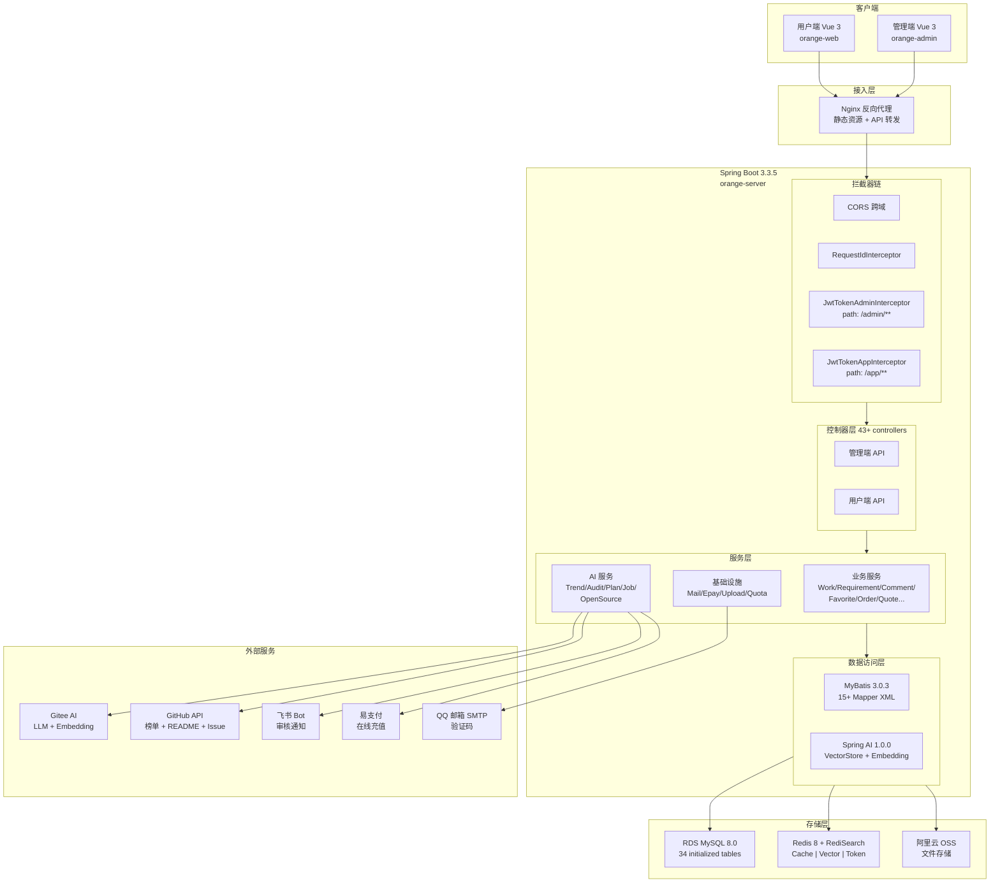
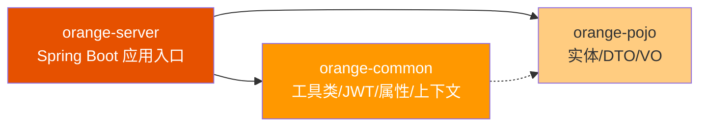
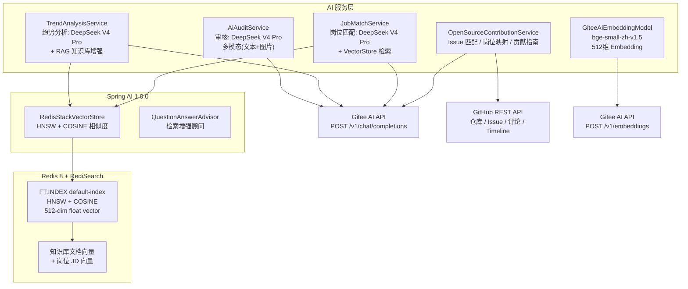
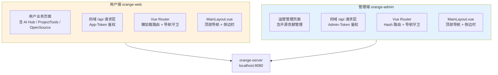
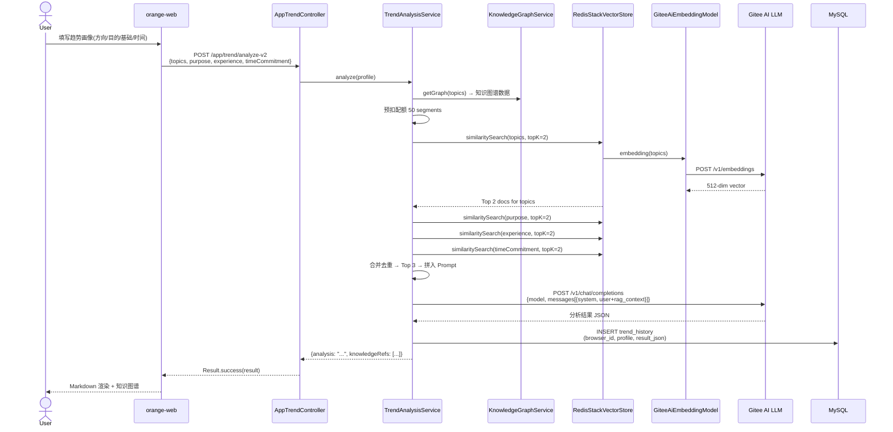
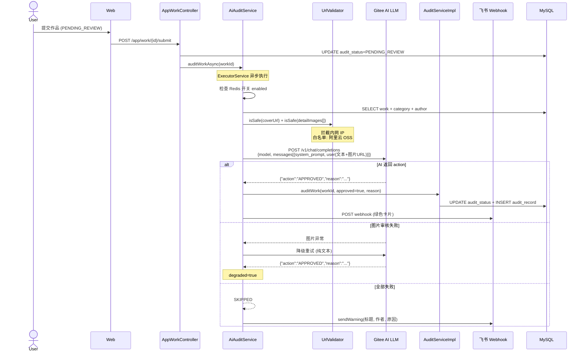
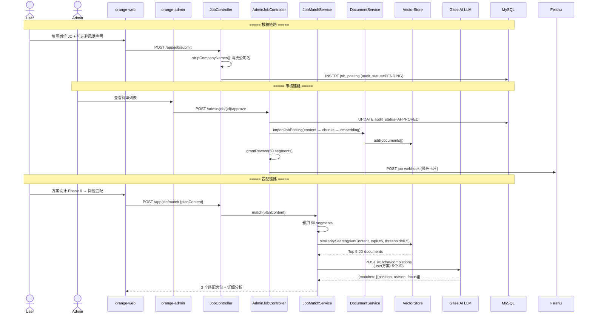
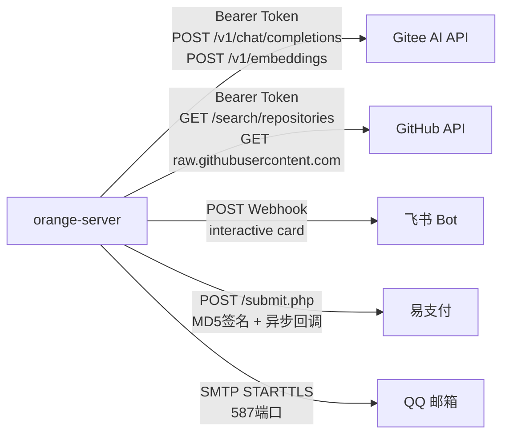
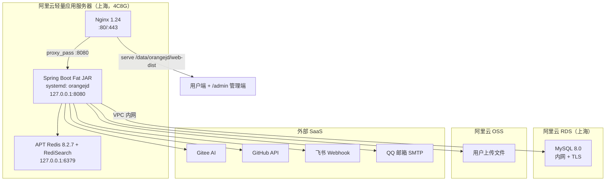
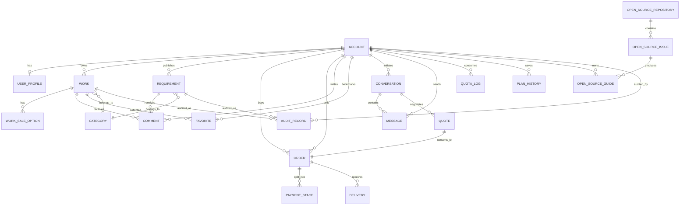

# OrangeJD 系统架构设计说明书

> **版本**: v1.2 | **日期**: 2026-07-21 | **状态**: 持续演进
>
> **适用范围**: 团队技术评审、新成员入职、项目落地交付、运维部署参考

---

## 1. 文档摘要

OrangeJD 是一个面向 AI 实习生和自由开发者的 **Vibe Coding 作品交易、项目实践与职业匹配平台**。平台连接 AI 技能持有者与项目需求方，并通过 GitHub 榜单、开源 Issue 发现、AI 方案设计和岗位能力映射，帮助用户完成“做自己的项目”与“参与开源项目”两类实践路径。

**技术定位**：单体 Spring Boot 应用 + 双前端门户，集成 Spring AI 向量检索（RAG）与 LLM 调用链，面向中小规模并发场景（设计目标 500 QPS）。

**核心数据**：

| 指标 | 数值 |
|------|------|
| 初始化数据表 | 34 张（MySQL 8.0 InnoDB，Flyway 最新 V12） |
| 控制器 | 43 个 `@RequestMapping` 控制器，其中开源贡献新增用户端/管理端控制器各 1 个 |
| Maven 模块 | 3 个（common / pojo / server） |
| 前端入口 | 2 个（用户端 orange-web / 管理端 orange-admin） |
| AI 模型 | DeepSeek V4 Pro + bge-small-zh-v1.5 Embedding |
| 外部集成 | GitHub API / Gitee AI / 飞书 / Epay / QQ 邮箱 |

---

## 2. 业务需求与系统设计目标

### 2.1 业务痛点

1. **AI 开发者缺乏作品展示渠道**：GitHub 只能展示代码，无法展示商业价值；自由职业平台缺乏 AI 技能标签
2. **需求方找人不精准**：传统外包平台按价格排序，缺少 AI 领域技术匹配能力
3. **技术趋势信息割裂**：GitHub Trending、招聘 JD、技术文章分散，缺少一站式趋势分析
4. **AI 实习生求职缺少参照系**：不知道自己的技能与真实岗位的差距，缺少学习路径指引

### 2.2 功能性需求

| 模块 | 核心功能 |
|------|---------|
| **账号体系** | 邮箱注册/登录，双通道 JWT（用户端/管理端），个人资料管理 |
| **内容发布** | 作品发布（含富文本详情/封面图/售卖选项），需求发布，草稿→提交审核→通过/拒绝 |
| **内容发现** | 分类浏览、收藏、评论、浏览历史、公开作品页 |
| **沟通协商** | 一对一私聊（WebSocket + HTTP 混合）、系统通知 |
| **交易闭环** | 报价→订单→支付阶段（定金/尾款）→交付记录 |
| **管理后台** | 分类 CRUD、作品/需求审核、用户管理、报表统计、订单管理 |
| **GitHub 榜单** | 15 个 Topic 分类，按周刷新并缓存快照，自动采集 README |
| **开源贡献** | 发现与核验 Issue、AI 候选匹配、岗位能力映射、贡献指南；默认每两天完整刷新 |
| **AI 趋势分析** | 知识图谱展示 + LLM 深度分析 + RAG 上下文增强 |
| **AI 自动审核** | DeepSeek V4 Pro 多模态审核（文本+图片），审核开关可配置 |
| **RAG 知识库** | 文档上传/切片/向量化，GitHub README 自动采集，岗位 JD 向量库 |
| **岗位招聘** | 用户投稿→管理员审核→向量化入库→AI 岗位匹配（方案设计→推荐岗位） |
| **方案设计** | 六阶段 AI 项目规划（想法→需求理解→成功标准→约束风险→任务计划→岗位匹配） |
| **配额系统** | 充值码/Epay 支付/消费预扣+退款/新用户赠送/审核奖励 |

### 2.3 非功能需求

| 维度 | 要求 | 实现方式 |
|------|------|---------|
| **性能** | 核心 API < 500ms P95，AI 调用 < 120s | RestTemplate 连接池 + 异步审核 |
| **可用性** | 99.5%（允许非核心 AI 功能降级） | `@Autowired(required=false)` 降级注入 |
| **安全性** | JWT 双通道 + BCrypt + SSRF 防护 + Token 黑名单 | Interceptor + UrlValidator |
| **可扩展性** | 分类动态管理，AI 模型配置外部化 | Redis 动态配置 + YAML 多环境 |
| **可观测性** | 全链路 RequestID + 管理审计日志 + 健康检查 | RequestIdInterceptor + AOP + /health |
| **数据一致性** | 配额消费原子性 | FOR UPDATE 行锁 + 幂等 requestId |

---

## 3. 总体架构设计

### 3.1 分层架构

```
┌─────────────────────────────────────────────────────────┐
│                    接入层 (Access Layer)                  │
│  Nginx 反向代理 → CORS 过滤器 → RequestID 拦截器          │
│  → JWT Admin 拦截器 ( /admin/** )                        │
│  → JWT App 拦截器   ( /app/** )                          │
├─────────────────────────────────────────────────────────┤
│                    业务层 (Business Layer)                │
│  ┌──────────┐  ┌──────────┐  ┌──────────┐               │
│  │ 内容模块  │  │ 交易模块  │  │ AI 模块   │               │
│  │ Work     │  │ Quote    │  │ Trend    │               │
│  │ Require  │  │ Order    │  │ Audit   │               │
│  │ Comment  │  │ Payment  │  │ Plan    │               │
│  │ Favorite │  │ Delivery │  │ Job/Open│               │
│  └──────────┘  └──────────┘  └──────────┘               │
├─────────────────────────────────────────────────────────┤
│                   数据层 (Data Layer)                     │
│  RDS MySQL 8.0 (MyBatis) │ Redis 8 (Jedis + RediSearch)  │
│  34 张初始化表            │ Cache + Vector + Token Blacklist│
├─────────────────────────────────────────────────────────┤
│                   外部集成 (External)                     │
│  Gitee AI │ GitHub API │ 飞书 Webhook │ Epay │ QQ 邮箱   │
└─────────────────────────────────────────────────────────┘
```

### 3.2 系统架构总图



### 3.3 模块依赖关系



| 模块 | 职责 | 关键内容 |
|------|------|---------|
| `orange-common` | 共享工具与基础设施 | `JwtUtil`、`UrlValidator`、`JacksonObjectMapper`、`BaseContext`（ThreadLocal）、`Result<T>` 统一响应、`JwtProperties` |
| `orange-pojo` | 数据对象定义 | Entity、DTO、VO 与分页查询对象 |
| `orange-server` | 业务逻辑与 API 入口 | Controllers / Services / Mappers / Interceptors / Config / AI / Task / Aspect |

---

## 4. 核心模块详细设计

### 4.1 接入层：安全与路由

#### 4.1.1 拦截器链（执行顺序）

```
HTTP Request
  │
  ▼
CORS Filter (WebMvcConfiguration.addCorsMappings)
  - allowedOriginPatterns: *
  - methods: GET/POST/PUT/DELETE/OPTIONS
  │
  ▼
RequestIdInterceptor (全局 /**)
  - 生成 8 位 UUID → MDC.put("requestId", ...)
  - 响应头: X-Request-Id
  │
  ▼
┌─ /admin/auth/login ──► 跳过 JWT（登录接口公开）
├─ /admin/**         ──► JwtTokenAdminInterceptor
│   - 从 Admin-Token 请求头提取
│   - parseJwt() + 黑名单检查
│   - BaseContext.setCurrentId(id)
└─ /app/**           ──► JwtTokenAppInterceptor
    - 从 App-Token 请求头提取
    - 公开路径排除: /app/auth/**, /app/category,
      /app/work/public, /app/requirement/public,
      /app/leaderboard/**, /app/trend/*, /ws/**
    - 消费类接口手动从 Header 提取用户身份
```

#### 4.1.2 双通道 JWT 设计

| 维度 | Admin 通道 | App 通道 |
|------|-----------|---------|
| 密钥 | `jwt.admin-secret-key` | `jwt.app-secret-key` |
| TTL | 7200000ms (2h) | 7200000ms (2h) |
| Header | `Admin-Token` | `App-Token` |
| 前缀 | `sk-` | `sk-` |
| 签名算法 | HmacSHA256（JJWT 0.12.6） | HmacSHA256 |
| 黑名单 | Redis Set `token:blacklist` | 同 |

JWT 生成 `sk-` 前缀 + 兼容解析（`parseJwt` 自动去前缀），保证旧 token 平滑过渡。

### 4.2 业务模块详细设计

#### 4.2.1 内容发布模块

**职责**：作品/需求的创建、编辑、提交审核、状态流转

```
状态机:
DRAFT → PENDING_REVIEW → APPROVED / REJECTED
  │                          │
  └──────────────────────────┘ (重新编辑后回到 DRAFT)
```

**关键 Service**：

| 服务 | 文件 | 核心职责 |
|------|------|---------|
| `WorkServiceImpl` | `service/impl/WorkServiceImpl.java` | 作品 CRUD、草稿管理、提交审核、可见性切换 |
| `RequirementServiceImpl` | `service/impl/RequirementServiceImpl.java` | 需求 CRUD、预算管理、状态流转 |
| `AuditServiceImpl` | `service/impl/AuditServiceImpl.java` | 审核执行（`auditWork`/`auditRequirement`），写 `audit_record` 表 |

**依赖**：`WorkMapper` / `RequirementMapper` / `CategoryMapper` / `AuditRecordMapper` / `FileUploadService`（封面图上传）

#### 4.2.2 交易闭环模块

**职责**：报价协商→订单创建→分阶段支付→交付记录

**状态流转**：
```
QUOTE: PENDING_CONFIRM → ACCEPTED → (创建订单)
ORDER: CREATED → DEPOSIT_PAID → IN_PROGRESS → FINAL_PAID → COMPLETED
PAYMENT: UNPAID → PAID
```

**关键实体关系**：
- `Quote` ──1:1──→ `Order`（source_type='QUOTE', source_id=quote.id）
- `Order` ──1:N──→ `PaymentStage`（最多 2 条：定金 + 尾款）
- `Order` ──1:N──→ `Delivery`（允许多次交付）

#### 4.2.3 通知与消息模块

| 通道 | 技术 | 用途 |
|------|------|------|
| WebSocket | `spring-boot-starter-websocket` | 实时消息推送（一对一私聊） |
| 系统通知 | HTTP Polling / `notification` 表 | 审核结果、报价状态变更 |
| 飞书通知 | Webhook POST | AI 审核结果、岗位审核结果（独立双 webhook） |

### 4.3 AI 服务模块

#### 4.3.1 模块依赖图



#### 4.3.2 AI 审核服务（AiAuditService）

| 维度 | 说明 |
|------|------|
| **入口** | `auditWorkAsync(workId)` / `auditRequirementAsync(reqId)` |
| **并发控制** | `Executors.newFixedThreadPool(2)`，最多 2 并发 |
| **模型** | DeepSeek V4 Pro，temperature=0.1 |
| **输入** | 标题 + 简介 + 详情 + 分类 + 封面图(URL) + 详情内嵌图(最多 5 张) |
| **SSRF 防护** | 所有图片 URL 经 `UrlValidator.isSafe()` 校验（拦截内网 IP） |
| **降级** | 图片审核失败 → 自动降级为纯文本审核（标记 `degraded:true`） |
| **输出** | JSON `{action: "APPROVED"/"REJECTED", reason: "..."}` |
| **通知** | 飞书 Webhook 推送审核结果（绿色/红色卡片） |
| **开关** | Redis `system:ai-audit:enabled`（管理后台 `/admin/ai-audit/toggle` 控制） |

#### 4.3.3 趋势分析服务（TrendAnalysisService）

| 维度 | 说明 |
|------|------|
| **输入** | `TrendProfileDTO`：topics/purpose/experience/languages/timeCommitment |
| **RAG 检索** | 4 维度独立检索（topics/purpose/experience/timeCommitment），每维 Top 2，合并去重取 Top 3 |
| **阈值** | `similarityThreshold=0.6`（bge-small-zh-v1.5 验证：相关 0.77~0.80 / 无关 0.38~0.45） |
| **Prompt** | 动态拼接知识库上下文 → DeepSeek V4 Pro |
| **降级** | `VectorStore == null` 时跳过 RAG，纯 LLM 分析 |
| **配额** | 50 segments/次，公开接口手动从 Header 提取用户 |

#### 4.3.4 岗位匹配服务（JobMatchService）

| 维度 | 说明 |
|------|------|
| **输入** | 方案设计内容（Phase 1-5 产出） |
| **检索** | `VectorStore.similaritySearch(planContent, topK=5, threshold=0.5)` |
| **Prompt** | 用户方案 + Top 5 JD 摘要 → DeepSeek V4 Pro |
| **输出** | 3 个匹配岗位，每岗位含 `position`/`reason`(100+字)/`focus`(100+字) |
| **配额** | 50 segments/次，预扣+失败退款 |

#### 4.3.5 开源贡献服务

| 组件 | 职责 |
|------|------|
| `OpenSourceGithubService` | 读取仓库元数据、最近更新的 open Issue、评论和 Timeline；识别 assignee、关联 PR、认领线索与环境风险 |
| `OpenSourceTranslationService` | 每批最多 10 条，把英文标题和正文压缩为中文标题与一句摘要，失败记录为 `FAILED` 供管理端重试 |
| `OpenSourceAiClient` | 复用趋势分析模型配置，生成候选排序和贡献指南 |
| `OpenSourceContributionService` | 用户端筛选、详情、实时核验、AI 匹配、岗位映射、指南持久化与配额事务边界 |
| `OpenSourceRefreshTask` | 每两天完整刷新、每 12 小时轻量核验；原子状态避免同类任务重复运行 |

发现页只展示缓存数据，不在普通分页请求中直接大规模调用 GitHub。AI 匹配、岗位匹配和贡献指南均采用“预扣配额、失败退款”；指南按 `account_id + issue_id` 幂等覆盖保存。

### 4.4 前端架构



#### 4.4.1 技术栈

| 项 | orange-web (用户端) | orange-admin (管理端) |
|-----|---------------------|----------------------|
| 框架 | Vue 3.5.34 | Vue 3.5.34 |
| 构建 | Vite 8.0.12 | Vite 8.0.12 |
| UI 库 | Element Plus 2.14.1 | Element Plus 2.14.1 |
| HTTP | Axios 1.17.0 | Axios 1.17.0 |
| 路由 | Vue Router 4.6.4 | Vue Router 4.6.4 |
| 图表 | ECharts 6.1.0 (趋势分析) | — |
| Markdown | marked 18.0.5 (方案设计) | — |
| 图标 | @element-plus/icons-vue | @element-plus/icons-vue |

#### 4.4.2 全局 API 配置模式

两个前端共用相同的 `request.js` 模式：
```
axios.create({ baseURL: '/api', timeout: 30000 })
  → 请求拦截器: 自动附加 Token Header (App-Token / Admin-Token)
  → 响应拦截器: 统一错误处理 (401 → 清除 token → 跳转登录)
  → sessionStorage 存储 token (非 localStorage，避免 XSS)
```

---

## 5. 全链路数据流设计

### 5.1 AI 趋势分析完整数据流



### 5.2 作品 AI 自动审核数据流



### 5.3 岗位投稿→AI匹配全链路



---

## 6. 存储分层设计

### 6.1 数据库总览

```
MySQL 8.0 (orangejd)
├── 账号体系
│   ├── account            — 账号（BCrypt密码，ADMIN/USER角色）
│   └── user_profile       — 用户资料（昵称/skills/头像/主页可见性）
├── 基础数据
│   └── category           — 分类（WORK/REQUIREMENT，支持GitHub Topic映射）
├── 内容发布
│   ├── work               — 作品（标题/富文本/封面/演示链接/审核状态）
│   ├── work_sale_option   — 作品售卖项（整卖/定制/部署服务）
│   ├── requirement        — 需求（标题/预算/需求状态）
│   └── audit_record       — 审核记录（target_type/target_id/auditor/结果/原因）
├── 内容发现
│   ├── favorite           — 收藏（UK: account_id+target_type+target_id）
│   ├── comment            — 评论（1024字，按target查询）
│   └── browse_history     — 浏览历史（按account_id+时间排序）
├── 沟通协商
│   ├── conversation       — 会话（work_id/requirement_id + initiator/receiver）
│   ├── message            — 消息（2048字，附件URL，已读标记）
│   └── notification       — 系统通知（AUDIT/MESSAGE/QUOTE/ORDER/SYSTEM）
├── 交易闭环
│   ├── quote              — 报价单（price/status/expire_time）
│   ├── order              — 订单（source_type/source_id/buyer/seller/定金/尾款）
│   ├── payment_stage      — 支付阶段（DEPOSIT/FINAL，FK→order）
│   └── delivery           — 交付记录（deliverer/content/attachment）
├── 榜单与趋势
│   ├── leaderboard_snapshot — 榜单快照（UK: source+topic+period+date，7天保留）
│   └── trend_history      — 趋势分析历史（browser_id+profile+result_json）
├── 知识库
│   └── knowledge_document — 知识库文档（title/source/source_ref/chunk_count）
├── 岗位招聘
│   └── job_posting        — 岗位JD（company/position/direction/content/displayContent/auditStatus）
├── 配额系统
│   ├── quota_log          — 消费日志（type/amount/balance/requestId幂等）
│   ├── redemption_code    — 充值码（code/quota/status/USED_BY）
│   └── top_up             — 充值记录（Epay订单映射）
├── 方案设计与上线体检
│   ├── plan_history       — 方案历史（account_id/summary/phase1~phase6）
│   └── launch_assessment  — 上线体检任务、阶段报告与配额状态
├── 法律与支付
│   ├── legal_consent_record — 用户协议和隐私文本同意记录
│   └── order_epay_transaction — 订单支付请求、回调和幂等状态
└── 开源贡献
    ├── open_source_repository — GitHub 仓库源、环境元数据和同步状态
    ├── open_source_issue      — Issue 缓存、翻译、核验和发布状态
    └── open_source_guide      — 用户贡献指南记录
```

### 6.2 存储技术矩阵

| 存储类型 | 技术选型 | 用途 | 容量 |
|---------|---------|------|------|
| **关系数据库** | RDS MySQL 8.0 InnoDB | 账号、内容、交易、AI 记录、开源贡献等 34 张初始化表 | 当前 < 1GB |
| **缓存** | Redis（Jedis 客户端） | JWT 黑名单 / AI 审核开关 / AI 配置 / 邮箱验证码 | < 100MB |
| **向量数据库** | Redis 8 RediSearch | 知识库文档切片（512维）、岗位 JD 向量 | 当前 < 500MB |
| **对象存储** | 阿里云 OSS | 用户上传文件（封面图/附件/富文本图片） | < 10GB |
| **本地文件** | 服务器磁盘 | 开发环境文件上传 /upload/ | < 5GB |

### 6.3 索引设计（核心业务表）

| 表 | 索引 | 类型 | 用途 |
|----|------|------|------|
| `account` | `uk_username` | UNIQUE | 用户名唯一 |
| `work` | `idx_owner_id` / `idx_audit_status` / `idx_category_id` | INDEX | 按作者/审核状态/分类查询 |
| `requirement` | `idx_publisher_id` / `idx_audit_status` | INDEX | 按发布者/状态查询 |
| `favorite` | `uk_favorite(account_id,target_type,target_id)` | UNIQUE | 防止重复收藏 |
| `leaderboard_snapshot` | `uk_snapshot(source,topic_name,period,snapshot_date)` | UNIQUE | 快照幂等 |
| `knowledge_document` | `uk_source_ref` | UNIQUE | GitHub repo 去重 |
| `job_posting` | `uk_company_position` / `idx_direction` / `idx_audit_status` | UNIQUE+INDEX | 岗位去重 + 按方向查询 |
| `quota_log` | `uk_request_id` | UNIQUE | 幂等消费 |
| `redemption_code` | `uk_code` | UNIQUE | 充值码唯一 |
| `open_source_repository` | `uk_open_source_repository_name` | UNIQUE | GitHub 仓库源去重 |
| `open_source_issue` | `uk_open_source_issue_github_id` / `uk_open_source_issue_repo_number` | UNIQUE | Issue 全局 ID 和仓库编号双重幂等 |
| `open_source_guide` | `uk_open_source_guide_account_issue` | UNIQUE | 同一用户同一 Issue 只保留一份当前指南 |

---

## 7. 服务通信方案

### 7.1 内部服务通信

| 通信方式 | 场景 | 实现 |
|---------|------|------|
| **同步 HTTP/REST** | 所有 CRUD API、AI 调用 | Spring MVC `@RestController` + RestTemplate |
| **WebSocket** | 一对一私聊实时推送 | `spring-boot-starter-websocket`，`/ws` 端点 |
| **异步线程池** | AI 审核（不阻塞用户提交） | `Executors.newFixedThreadPool(2)` |
| **定时任务** | 榜单刷新（周一凌晨 2:00） | `@Scheduled(cron = "0 0 2 * * 1")` |
| **应用事件** | 启动预热（延迟 30s 刷新榜单） | `@PostConstruct` + new Thread() |

### 7.2 外部 API 集成



| 集成服务 | 配置前缀 | 依赖级别 | 降级策略 |
|---------|---------|---------|---------|
| **Gitee AI** (LLM) | `orange.ai-audit` / `orange.ai-trend` | 强依赖 | AI 功能不可用 |
| **Gitee AI** (Embedding) | `orange.ai-embedding` | 弱依赖 | `VectorStore == null`，RAG 跳过 |
| **GitHub API** | `orange.leaderboard.github-token` | 弱依赖 | 返回空榜单，不影响业务 |
| **飞书 Webhook** | `orange.feishu.webhook-url` / `job-webhook-url` | 弱依赖 | `@Value("...:}")` 默认空，不发送通知 |
| **Redis** | `spring.data.redis` / `orange.redis` | 中依赖 | `@Autowired(required=false)`，缓存/AI开关/黑名单降级 |
| **Epay** | `orange.epay.*` | 弱依赖 | 充值不可用，不影响兑换码 |
| **QQ 邮箱** | `spring.mail.*` | 中依赖 | 邮箱验证码发送失败时注册不可用 |
| **阿里云 OSS** | `orange.oss.*` | 弱依赖 | 降级到本地文件上传 |

### 7.3 统一 API 响应格式

```json
{
  "code": 1,        // 1=成功, 0=失败
  "msg": "success", // 错误信息
  "data": {}        // 业务数据
}
```

`Result<T>` 泛型类通过 `JacksonObjectMapper` 序列化，自动处理 `LocalDateTime → "yyyy-MM-dd HH:mm:ss"` 格式转换。

---

## 8. 部署架构与资源规划

### 8.1 部署拓扑



### 8.2 资源配置预估

| 组件 | 规格 | 用途 |
|------|------|------|
| **轻量服务器** | 4 vCPU / 8 GiB / 70 GiB | Spring Boot、Nginx、Redis 8 |
| **RDS MySQL** | MySQL 8.0，独立云实例 | 业务数据库，内网 TLS 连接 |
| **Redis** | APT 安装 Redis 8.2.7，本机最大内存 2GB | 缓存、Token 黑名单、RediSearch 向量索引 |
| **OSS** | 私有 Bucket，按量计费/试用资源包 | 图片、视频、交付附件和签名读取 |
| **公网** | 峰值 200 Mbps，按实际产品流量规则计费 | 用户访问；容量判断必须结合业务压测，不以峰值带宽等同稳定吞吐 |

### 8.3 启动方式

```bash
sudo systemctl start orangejd
sudo systemctl status orangejd --no-pager -l
curl -fsS http://127.0.0.1:8080/health/detail
```

生产秘密由 systemd 的 `EnvironmentFile=/etc/orangejd/orangejd.env` 注入，JAR 固定为 `/data/orangejd/orange-server.jar`。服务只监听回环地址，公网 API 必须经过 Nginx。

### 8.4 当前发布流程

```
本地 V2 工作区
  │
  ▼
scripts/build-release.sh
（Maven verify + 双前端 npm ci/build）
  │
  ▼
SHA256 校验 + SCP 统一发布包
  │
  ▼
备份 JAR/双前端/环境和 Nginx → 安装 → systemctl restart
  │
  ▼
健康检查 + Flyway + Nginx + 浏览器业务冒烟
```

当前无自动化 CI/CD 流水线（Jenkins/GitHub Actions），部署为手动 Maven 打包 + SCP 上传。

---

## 9. 关键难点技术实现方案

### 9.1 RAG 检索增强生成

**难点**：中文 Embedding 精度、向量检索召回率、跨模态知识匹配

**方案**：

| 环节 | 选型 | 原因 |
|------|------|------|
| Embedding 模型 | Gitee AI `bge-small-zh-v1.5` | 512 维中文原生，免费 API，实测相关 0.77~0.80 / 无关 0.38~0.45 |
| 向量数据库 | Redis Stack RediSearch | 与缓存共用实例，减少运维成本 |
| 检索策略 | 4 维独立检索 + 合并去重 | 避免单一维度语义偏移 |
| 切片策略 | 500 字/段 × 重叠 50 字 | bge-small 512 token 限制，截断至 400 字 |
| 索引算法 | HNSW + COSINE 相似度 | RediSearch 原生支持 |

**初始化必须配置**：
```yaml
spring.ai.vectorstore.redis.initialize-schema: true  # 默认 false，不开启 FT.INDEX 不创建
```

### 9.2 多模态 AI 审核

**难点**：图片违规检测、大模型图片支持不稳定、并发审核控制

**方案**：

```
审核流程:
  收集所有图片URL → UrlValidator.isSafe() SSRF校验 → 去重 → 最多5张
  → 多模态请求(文本+图片URL) → AI分析
  → 成功? → 解析action/reason → 执行审核
  → 失败且涉及图片? → 降级纯文本 → 标记degraded=true
  → 全部失败? → SKIPPED + 飞书warning
```

**并发控制**：`FixedThreadPool(2)` + `runningCount` 计数器，避免大量审核请求打满 AI API 额度。

### 9.3 配额系统并发安全

**难点**：高并发消费时防止超扣

**方案**：

```java
// ① 幂等检查 (requestId UNIQUE KEY)
if (quotaLogMapper.existsByRequestId(requestId) > 0) return balance;

// ② FOR UPDATE 行锁
Account acc = accountMapper.selectByIdForUpdate(accountId);

// ③ 原子扣减 (SQL: UPDATE account SET quota = quota - #{amount} WHERE id = #{id} AND quota >= #{amount})
int rows = accountMapper.decreaseQuota(accountId, amount);
if (rows == 0) throw new BaseException("余额不足");

// ④ 写消费日志 (requestId 确保唯一)
writeLog(accountId, "CONSUME", -amount, balance, null, description, requestId);
```

**关键 SQL**：
```sql
UPDATE account SET quota = quota - #{amount}
WHERE id = #{id} AND quota >= #{amount}
```
利用 MySQL InnoDB 行级锁 + 条件更新保证原子性，`rows==0` 表示余额不足或被并发扣减。

### 9.4 方案设计六阶段 Token 优化

**难点**：长对话上下文累积 → Token 消耗激增

**方案**：

| 阶段 | Token 策略 | 上下文传递 |
|------|-----------|-----------|
| Phase 1 | 无 AI 调用（用户输入） | — |
| Phase 2-4 | 标准提示词（400-600 tokens） | 前阶段完整内容 |
| Phase 5 | 标准模式 ~800 tokens / 精简模式 ~300 tokens | 前 4 阶段全部内容 |
| Phase 6 | 独立调用（不累积前阶段 prompt） | 仅方案概要 + 向量检索 top JD |

精简模式（`planMode='lite'`）仅影响 Phase 5，Phase 2-4 保持完整分析质量。

### 9.5 岗位匹配版权合规

**难点**：用户提交的 JD 可能来自公司内部渠道，存在保密/版权风险

**方案（避风港原则）**：
1. **投稿声明**：用户必须勾选"所提交信息来自公开渠道，不含内部保密信息"
2. **自动清洗**：后端 `stripCompanyNames()` 替换已知公司名为"该公司"
3. **分层存储**：`content`（管理员可见，含公司名）/ `displayContent`（公开，已脱敏）
4. **DMCA 声明**：岗位详情页底部展示版权声明 + 构建时配置的网站法律联系邮箱

---

## 10. 监控、告警、观测体系

### 10.1 健康检查

| 端点 | 用途 | 鉴权 |
|------|------|------|
| `GET /health` | 基础存活检测 | 无 |
| `GET /health/detail` | 详细状态：DB / Redis / RAG VectorStore | 无 |

响应示例：
```json
{"db": "UP", "redis": "UP", "rag_vector_store": "UP"}
```

### 10.2 日志体系

| Logger | 用途 | 输出 |
|--------|------|------|
| `com.orangejd` (root) | 业务日志 | 控制台 + 文件 |
| `ADMIN_AUDIT` | 管理员操作审计（AOP 切面） | 独立文件 |
| `LeaderboardRefreshTask` | 榜单刷新任务日志 | INFO 级别 |
| `AiAuditService` | AI 审核全链路 | INFO/WARN/ERROR |

**日志格式**（通过 RequestIdInterceptor 注入 MDC）：
```
2026-07-05 10:30:15.123 [http-nio-8080-exec-1] INFO  [req-a3f2b1c4] c.o.s.c.a.AppWorkController - 作品提交成功 workId=123
```

### 10.3 关键指标监控

| 指标 | 采集方式 | 告警阈值 |
|------|---------|---------|
| API 响应时间 | RestTemplate timeout (90s AI / 30s normal) | > 5s 连续 10 次 |
| AI 审核成功率 | `AiAuditService` 日志计数 | < 80% |
| Redis 连接状态 | `/health/detail` | DOWN |
| 配额消费异常 | `QuotaServiceImpl` ERROR 日志 | 任意 ERROR |
| 榜单刷新失败 | `LeaderboardRefreshTask` ERROR 日志 | 连续 2 周失败 |
| JVM 内存 | Spring Boot Actuator (未集成) | Heap > 80% |

> **当前状态**：无独立监控系统（Prometheus/Grafana），依赖日志和 `/health/detail` 手动巡检。建议下一迭代引入 Spring Boot Actuator + Micrometer。

### 10.4 管理员审计

`AdminAuditAspect` AOP 切面拦截所有 `/admin/**` 的 POST/PUT/DELETE 操作：
```
[ADMIN_AUDIT] adminId=1 | action=POST /admin/job/123/approve | ip=127.0.0.1 | params={"id":123}
```

---

## 11. 安全设计

### 11.1 安全架构总览

```
请求进入
  │
  ▼
CORS 跨域控制 (allowedOriginPatterns: *, allowCredentials: true)
  │
  ▼
RequestID 注入 (全链路追踪)
  │
  ▼
JWT 双通道鉴权 (Admin-Token / App-Token，密钥独立)
  │
  ▼
SSRF 防护 (UrlValidator.isSafe → 拦截内网IP，白名单CDN)
  │
  ▼
Token 黑名单 (Redis Set，退出登录时加入)
  │
  ▼
BCrypt 密码存储 (不可逆)
```

### 11.2 各层安全措施

| 层 | 措施 | 实现 |
|----|------|------|
| **传输** | HTTPS（生产 Nginx 终止 TLS） | Nginx 配置 |
| **认证** | JWT HS256 + `sk-` 前缀 + 2h TTL + 黑名单 | `JwtUtil` + `TokenBlacklistService` |
| **授权** | 双通道独立密钥（admin token 不能访问 app，反之亦然） | 两个 Interceptor |
| **密码** | BCrypt 加密存储，不可逆 | `spring-security-crypto` |
| **输入** | SSRF URL 校验（拦截 10.x/172.16/192.168/127.x/0.0.0.0） | `UrlValidator.isSafe()` |
| **数据** | 岗位内容自动脱敏（公司名→"该公司"），管理员可见完整版 | `stripCompanyNames()` |
| **幂等** | `quota_log.uk_request_id` 防止重复消费 | UNIQUE KEY |
| **审计** | 管理员写操作全程 AOP 记录（adminId/action/IP/params） | `AdminAuditAspect` |
| **密码找回** | 邮箱验证码（6 位随机数，Redis 5 分钟过期） | `SmtpMailServiceImpl` |

### 11.3 数据权限模型

| 角色 | 可见数据 | 不可见数据 |
|------|---------|-----------|
| **未登录用户** | 公开作品/需求、分类、榜单、趋势分析 V1、岗位方向列表 | 用户信息、私聊、订单、趋势分析 V2 |
| **普通用户 (USER)** | 自己的作品/需求/订单/消息/配额，公开内容，岗位详情（脱敏） | 他人私密作品、管理端 |
| **管理员 (ADMIN)** | 全部数据（含完整岗位 JD、用户列表、审核记录、统计报表） | — |

### 11.4 岗位版权合规（避风港原则）

平台定性为 **UGC 信息聚合平台**，不承担主动审查义务：
1. 用户投稿时必须勾选强制声明（"信息来自公开渠道，不含内部保密信息"）
2. 岗位详情页展示 DMCA 版权声明 + 权利人通知路径
3. 收到权利人通知后，72 小时内下架 + 通知投稿人
4. 管理员可以随时删除/拒绝任何岗位投稿

---

## 12. 容灾、扩容、故障处理

### 12.1 故障场景与应对

| 故障 | 影响范围 | 系统行为 | 恢复方式 |
|------|---------|---------|---------|
| **MySQL 宕机** | 全部功能不可用 | 应用无法启动/API 返回 500 | 重启 MySQL + 应用 |
| **Redis 8 宕机** | AI 审核开关、Token 黑名单、RAG 向量检索不可用 | 部分非核心能力可降级，鉴权和向量能力需重点确认 | `systemctl restart redis-server` 后检查 `FT._LIST` |
| **Gitee AI API 故障** | AI 审核、趋势、方案、岗位与开源 AI 功能不可用 | 交互型配额功能返回错误并退款；Issue 缓存仍可浏览 | 等待 API 恢复并检查失败记录 |
| **飞书 Webhook 故障** | 审核通知不发送 | try-catch 静默失败，不影响审核 | 无需恢复 |
| **GitHub API 限流或 Token 失效** | 榜单与 Issue 不刷新、实时核验失败 | 使用 MySQL 缓存继续展示，管理端记录同步错误 | 更新 Token 或等待限流窗口恢复 |
| **OSS 故障** | 文件上传失败 | 降级到本地文件存储 | 切换 OSS bucket |
| **邮箱 SMTP 故障** | 注册验证码发送失败 | 注册接口返回错误 | 检查 SMTP 配置 |

### 12.2 降级开关总览

| 开关 | 存储位置 | 控制方式 | 默认值 |
|------|---------|---------|--------|
| AI 自动审核 | Redis `system:ai-audit:enabled` | 管理后台 `/admin/ai-audit/toggle` | false |
| AI 配置 | Redis `ai-config:*` | 管理后台 AIConfig 页面 | YAML 默认值 |
| 交易模式 | Redis `system:trade-mode` | 管理后台配置页 | true |

### 12.3 数据备份策略

| 数据 | 方式 | 频率 | 保留 |
|------|------|------|------|
| RDS MySQL | RDS 自动备份 + 重大迁移前手动备份 | 按控制台策略 | 按实际套餐和合规要求 |
| Redis | AOF + 定期异机副本 | 待自动化 | 不得只保存在同一系统盘 |
| OSS 文件 | 私有 Bucket + 生命周期/版本策略 | 按业务等级 | 按成本和恢复目标 |
| 应用日志 | 日志文件轮转 | 按天 | 30 天 |

> **当前状态**：备份策略为手动执行，未配置自动化。建议引入阿里云 DBS 自动备份。

### 12.4 扩容路径

当前为单机部署，未来扩容路径：

```
当前: 单应用服务器 (Spring Boot + Nginx + Redis) + RDS + OSS
  │
  ├─► Redis 分离: 选择支持 RediSearch/Vector 的托管实例
  │
  ├─► 应用扩容: Spring Boot × 2 (Nginx upstream)
  │
  └─► 静态资源: Nginx → CDN (阿里云 CDN)
```

---

## 13. 迭代规划与技术债务说明

### 13.1 版本历史

| 版本 | 日期 | 核心交付 |
|------|------|---------|
| v0.1 | 06-07 | 项目骨架 + 账号体系 |
| v0.2 | 06-08 | 分类 CRUD + 内容发布 + 审核流程 |
| v0.3 | 06-09 | 沟通协商(WebSocket) + 交易闭环 + 管理后台 |
| v0.4 | 06-14 | 前端双门户 + 文件上传 + 安全加固 |
| v0.5 | 06-16 | 部署上线（阿里云 ECS） |
| v0.6 | 06-17 | GitHub 榜单 + AI 趋势分析 |
| v0.7 | 06-18 | AI 自动审核（多模态）+ 富文本编辑器 |
| v0.8 | 06-24 | RAG 知识库集成（Spring AI + Redis Stack） |
| v0.9 | 06-30 | 邮箱注册 + 项目对比借鉴 + 安全增强（SSRF/Token前缀/RequestID/审计） |
| v1.0 | 07-01 | 配额系统 + Epay 支付 + 方案设计（四阶段） |
| v1.1 | 07-05 | 岗位招聘系统 + 方案设计六阶段重构 + 飞书双 Webhook |
| v1.2 | 07-21 | 上线体检、法律与支付迁移、开源 Issue 发现/匹配/指南、AI 工具首页重构、统一发布包 |

### 13.2 当前技术债务

| 编号 | 债务 | 严重程度 | 建议修复 |
|------|------|---------|---------|
| TD-01 | 向量删除失败（RedisStack FT.INDEX metadata 索引缺失） | 🟡 中 | 升级 Spring AI 1.1.x |
| TD-02 | 无 CI/CD 流水线 | 🟡 中 | 引入 GitHub Actions |
| TD-03 | 无自动化测试（单元/集成） | 🔴 高 | 引入 JUnit 5 + Mockito |
| TD-04 | 无 API 限流 | 🟡 中 | 引入 Guava RateLimiter 或 Sentinel |
| TD-05 | 无接口文档自动生成（springdoc-openapi 已引入但未配置） | 🟢 低 | 配置 springdoc 扫描路径 |
| TD-06 | Epay 支付未真实对接（无有效商户号） | 🟢 低 | 注册商户后联调 |
| TD-07 | 榜单刷新单线程串行（15 个 Topic × 2 窗口 × 6s = 180s+） | 🟡 中 | 改为线程池并行抓取 |
| TD-08 | 岗位匹配无检索结果时仍消耗配额 | 🟢 低 | 检测 `jobDocs.isEmpty()` 降低费用 |
| TD-09 | `application-prod.yml` 缺少 `job-webhook-url` 和 `mail` 配置段 | 🟡 中 | 补齐生产环境配置 |

### 13.3 下一迭代（v1.2）建议

1. **自动化测试**（P0）：核心 Service 单元测试 + Controller 集成测试
2. **CI/CD**（P0）：GitHub Actions → 自动 Maven 打包 + SCP 部署
3. **监控升级**（P1）：Spring Boot Actuator + Prometheus + Grafana
4. **API 限流**（P1）：防止 AI API 被刷
5. **方案设计导出**（P2）：PDF 导出，支持分享链接
6. **知识库优化**（P2）：向量删除修复 + 混合检索（BM25 + 向量）

---

## 14. 潜在风险与应对

| 编号 | 风险 | 触发条件 | 影响 | 概率 | 应对措施 |
|------|------|---------|------|------|---------|
| R-01 | **Gitee AI API 服务中断** | API 欠费/升级/限流 | AI 审核/趋势/方案/匹配全部不可用 | 中 | 配额退款机制已就绪；关键业务不依赖 AI |
| R-02 | **Redis 8 内存溢出** | 知识库文档激增，向量占用过大 | 向量检索变慢或写入失败 | 低 | 当前 `maxmemory=2gb`、`noeviction`；监控内存并在写入失败前扩容 |
| R-03 | **MySQL 慢查询** | 数据量增长，缺少索引优化 | API 响应变慢 | 低 | 已有基础索引；后续加入慢查询日志 + EXPLAIN 优化 |
| R-04 | **AI 审核误杀/漏审** | 模型理解偏差或 prompt 不完善 | 合规内容被拒或不适当内容通过 | 中 | 人工复审机制（管理后台审核页）；飞书通知可人工介入 |
| R-05 | **版权纠纷** | 用户提交未公开的内部 JD | 法律风险 | 中 | 避风港原则：强制声明 + 自动脱敏 + 72h 下架流程 |
| R-06 | **配额超扣** | FOR UPDATE 锁失效或并发绕过 | 用户余额变负 | 低 | 已有原子 SQL `WHERE quota >= amount` + UNIQUE requestId 双重防护 |
| R-07 | **JWT 密钥泄露** | 配置管理不当 | 所有用户账户可被伪造 | 低 | 密钥通过环境变量注入，不写入代码仓库 |
| R-08 | **单点故障** | ECS 宕机 | 整个平台不可用 | 低 | 当前单机部署；后续通过 RDS + 多应用实例消除单点 |

---

## 附录 A：技术栈完整清单

| 类别 | 技术 | 版本 | 用途 |
|------|------|------|------|
| **语言** | Java | 21 | 后端 |
| **框架** | Spring Boot | 3.3.5 | 应用框架 |
| | Spring AI | 1.0.0 | AI 集成（VectorStore + Embedding） |
| | Spring AOP | 3.3.5 | 审计切面 |
| | Spring Cache | 3.3.5 | 缓存抽象 |
| | Spring WebSocket | 3.3.5 | 实时消息 |
| | Spring Validation | 3.3.5 | 参数校验 |
| **ORM** | MyBatis Spring Boot | 3.0.3 | 数据访问 |
| | PageHelper | 2.0.0 | 分页插件 |
| **安全** | JJWT | 0.12.6 | JWT 签发/解析 |
| | Spring Security Crypto | 6.x | BCrypt |
| **数据库** | MySQL Connector | 8.0.33 | JDBC 驱动，连接 RDS MySQL 8.0 |
| | Redis (Jedis) | — | 缓存/向量/黑名单 |
| **文档** | SpringDoc OpenAPI | 1.7.0 | Swagger UI |
| **文件** | Apache POI | 5.2.5 | Excel 导入导出 |
| **邮件** | Spring Boot Mail | 3.3.5 | SMTP 邮件 |
| **前端** | Vue 3 | 3.5.34 | UI 框架 |
| | Element Plus | 2.14.1 | UI 组件库 |
| | Axios | 1.17.0 | HTTP 客户端 |
| | Vue Router | 4.6.4 | 路由 |
| | Vite | 8.0.12 | 构建工具 |
| | ECharts | 6.1.0 | 图表（用户端） |
| | marked | 18.0.5 | Markdown 渲染（用户端） |
| **AI** | DeepSeek V4 Pro | — | LLM |
| | bge-small-zh-v1.5 | — | Embedding 模型 (512维) |
| **基础设施** | systemd | Ubuntu 24.04 | 管理 Spring Boot 与 Redis 服务 |
| | Nginx | 1.24 | 反向代理 |
| | MySQL | 8.0 | 业务数据库 |
| | Redis 8 + RediSearch | 8.2.7 | 缓存、Token 黑名单和向量检索 |

## 附录 B：API 端点总览

### 管理端 Admin API（含开源贡献管理）

| Controller | Base Path | 端点数 | 核心功能 |
|------------|-----------|--------|---------|
| `AdminAuthController` | `/admin/auth` | 3 | 登录/改密/登出 |
| `AdminCategoryController` | `/admin/category` | 5 | 分类 CRUD + 启用/停用 |
| `AdminWorkController` | `/admin/work` | 5 | 作品列表/详情/下架/审核 |
| `AdminRequirementController` | `/admin/requirement` | 4 | 需求列表/详情/下架/审核 |
| `AdminAuditController` | `/admin/audit` | 5 | 待审列表/通过/拒绝/批量 |
| `AdminCommentController` | `/admin/comment` | 2 | 评论列表/删除 |
| `AdminUserController` | `/admin/user` | 4 | 用户列表/详情/禁用/启用 |
| `AdminOrderController` | `/admin/order` | 3 | 订单列表/详情/状态变更 |
| `AdminConfigController` | `/admin/config` | 3 | 交易模式开关/状态读取 |
| `AdminAIConfigController` | `/admin/ai-config` | 2 | AI 配置读写（Redis） |
| `AdminStatsController` | `/admin/stats` | 3 | 用量统计/仪表盘数据 |
| `AdminRedemptionController` | `/admin/redemption` | 3 | 充值码生成/列表/统计 |
| `AdminJobController` | `/admin/job` | 10 | 岗位导入/审核/编辑/删除/AI开关/同步 |
| `AdminKnowledgeController` | `/admin/knowledge` | 2 | 知识库文档管理 |
| `ReportController` | `/admin/report` | 2 | 报表导出 |
| `StatisticsController` | `/admin/statistics` | 2 | 平台统计 |
| `CommonController` | `/admin/common` | 1 | 文件上传 |
| `AdminOpenSourceController` | `/admin/open-source` | 9 | 仓库源、Issue 编辑/翻译/核验、完整与轻量刷新 |

### 用户端 App API（含开源贡献流程）

| Controller | Base Path | 端点数 | 核心功能 |
|------------|-----------|--------|---------|
| `AppAuthController` | `/app/auth` | 6 | 注册/登录/改密/登出/发送验证码 |
| `AppCategoryController` | `/app/category` | 1 | 可用分类列表 |
| `AppWorkController` | `/app/work` | 8 | 作品 CRUD/提交审核/可见性/公开列表 |
| `AppRequirementController` | `/app/requirement` | 8 | 需求 CRUD/提交审核/可见性/公开列表 |
| `AppConversationController` | `/app/conversation` | 4 | 会话创建/列表/详情 |
| `AppMessageController` | `/app/message` | 3 | 发送消息/历史/未读数 |
| `AppNotificationController` | `/app/notification` | 3 | 通知列表/已读/未读数 |
| `CommentController` | `/app/comment` | 4 | 评论 CRUD/列表 |
| `FavoriteController` | `/app/favorite` | 3 | 收藏/取消/列表 |
| `BrowseHistoryController` | `/app/browse-history` | 2 | 记录浏览/查询历史 |
| `QuoteController` | `/app/quote` | 5 | 报价 CRUD/接受/拒绝 |
| `OrderController` | `/app/order` | 5 | 订单 CRUD/支付/确认 |
| `ProfileController` | `/app/profile` | 2 | 资料读写 |
| `AppLeaderboardController` | `/app/leaderboard` | 3 | GitHub 榜单/分类/详情 |
| `AppTrendController` | `/app/trend` | 4 | 知识图谱/趋势分析 V1+V2/历史 |
| `AppPlanController` | `/app/plan` | 5 | 方案生成/历史保存/加载/删除 |
| `KnowledgeController` | `/app/knowledge` | 3 | 文档上传/列表/删除 |
| `JobController` | `/app/job` | 5 | 方向列表/岗位列表/详情/投稿/匹配 |
| `AppQuotaController` | `/app/quota` | 3 | 余额/兑换/消费日志 |
| `EpayController` | `/app/epay` | 2 | 创建支付/异步回调 |
| `AppConfigController` | `/app/config` | 1 | 交易模式查询 |
| `AppCommonController` | `/app/common` | 1 | 文件上传 |
| `AppOpenSourceController` | `/app/open-source` | 10 | 配置、Issue 列表/详情/核验、AI 匹配、岗位映射、贡献指南 |

## 附录 C：数据库实体关系（核心业务域）



---

> **文档维护**：本文档基于 2026-07-21 的 `V2` 工作区实际代码维护。具体发布版本以 `git log -1`、发布包 SHA256、生产 Flyway 记录和业务验收结果共同确定，不能只依赖文档中的日期。
