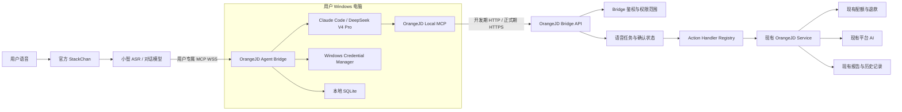
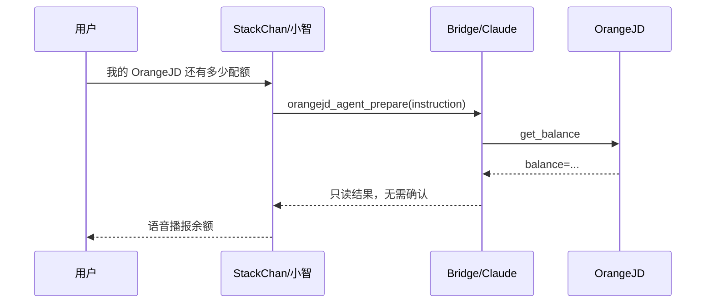
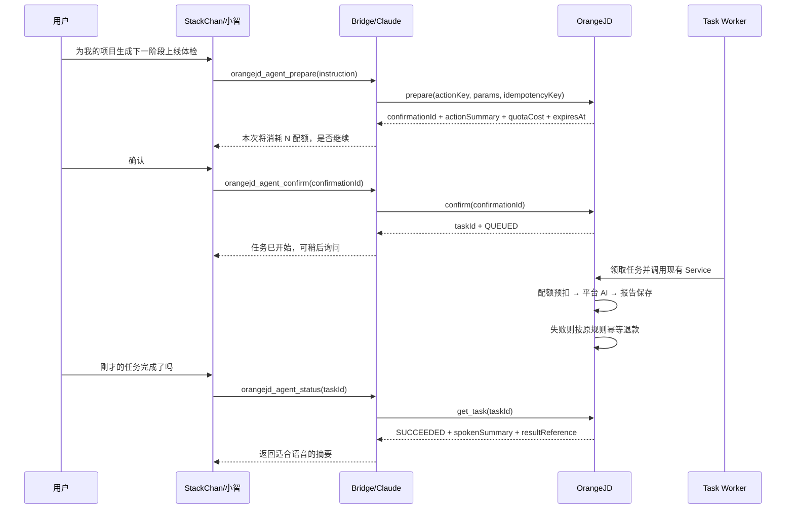

# OrangeVC 小智连接器第一阶段接入方案

> 状态：本地实现完成，等待真实环境端到端验收
> 范围：官方 StackChan 不刷机，通过用户 Windows 电脑上的 OrangeVC 小智连接器，以语音完成与网页等价的 OrangeVC 操作。
> 核心原则：本地连接器只负责理解和编排；OrangeVC 服务器继续负责业务校验、平台 AI、配额、退款和报告持久化。

## 0. 当前实现快照

截至 2026-07-22，第一阶段核心代码已经落地：

- Flyway `V13__add_agent_device_bridge.sql` 创建一次性连接码、设备凭据和动作任务 3 张表。
- 用户端“设置 → 智能设备”可以创建 10 分钟一次性连接码、查看设备并撤销授权。
- 服务端 `/agent/**` 使用独立 Bearer Device Token；数据库只保存 SHA-256 哈希，令牌明文只签发一次。
- 已开放八种动作：查询配额、上线体检列表/创建/阶段生成、开源 Issue 列表/详情/岗位匹配/贡献指南。
- 写操作和付费操作采用 `prepare → confirm → status/cancel`；确认后由服务端异步调用现有 `LaunchCheckService`。
- Windows Bridge 支持 `fake` 与 `remote` 两种后端，OrangeJD Token 和小智 MCP 地址保存在 Windows Credential Manager。
- Windows 图形连接器封装 SSH 隧道、绑定码交换、凭据保存和 Bridge 启停；日常重新连接无需打开终端。
- 自动化验证已通过：后端 60 项测试、Bridge 18 项测试和用户端生产构建。
- 用户端设备页展示最近 30 条语音任务；服务重启会将遗留任务标记为中断，不会自动重复执行。

当前尚未完成的不是核心编码，而是真实链路验收：需要部署包含 V13 的后端和新用户端，在 HTTPS 域名可用后使用 `https://正式域名/api` 绑定一台真实设备，完成配额、创建项目、付费阶段、失败退款和撤销授权测试。

实际接口以当前代码为准：

```text
POST   /app/agent-devices/link-code
GET    /app/agent-devices
GET    /app/agent-devices/tasks
DELETE /app/agent-devices/{credentialId}
POST   /agent/connect/exchange
POST   /agent/actions/prepare
POST   /agent/actions/{taskId}/confirm
GET    /agent/actions/status?taskId={taskId}
POST   /agent/actions/{taskId}/cancel
```

## 1. 目标与非目标

### 1.1 第一阶段目标

1. StackChan 保持官方固件和原有小智配置。
2. Bridge 在线时，小智可通过用户自己的 MCP 接入点调用 OrangeJD。
3. Bridge 退出后，StackChan 原有对话和设备配置不受影响。
4. 用户本地 Claude 外壳（当前接入 DeepSeek V4 Pro）只把自然语言转换为受限工具调用。
5. OrangeJD 的 AI 功能继续使用服务器现有模型配置，不接收用户模型 API Key。
6. 语音调用与网页调用使用相同业务 Service、价格、配额预扣和失败退款规则。
7. 付费操作先报价并要求确认；重复确认、网络重试不得重复扣费。
8. 长任务异步执行，可跨小智会话和 Bridge 重启查询结果。

### 1.2 第一阶段非目标

- 不刷 `stackchan-xiaozhi-firmware`，不控制舵机、LED 或自定义表情。
- 不实现电脑关机后的云端 Agent 托管。
- 不允许语音充值、支付、删除、发布、订单、管理员或服务器运维操作。
- 不把 Claude、DeepSeek、小智 MCP Token 或其他用户密钥上传 OrangeJD。
- 不使用浏览器自动点击模拟网页；统一调用稳定的服务端业务接口。
- 不承诺主动唤醒 StackChan 播报任务完成，第一阶段由用户语音查询结果。

## 2. 已确认的产品决策

| 决策项 | 第一阶段选择 |
|---|---|
| 本地 Agent | Claude Code 外壳，实际模型为用户配置的 DeepSeek V4 Pro |
| 本地在线要求 | 用户电脑必须保持在线，Bridge 作为后台进程运行 |
| StackChan 固件 | 官方固件，不刷机 |
| 平台 AI | 保持 OrangeJD 服务器现有模型和提示词 |
| 配额 | 与网页端相同价格、相同扣费和退款逻辑 |
| 用户模型费用 | 由用户本地 Claude/DeepSeek 配置承担 |
| 正式鉴权 | HTTPS + 独立 Bridge 授权；本地开发先使用 HTTP 测试地址 |
| 结果存储 | 完整报告存 OrangeJD；StackChan 只播报短摘要 |

## 3. 总体架构



### 3.1 两类 MCP 工具

对小智暴露的工具保持少而稳定：

| 工具 | 用途 |
|---|---|
| `orangejd_agent_prepare` | 接收自然语言任务，交给本地 Agent 识别，并返回操作摘要、价格和确认编号 |
| `orangejd_agent_confirm` | 确认已经冻结参数和价格的操作，返回平台任务编号 |
| `orangejd_agent_status` | 查询指定任务或最近任务的进度和语音摘要 |
| `orangejd_agent_cancel` | 取消尚未开始的任务；第一阶段不保证取消已经进入平台 AI 的任务 |

本地 Claude 可见的 OrangeJD MCP 工具按业务拆分，避免它自行拼接 URL 或用户 ID：

| 工具 | 类型 | 第一阶段状态 |
|---|---|---|
| `orangejd_get_balance` | 只读 | 开放 |
| `orangejd_list_launch_checks` | 只读 | 开放 |
| `orangejd_get_launch_check` | 只读 | 开放 |
| `orangejd_prepare_launch_check_project` | 写入、免费 | 开放 |
| `orangejd_prepare_launch_check_stage` | 写入、付费 | 开放 |
| `orangejd_get_task` | 只读 | 开放 |
| `orangejd_list_recent_tasks` | 只读 | 开放 |
| Issue 列表/详情、岗位匹配、贡献指南 | 混合 | 已开放；付费动作需要确认 |
| 自由趋势分析、画像趋势分析、方案设计 | 付费 | 已开放；画像支持多轮收集、结果选择和一键导入，方案阶段可自动继承 |

第一轮端到端选择“上线体检”作为代表业务，因为它同时覆盖项目归属、阶段顺序、平台 AI、配额、退款和报告保存。

## 4. 关键交互流程

### 4.1 读取配额



### 4.2 付费任务



### 4.3 Bridge 退出

1. Bridge 只建立出站连接，不修改 StackChan NVS、Wi-Fi 或智能体绑定。
2. Bridge 退出后，小智找不到 OrangeJD 工具时应提示“OrangeJD 连接当前离线”。
3. 已提交到服务器的任务继续执行。
4. Bridge 重启后凭本地设备凭据恢复连接，并从服务器查询最近任务。
5. 用户撤销授权后，Bridge 即使仍持有旧凭据也只能收到 `401`。

## 5. OrangeJD 服务端设计

### 5.1 后续重构方向

下面是后续扩大动作范围时可采用的独立包结构；当前最小闭环遵循现有项目架构，代码位于 `controller/agent`、`interceptor`、`service` 和 `mapper`：

```text
com.orangejd.server.agentbridge
├── controller
│   ├── BridgePairingController
│   └── BridgeActionController
├── interceptor
│   └── BridgeTokenInterceptor
├── service
│   ├── BridgeAuthorizationService
│   ├── BridgeActionService
│   ├── BridgeTaskService
│   └── BridgeTaskWorker
├── action
│   ├── AgentActionHandler
│   ├── AgentActionHandlerRegistry
│   └── launchcheck
│       ├── LaunchCheckCreateHandler
│       └── LaunchCheckStageHandler
└── model
    ├── InvocationSource
    └── AgentTaskStatus
```

现有 AI Service 不复制。Action Handler 只完成参数转换、权限校验和对现有 Service 的调用。

### 5.2 当前鉴权与正式增强

当前使用一次性连接码加长期 Device Token 完成最小闭环；OAuth 2.1、PKCE 和 Refresh Token 是公开发布前的增强目标，并非当前已经存在的能力。

开发期：

- OrangeJD 本地地址为 `http://127.0.0.1:8080`。
- 使用一次性配对码绑定当前已登录用户。
- Bridge 获得独立设备令牌，不保存账号密码或网页 `App-Token`。

正式增强目标：

- 只允许 HTTPS。
- 配对流程升级为 OAuth 2.1 风格设备授权或授权码 + PKCE。
- Access Token 短期有效；Refresh Token 轮换并只保存哈希。
- 每台 Bridge 有独立授权和权限范围，可单独撤销。

建议权限范围：

```text
bridge:profile:read
bridge:quota:read
bridge:ai:execute
bridge:reports:read
bridge:reports:write
```

### 5.3 早期接口草案（不得用于当前联调）

下列 `/bridge/**` 路径是早期设计记录，当前实现已经统一为本文第 0 节列出的 `/app/agent-devices/**` 和 `/agent/**`。保留本节仅用于后续 OAuth 化时参考。

配对接口：

```text
POST /bridge/device/authorization
POST /app/bridge/authorizations/{userCode}/approve
POST /bridge/device/token
POST /bridge/device/token/refresh
DELETE /app/bridge/devices/{deviceId}
GET /app/bridge/devices
```

业务接口：

```text
POST /bridge/v1/heartbeat
GET  /bridge/v1/capabilities
GET  /bridge/v1/account/quota
POST /bridge/v1/actions/prepare
POST /bridge/v1/actions/{confirmationId}/confirm
POST /bridge/v1/tasks/{taskId}/cancel
GET  /bridge/v1/tasks/{taskId}
GET  /bridge/v1/tasks/recent
```

所有 `/bridge/v1/**` 请求使用：

```http
Authorization: Bearer <bridge-access-token>
X-Idempotency-Key: <uuid>
X-Bridge-Version: <semver>
```

用户身份只能来自 Bridge Token，模型参数中禁止出现可生效的 `accountId`。

### 5.4 准备操作返回值

```json
{
  "confirmationId": "6f07cde0-...",
  "actionKey": "launch_check.stage.generate",
  "actionSummary": "为“OrangeJD”生成第 2 阶段上线体检",
  "quotaCost": 50,
  "balance": 9860,
  "needsConfirmation": true,
  "expiresAt": "2026-07-22T21:10:00+08:00"
}
```

服务端在准备阶段冻结规范化参数及其哈希。确认接口只接收 `confirmationId`，不能再次提交或修改参数。如果价格已变化，确认失败并要求重新报价。

### 5.5 任务状态

```text
PREPARED
QUEUED
RUNNING
SUCCEEDED
FAILED
REFUNDED
EXPIRED
CANCELLED
```

返回值分离完整数据和语音摘要：

```json
{
  "taskId": "...",
  "status": "SUCCEEDED",
  "spokenSummary": "第二阶段体检已经完成，推荐从低预算配置起步，并保留扩容路径。",
  "resultType": "LAUNCH_ASSESSMENT_STAGE",
  "resultId": 123,
  "quotaCost": 50,
  "refunded": false
}
```

## 6. 数据模型

当前数据库实际使用 `agent_device_link_code`、`agent_device_credential` 和 `agent_action_task`，字段以 V13 迁移为准。以下 `agent_bridge_*` 是后续短期 Access Token、Refresh Token 轮换和任务恢复增强草案，不代表当前表名。

当前 Flyway 最新为 V13，已新增 `V13__add_agent_device_bridge.sql`。

### 6.1 `agent_bridge_device`

| 字段 | 说明 |
|---|---|
| `id` | 设备授权 ID |
| `account_id` | OrangeJD 用户 ID |
| `device_uuid` | Bridge 本地生成的稳定 UUID |
| `display_name` | 用户看到的电脑名称 |
| `platform` | 第一阶段固定 `WINDOWS` |
| `scopes` | 授权范围 JSON |
| `refresh_token_hash` | Refresh Token 哈希，不保存明文 |
| `status` | `ACTIVE/REVOKED` |
| `bridge_version` | 客户端版本 |
| `last_seen_at` | 最近心跳时间 |
| `expires_at` | 授权过期时间 |
| `created_at/updated_at` | 审计时间 |

唯一约束：`account_id + device_uuid`。

### 6.2 `agent_bridge_task`

| 字段 | 说明 |
|---|---|
| `id` | UUID 任务 ID |
| `account_id` | 用户 ID |
| `bridge_device_id` | 发起电脑 |
| `action_key` | 规范化业务动作 |
| `params_json/params_hash` | 冻结参数及摘要 |
| `status` | 任务状态 |
| `idempotency_key` | 客户端幂等键 |
| `quota_cost_snapshot` | 报价时价格 |
| `quota_request_id` | `stackchan:<taskId>` |
| `result_type/result_id` | 指向现有业务报告，不复制报告正文 |
| `spoken_summary` | 语音摘要，限制长度 |
| `error_code/error_message` | 可控错误信息 |
| `expires_at` | 确认过期时间 |
| `started_at/finished_at` | 执行时间 |
| `created_at/updated_at` | 审计时间 |

唯一约束：`account_id + idempotency_key`。

配对码建议放 Redis 并设置 5 分钟 TTL，不写数据库。

## 7. 当前配额与并发控制

1. `prepare` 不扣费，只读取当前价格和余额；只读动作会直接记为 `SUCCEEDED`。
2. 创建项目和生成阶段都必须确认；确认接口通过原子状态更新保证同一任务只能从 `PREPARED` 进入一次 `QUEUED`。
3. Worker 只领取一次 `QUEUED` 任务，并复用现有 `LaunchCheckService`。阶段生成的实际扣费和失败退款仍由现有业务 Service 负责。
4. 当前没有自动重跑 `RUNNING` 任务，避免服务重启后重复调用平台 AI 或重复扣费；正式灰度前需要补充中断任务审计与人工恢复策略。
5. 当前尚未增加独立的 `STACKCHAN` 配额来源字段；账单规则和价格一致，但审计来源增强列入下一阶段。服务启动时会把遗留的 `QUEUED/RUNNING` 标记为 `SERVER_RESTARTED`，不自动重跑；可能已扣费的中断任务需要人工核对配额记录。

## 8. Windows Bridge 设计

### 8.1 目录结构建议

```text
OrangeVC-XiaoZhi-Connector/
├── bridge
│   ├── app.py
│   ├── xiaozhi_pipe.py
│   ├── mcp_server.py
│   ├── orangejd_client.py
│   ├── task_store.py
│   └── credential_store.py
├── agent
│   ├── base.py
│   └── claude_code.py
├── config
│   └── settings.example.json
├── tests
└── packaging
    └── windows
```

可复用 `stackchan-claude-bridge/bridge/mcp_pipe.py` 的 WSS/STDIO 转发和指数退避思路，但不原样使用其 Claude 工具、`.env` 凭据和 `/tmp` outbox。

### 8.2 本地存储

- Windows Credential Manager/DPAPI：小智 MCP Token、OrangeJD Refresh Token。
- SQLite：本地设备 UUID、服务器 taskId、最近状态、非敏感设置。
- 日志：不记录 WSS URL、Authorization、Cookie、API Key 和完整隐私输入。
- Bridge 只建立出站 WSS/HTTPS，不监听局域网或公网端口。

### 8.3 Claude Code 限权

当前本机 Claude Code 版本为 `2.1.185`。产品调用必须使用独立 MCP 配置和严格工具白名单：

- 使用 `--strict-mcp-config`，不加载用户其他 MCP。
- 禁止 `Bash`、`Edit`、`Write`、浏览器、邮件和其他无关工具。
- 不使用原仓库的 `--permission-mode acceptEdits`。
- 使用结构化 JSON 输出，校验后才执行动作。
- 使用独立工作目录，不读取 OrangeJD 源码或用户主目录。
- 单次调用设置时间和费用上限。
- 不依赖 Claude 对话记忆；待确认操作由服务器和本地 SQLite 保存。

由于当前 Claude 外壳接入第三方 DeepSeek V4 Pro，实施前必须做一次兼容性 Spike，确认：

1. `--print` 可以稳定返回；
2. DeepSeek 能稳定调用指定 MCP 工具；
3. 严格 MCP 和工具白名单不会破坏现有第三方模型配置；
4. JSON 结构化输出和超时行为符合预期。

## 9. 安全控制

| 风险 | 第一阶段控制 |
|---|---|
| 语音误识别 | 付费和写入操作必须先报价并确认 |
| 提示词注入 | Claude 无 Shell/文件工具；服务端再次校验 actionKey 和参数 |
| 越权访问 | accountId 只来自 Bridge Token；所有业务对象检查归属 |
| 重复扣费 | confirmationId + idempotencyKey + 固定 quota requestId |
| Token 泄露 | Windows 凭据库；日志脱敏；网页可撤销单台电脑 |
| WSS Token 泄露 | 不上传平台、不写 `.env`、不显示完整值 |
| Bridge 被替换 | 正式版代码签名、版本头和最低版本策略 |
| 长任务串结果 | 全链路使用服务器 taskId，不读取“最新 txt 文件”猜测结果 |
| 服务器重启 | 持久化任务状态和可恢复 Worker |
| 高风险能力扩散 | 第一阶段 Action Handler 白名单，不提供通用 HTTP/Shell 工具 |

之前在对话中出现过的小智 MCP Token 必须在测试前重新生成。

## 10. 开发拆分

### Sprint 0：兼容性验证

- 使用官方 StackChan 和新生成的小智 MCP 接入点。
- 在 Windows 上运行修改后的 WSS/STDIO Bridge。
- 验证 Claude Code + DeepSeek V4 Pro 的非交互和 MCP 工具调用。
- 使用本地假工具完成“查询余额”模拟，不连接生产数据库。

完成门槛：连续 20 次语音调用中，工具选择、参数 JSON 和回执均正确，无一次触发 Shell/文件工具。

### Sprint 1：服务端最小闭环

- V13 数据迁移。
- Bridge 配对、令牌、撤销和心跳。
- Action Registry、任务状态机和 Worker。
- 开放余额读取、上线体检项目读取/创建、阶段生成。
- 配额来源、幂等扣费和退款测试。

完成门槛：通过 HTTP 集成测试验证一次成功、一次余额不足、一次 AI 失败退款和一次重复确认。

### Sprint 2：Windows Bridge

- 凭据库、SQLite、WSS 重连和 Claude Adapter。
- 准备/确认/查询状态三个小智 MCP 工具。
- 语音摘要和明确错误码映射。
- Bridge 重启恢复和授权撤销。

完成门槛：真实 StackChan 跑通付费任务，关闭 Bridge 不影响原有小智功能。

### Sprint 3：功能扩展与界面

- 复用 Registry 加入趋势分析、方案设计、Issue 匹配、岗位匹配和贡献指南。（已完成）
- 用户端增加“设备与 Agent”页面。
- 展示在线状态、权限、最近任务、完整结果和撤销授权。
- 补充新手教程和故障排查。

### 4.4 多轮画像分析到方案设计

Bridge 在本机保存一个不含凭据的持久化会话状态，依次收集技术方向、目的、编程基础、语言和时间投入。资料齐全后才向服务器准备 `trend.profile.generate`，服务器调用网页同款 `TrendAnalysisService.analyzeV2`，沿用 `ai:trend:v2` 定价、扣费和失败退款，并把结果写入趋势分析历史。

付费任务确认后立即转入异步状态，MCP 不等待模型生成。任务处于 `QUEUED/RUNNING` 时，Bridge 拒绝开启其他 OrangeJD 业务并只返回进度，避免小智工具调用超时。完成后最多展示三个编号推荐，用户选择后可朗读详情并导入 `plan.phase.generate`。方案导入继续收集目标用户、核心功能和约束，再按阶段确认与生成。

不刷机边界：编号选项通过助手回复显示在官方聊天区域；Bridge 无权独占屏幕、主动推送完成通知或阻止普通小智对话。永久“生成中”状态页和可点击选项需要未来固件增加显示/交互端点。

## 11. 测试矩阵

### 11.1 服务端自动化测试

- 配对码过期、重复批准、暴力尝试限流。
- Bridge Token 过期、撤销、错误 scope。
- 他人项目 ID 越权。
- 相同幂等键重复 prepare/confirm。
- 报价后价格变化。
- 余额不足不创建付费执行。
- AI 成功保存报告。
- AI 空响应、超时和异常均退款。
- Worker 重启恢复，不重复扣费。
- `spokenSummary` 长度和敏感字段过滤。

### 11.2 Bridge 自动化测试

- WSS 断线指数退避和恢复。
- OrangeJD 401 后刷新令牌或要求重新授权。
- Claude 输出非法 JSON 时不执行任何业务动作。
- 重复语音确认只产生一个 taskId。
- SQLite 损坏或 Bridge 重启时从服务器恢复任务。
- 日志中不存在 Token、API Key 和 Authorization。

### 11.3 真实端到端验收

1. 官方 StackChan 不刷机完成接入。
2. Bridge 在线后语音查询真实配额。
3. 语音选择一个属于当前用户的上线体检项目。
4. 生成下一阶段前准确播报配额价格。
5. 用户确认后只扣一次网页版对应配额。
6. 任务完成后可语音查询摘要，网页能打开完整报告。
7. 人为让平台 AI 失败，配额自动退回。
8. 在确认消息上重复说两次“确认”，仍只产生一个任务。
9. 执行中重启 Bridge，服务器任务不丢失。
10. 退出 Bridge 后，StackChan 原有功能保持正常。
11. 从网页撤销授权，旧 Bridge 立即失去 OrangeJD 访问能力。

## 12. 上线门槛

本地开发完成不等于可以公开发布。正式开放前必须满足：

- 正式域名、备案状态和 HTTPS 已就绪。
- Bridge API 禁止明文 HTTP。
- Access Token 短期化，Refresh Token 轮换。
- Windows 安装包签名、校验和与自动更新来源固定。
- 小智 Token 和 OrangeJD Token 已通过系统凭据库验收。
- 管理端可查询 Bridge 版本、在线数量、失败率和异常扣费。
- 隐私政策说明语音文本会经过小智、本地 Agent 和 OrangeJD 的数据边界。
- 完成至少一轮灰度测试，再逐步开放更多 Action Handler。

## 13. 第一阶段完成定义

第一阶段完成必须同时满足：

> 用户使用官方 StackChan，在不刷机、不改变原有设备配置、不向 OrangeJD 上传本地模型凭据的情况下，通过 Windows Bridge 和本地 Claude/DeepSeek，以语音完成一次需要配额确认的 OrangeJD 上线体检操作；服务器使用现有平台 AI 和现有业务规则生成报告，配额只扣一次且失败可退款，完整结果可在网页查看，Bridge 退出后 StackChan 原有功能不受影响。
