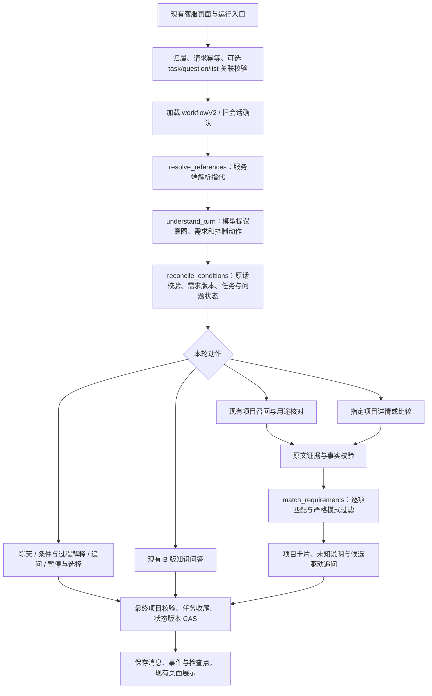

# 第二阶段：客服工作流实施记录

日期：2026-10-29。范围：本地 OrangeJD 客服，继续复用 B 版知识库。**业务代码已接入，真实模型、真实库和浏览器已完成部分联调；完整推荐闭环仍未通过最终验收。** 最新修复与验证范围见 [复盘报告](06-local-acceptance-review.md)，实测统计见 [implementation-verification.json](implementation-verification.json)。

后续第三阶段已按用户选择接入有限 Spring AI、节点上下文、历史回查和分段摘要；代码、离线/数据库验证及真实模型未验收边界见 [第三阶段实施记录](../context-v3/implementation.md)。本文件保留第二阶段的历史证据。

## 已确认的实施边界

- 按用户选择 1C，由助手实现并测试，再结合代码讲解。
- 按 2C，直接替换现有客服业务流程，不增加实验入口或新旧模式选择页面。已有 Legacy 和 LangGraph 执行器都调用同一套新业务步骤；它们不是两套客服产品流程。
- 本地 `.env.local` 的 `CUSTOMER_EXECUTION_ENGINE` 已由 `LEGACY` 改为 `LANGGRAPH4J`；`application.yml` 默认值同步调整。后续已成功重启，并完成真实 HTTP 与浏览器的部分验收。
- 按 3A，保留旧消息，首次续聊创建新任务，仅从带原话依据的历史条件中提出沿用建议，需用户确认。旧候选、旧追问和旧执行进度不直接恢复。
- 按 4A，真实验收最多 50 次实际模型请求，包含重试和 Embedding；已加入持久化额度账本。账本现为 50/50，保守保留其中 11 次测试模拟记录；本轮收尾使用独立断网测试容器，不增加或重置账本。
- 按 5A，记录真实耗时后再讨论性能目标，不预先承诺延迟。只操作本地，不部署服务器。

## 实际执行链



## 代码落点与复用关系

所有路径相对仓库根目录。

| 部分 | 实际文件 | 本次功能 |
| --- | --- | --- |
| 持久化业务状态 | `orange-server/src/main/java/com/orangejd/server/customer/CustomerWorkflow.java` | `state_json.workflowV2`、任务、归档任务、需求、问题、固定顺序候选列表；保留旧状态快照 |
| 开放需求 | 同目录 `CustomerRequirementService.java` | 不限于固定画像；原话、消息来源、稳定 ID、修订历史、删除标记；结构化值继续经过原 `CustomerState` 校验 |
| 指代前置 | 同目录 `CustomerReferenceResolver.java` | 当前/显式历史列表、第几个、这两个、关注对象、明确名称；歧义不猜选，消解不生成需求 |
| 理解协议 | 同目录 `CustomerTurnInterpreter.java`、`CustomerModel.java` | 需求提议、问题回答关联、任务控制；兼容 JSON 和扩展后的 native action schema |
| 意图适配 | 同目录 `CustomerRoutePolicy.java` | 对外增加八类 `workflowIntent` 与六条 `workflowRoute`；原 `intent` 字段保留以兼容客户端 |
| 多轮任务与追问 | 同目录 `CustomerTaskService.java` | 一条开放主要问题；插问保留、回答关闭、跳过、暂停、恢复、换目标、选定；资料未知时给候选取舍问题 |
| 图接入 | 同目录 `CustomerConversation.java`、`LangGraphCustomerEngine.java` | 增加 `resolve_references`、`match_requirements`；图版本 `customer-graph-v2`，状态 schema 2 |
| 现有检索 | 同目录 `CustomerRecommendationSteps.java`、`CustomerEvidenceSteps.java` | 继续调用 B 版召回、用途核对、分项目证据检索；开放需求进入检索与匹配，不重建索引 |
| 逐项证据 | 同目录 `CustomerRequirementMatcher.java` | 结构化条件确定性核对；开放需求按原文片段提议结论，再独立校验；跨项目引用拒绝；UNKNOWN/PARTIAL 不冒充满足 |
| 并发和幂等 | 同目录 `CustomerStore.java`、`CustomerMapper.java` | `state_version` 条件更新；取消后的晚结果不提交；请求内容及关联信息共同参与幂等哈希 |
| 导入保护 | 同目录 `CustomerImportService.java` | 增加任务/需求版本与必要要求核对；沿用原项目有效性、引用版本和导入资格校验 |
| 页面 | `orange-web/src/components/CustomerChat.vue`、`src/composables/useCustomerChat.js` | 开放需求、任务状态、选项和先看候选；逐项匹配；选定项目携带固定列表 ID；网络重试保留关联 |
| 验收请求限额 | `orange-server/src/main/java/com/orangejd/server/foundation/external/AiAcceptanceBudget.java` | HTTP 前文件锁记账，失败尝试也计数；达到上限禁止出站；不记录密钥或提示词 |

参考 Mewhelp 的流程拆分和对象关联校验思路，但没有复制它的 Python 运行时。本次没有迁移 Mewhelp 的完整上下文工程。原计划的 `CustomerClarificationPolicy` 暂与 `CustomerTaskService` 合并，避免同一问题生命周期由两处修改。

## 状态与安全行为

1. 原始用户消息保留。开放需求带 `source.messageId/quote`；“是的”这类短答还必须能关联当前开放问题，保存问题来源。
2. 固定字段由原 `CustomerState` 归一化，开放提议不能绕过固定字段验证。取消需求保留 `REMOVED` 和修订历史。
3. 问“支持扫码吗”不会直接变为“必须扫码”。指代解析只返回服务端已经保存的项目身份。
4. 有候选表示 `PRESENTED`，选定表示 `COMPLETED`；选定不会自动导入。项目卡片导入仍走原接口并重新检查。
5. 硬冲突始终排除；探索模式可以展示 UNKNOWN/PARTIAL 并禁止导入，STRICT 只允许必要项全部核实满足的候选。
6. `verificationMode` 是检索策略，不作为项目能力要求，否则严格模式会错误地把所有项目排除。
7. 单轮失败不清除需求；无结果运行结束后不会让任务永远显示“正在执行”。跨轮任务续接依赖数据库状态，仍不宣称能从任意图节点完整断点恢复。

## P2 实施和验收状态

| 任务 | 产出 | 验证情况 |
| --- | --- | --- |
| P2-S1 需求、任务与旧会话 | 新状态空间、版本、原话和沿用确认 | 自动测试及真实 MySQL/HTTP/浏览器旧会话确认已通过 |
| P2-S2 指代与路由 | 前置节点、八意图/六路线适配、列表绑定 | 当前与历史列表、歧义、这两个、归属/过期关联、图执行测试已运行 |
| P2-S3 追问续接 | 回答、插问、跳过、记录、暂停/恢复/切换、选择 | 真实追问、插问、回答、记录、暂停/恢复及绑定选择通过；完整场景集仍未全量验收 |
| P2-S4 B 检索与匹配 | 复用现有 B 检索，新增逐项证据与严格模式 | 跨项目引用、未知与硬冲突、原检索回归已运行；真实语料覆盖与结论质量待测 |
| P2-S5 图与页面 | 现有入口接入、交互关联、状态展示 | 图回归及真实页面旧需求确认、刷新恢复、移动端检查通过 |
| P2-S6 本地真实验收 | 共享 50 次账本、HTTP/浏览器脚本、逐轮耗时报告 | **本轮部分通过；用途空批次分类待修复，严格模式真实闭环受额度限制未完成**，见 [复盘报告](06-local-acceptance-review.md) |

自动测试执行生产状态服务、生产路由和实际 LangGraph4j；外部模型/候选以测试替身隔离。没有把 `conversation-cases.json` 的 `expect.patch` 回写为运行结果。该文件仍是设计场景；现有测试不能被表述为其中 23 个场景已经全部通过真实端到端验收。

旧业务回归的初始状态已显式升级为当前状态夹具 `CustomerWorkflowFixtures`，迁移另测。原冻结实现继续由 `LegacyCustomerConversationContract` + `CustomerFrozenConversationRegressionTest` 独立验证，不与新流程强行逐字段等同。

## 本地验证命令

在 `D:\Orangejd`：

```powershell
mvn -q -pl orange-server -am test '-Dtest=Customer*Test,ExternalAiClient*Test,RagBEmbeddingModelsTest,RagBOllamaEmbeddingModelTest' '-Dsurefire.failIfNoSpecifiedTests=false'
npm --prefix orange-web test -- src/composables/useCustomerChat.test.js src/components/CustomerRecommendationReport.test.js
npm --prefix orange-web run build
```

后续真实验证顺序（本轮已经执行，账本现为 50/50；不能直接再次运行）：

1. 检查 `docker info` 成功，恢复已有 MySQL/Redis 数据卷；不要执行 factory reset 或 `down -v`。
2. 执行现有 `scripts/start_local.ps1` 启动本地服务，确认后端加载新代码且执行器为 LANGGRAPH4J。
3. 本轮实际使用 `scripts/customer_workflow_http_acceptance.py` 和浏览器脚本，避免再启动一套 Spring 测试服务；合成账号、短期测试 JWT 和共享账本。原 `customer_workflow_v2_acceptance.py` 保留为独立 opt-in 工具，本轮未执行该 Java 实际模型测试类。
4. 查看 `http-acceptance.json`（真实业务结果、状态和耗时）、`live-review.json`（只读复核判定）、`provider-calls.jsonl`（保守计数）。重试必须复用同一账本，**不要删除账本来重置 50 次限额**。
5. 再用现有客服页面执行 Java 求职、小店库存、旧会话确认、暂停/恢复、历史列表选择与导入拒绝场景。模型理解失败、资料缺失、服务不可用分别记录，不以 HTTP 成功代替业务通过。

当前真实验收类覆盖两条主线的基础版本，仍需扩充为设计包的完整场景集。真实请求额度不足时如实保留未验收项。

## 当前阻塞与边界

- 原 Docker 启动故障已由用户解除；本轮恢复原容器和数据卷，健康检查通过。未删除数据库或卷。
- 本轮已有真实模型和 Embedding 验收；账本 50/50（含 11 次测试模拟调用，保守保留），保护仍启用。只报告实测样本耗时，不宣称推荐准确率或稳定 P95。当前剩余问题和下一步以 [复盘报告](06-local-acceptance-review.md) 为准。
- 旧会话只从最近 40 条可读消息恢复可溯源条件；更早或缺少来源的条件保留于旧快照，需重新说明，页面会提示此边界。
- 每个任务最多接纳 32 条有效开放/固定需求（固定字段另有原校验）；一次语义核对最多处理 12 个“项目 × 开放需求”组合，最多 3 个项目。匹配和复核输入各不超过 `min(全局输入预算, 4000)` 的保守字符估算；未提交或未复核的组合保持 UNKNOWN。大量长需求的分轮覆盖仍需后续节点级上下文工程完善。
- 当前每次核对现有检索选出的最多 3 个候选。筛除后不代表全库、全 GitHub 无项目；后续候选补查/重排及 GitHub 扩展另做。本阶段没有实时 GitHub 搜索工具。
- 问题保存需求依赖的修订快照；相关条目改变且本轮并非回答该问题时，旧问题变为 SUPERSEDED。新增无关需求不使问题自动失效。初始问题默认保守依赖已有需求，候选取舍问题仅依赖对应要求；更精细的语义依赖选择属于后续优化。

## 回退与代码复盘

本轮前的工作区文件副本位于 `_staging/customer-workflow-v2-a10b9b5412144200977f08e1ad95b423`，其中原项目已有未提交改动；**不能用 `git reset --hard` 回退本轮**。回退前逐文件比较副本和当前修改，恢复本轮改动，保留原用户修改及会话数据；新增源码和状态需要单独核对。只切换执行器为 LEGACY 不会恢复旧业务流程，因为两个执行器共用新步骤。

建议复盘顺序：先读 `CustomerWorkflowV2Test.actualMultiTurnRouterPreservesQuestionAcrossKnowledgeInterruptionThenSearches`，再沿 `CustomerConversation.step → CustomerReferenceResolver → CustomerRequirementService → CustomerTaskService → CustomerRequirementMatcher` 跟踪一轮。最后看 `CustomerWorkflowGovernanceTest`，理解为什么请求去重、问题身份、需求版本和会话 CAS 是不同职责。
