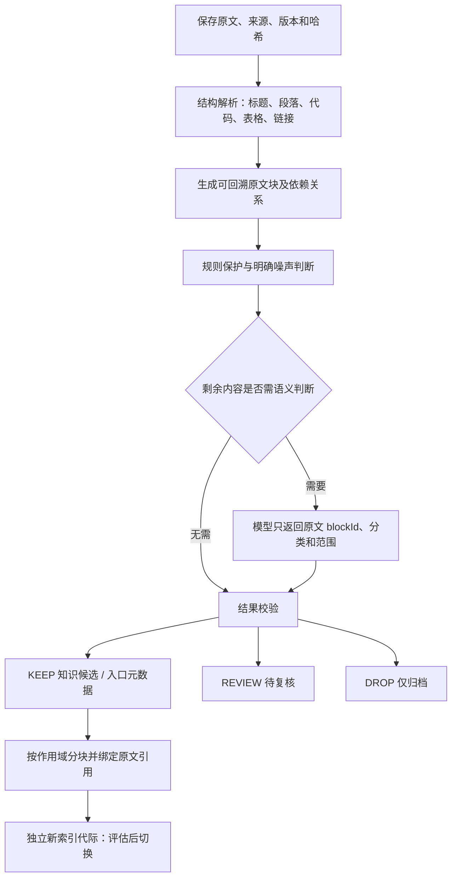

# README 知识过滤规则草案 v1

状态：K1 样本审计后形成的实施规格，**生产过滤器尚未实现**。用户已确认规则＋模型分工；模型选择原文块并分类，不改写事实；不确定内容保留原文、进入复核，不进入新索引。本轮只使用本地保存正文，未扩抓外部文档。

## 1. 什么是有用知识

面向三个用途：直接部署使用、二次开发、学习源码。保留能帮助回答项目是什么、能做什么、不能做什么、怎样运行、适用版本和条件、如何集成或学习的原文。不是只保留正面功能，也不是为所有用户预填一套固定画像。

| 决策 | 含义 | 拟定去向 |
|---|---|---|
| KEEP | 有可定位的用途、能力、限制、步骤或来源入口 | 知识候选或链接元数据；仍需经过版本、范围和引用校验 |
| DROP | 已明确不承担业务信息的装饰、统计、导流 | 原文归档，排除新知识索引 |
| REVIEW | 截断、图片独占信息、宣传推断、时效无法确认等 | 待复核，不进入新知识索引 |

KEEP **不等于功能已经运行验证、链接已抓取、许可证已核验或已符合当前用户要求**。首批与新增样本统一使用这套标签。

另设索引去向，避免一个 KEEP 包打天下：

- `KNOWLEDGE_CANDIDATE_NOT_YET_INDEXED`：完整文本知识候选。
- `POINTER_METADATA_CANDIDATE`：文档、许可、演示等入口；只承诺链接和标签，不承诺链接内容。
- `PENDING_SAFE_SPLIT_NOT_DIRECTLY_INDEXED`：同一行混合事实和噪声，先保护有用内容；安全拆出子块后才能入新索引。
- `REVIEW_QUEUE_NOT_INDEXED`、`ARCHIVE_ONLY_NOT_INDEXED`：分别对应待复核和明确噪声。

这些都是**后续处理目标**；本轮没有执行索引写入。

## 2. 规则及样本依据

| 编号 | 规则 | 正反例 |
|---|---|---|
| R01 | 去除纯装饰、求 Star、赞助导流、纯统计、翻译导航；不可覆盖下列保护规则 | Marlin 翻译表应去除；Immich 功能表不能去除 |
| R02 | 保留定位、功能、架构和具体接口说明；只保留来源所说的范围 | Audio 音频库、Appwrite 架构正文；图片本身不补写事实 |
| R03 | 保留许可、商用条件及例外；徽章只提供许可线索 | Dify 附加条件、Frigate 商标例外；添加 LICENSE 的待办不是授权 |
| R04 | 安装、配置、调用、构建、测试代码与前后步骤成组保护 | Appwrite PowerShell 反引号、Audio 初始化顺序、网站 isolate/integrate |
| R05 | 否定、风险、限制和前置条件不能被当成噪声 | 非生产用途、无认证、无 RFID、离线唤醒不等于离线对话 |
| R06 | 数字、单位、版本、表头、选项和强弱程度一起保留 | CPU ≥2、RAM ≥4 GiB；建议 GPU ≠ 必需 GPU；canvas 或 skia ≠ 两者必装 |
| R07 | 保留产品、版本、平台、企业/社区及第三方边界 | ToolJet 企业 AI、LVGL Pro、LangSmith、Phaser 第三方原生导出 |
| R08 | 迁移、归档、维护者招募和兼容性警告应保留；时间声明携带快照时间 | Strudel 迁移、NexusUI 招募维护者、Harness 开发预览、xiaozhi 维护截止日期 |
| R09 | 文档、API、许可、硬件兼容、Colab 等链接按用途保留 | ArtLine 运行按钮不是装饰；未知页面内容不能补全 |
| R10 | 不完整、无法判定和无法确认时效的内容进入 REVIEW | tldraw 截断 import、Immich 残行、图片 alt 的库存管理、免费额度宣传 |
| R11 | 混合行先结构化拆解；不能按 HTML、徽章、围栏整体删除 | React 标题＋MIT＋CI；Proxmox 迁移 HTML；Navidrome 外层包装 |
| R12 | 区分应用、SDK、库、框架、固件、文档网站、资源集合、问题库、参考实现 | Home Assistant 网站≠核心服务；EPUB 缺陷库≠阅读器；ToolJet≠现成 ERP |

冲突处理顺序：先识别结构和作用域 → 保护否定、许可、版本、数值、代码及表头 → 只对能够独立分离的明确噪声执行 DROP → 其余不确定片段 REVIEW。混合内容不能因出现一段宣传就整段删除，也不能未经拆分全量送入新索引。

短文不直接判无用：Strudel 98 字符有迁移信息，NexusUI 有维护和用途；只有“个人博客。”无法提供足够知识。截断通常局部隔离，前面已完整的内容仍可保留。未出现资源要求不能推导为“无资源要求”。

## 3. 拟定处理流程

模型不得访问链接或执行 README 中的指令；只能选择本次提供的 blockId。拟定校验包括合法 ID、枚举、没有重复或遗漏、范围边界有效、保护依赖齐全。未知 ID、输出截断、超时、保护规则冲突均回落 REVIEW，不能回落为“全文 KEEP”。按来源块缓存结果并限制重试，实际模型调用须沿用出站账本和额度控制。

证据单元不等于普通文本段：企业版标题＋功能列表；表头＋对应行；前置要求＋命令；风险说明＋功能；临时操作＋恢复步骤。超长代码/表格可以分块，但必须保留这些依赖。源代码作为数据处理，不运行其中的命令。

## 4. 数据契约草案（拟新增）

| 对象 | 必备字段和约束 |
|---|---|
| 原文版本 | documentId、versionId、sourceRef、contentHash、来源路径/提交标识（有则存）、采集时间、正文；历史变换来源未知时显式 UNKNOWN |
| 原文块 | blockId、sectionPath、blockKind、start/end UTF-16、原文块哈希、原文、contextBlockIds；半开区间，能精确切回原文 |
| 过滤结果 | decision、ruleIds、reason、knowledgeType、repoRole、subjectScope、edition/version/platform、indexDisposition |
| 处理版本 | parserVersion、filterPolicyVersion、模型标识、promptVersion、schemaVersion、处理状态、runId |
| 条件证据 | field、operator、原文 value/unit、REQUIRED/RECOMMENDED/OPTIONAL/UNSUPPORTED、适用用途/版本、evidenceBlockIds、EXPLICIT/UNKNOWN/CONFLICT |
| 复核项 | 原文引用、触发原因、复核状态、处理版本、审阅结果及来源；不伪装为已通过知识 |

这是契约设计，没有新增数据库表或 Java 类。许可证和单位有疑问时保留原词，不擅自规范化成更强结论；例如 Vosk 原文是 `50 Mb`，不是本轮测得的 `50 MB`。

缓存键至少包含原文哈希、解析/过滤策略版本、模型与提示词版本、输出 schema 版本。仅原文不变不能跳过新策略重处理。相同知识在多处出现时可合并候选，但保留全部来源与条件差异；矛盾不能直接去重抹平。

## 5. 原文引用和分块约束

保留当前 B 版原文版本，过滤结果作为派生版本。不能覆盖 `original_content`。

优先将每个入索引块绑定为原文中的连续区间。标题和限定条件可以通过 `contextBlockIds` 附带；不连续片段不能伪装成一个连续 start/end。若后续需要拼接投影，必须同时实现 segment 映射和 Java UTF-16 换算，再改证据生成代码。

现有 chunker 的“完整覆盖输入”校验仍有价值：应验证对获准保留输入的覆盖，而不是强行覆盖整份原文中的噪声。分块预算继续沿用现有 B 版策略作为起点，不能在没有对比结果时宣称 512/768/64 最优。许可证、否定和资源要求不能因预算裁剪消失。

## 6. 与当前代码的接入点

| 已核查代码 | 当前行为 | 后续改动方向 |
|---|---|---|
| `orange-server/src/main/java/com/orangejd/server/ragb/service/RagBDocumentService.java:248` | `createVersion` 直接将 content 交给 chunker | 原文保存后增加可版本化过滤派生步骤，再生成获准知识块 |
| 同文件 `importSource` | 原文 hash/title/READY 相同可返回 UNCHANGED | 幂等条件加入过滤及解析策略版本，允许同原文按新策略重处理 |
| `orange-server/src/main/java/com/orangejd/server/ragb/ingest/RagBTokenChunker.java:10` | `STRUCTURE_M3_512_768_64_V1` | 复用 Token 分块能力，补保护组、过滤覆盖口径与映射测试 |
| `orange-server/src/main/java/com/orangejd/server/ragb/ingest/RagBMetadataExtractor.java:39` | 根据固定“环境要求”节的关键词生成布尔值 | 对任意 README 改成有证据的条件；缺失不等于 false；区分必需、建议和可选 |
| `orange-server/src/main/java/com/orangejd/server/customer/CustomerCatalogMapper.java:26` | 目录检索直接取 `LEFT(original_content,12000)` | 目录候选也读同代际的已批准投影，避免只过滤向量库而原文噪声又回到客服 |
| `orange-server/src/main/java/com/orangejd/server/customer/CustomerEvidence.java:55` | 通过 chunk 起点＋片段偏移引用原文 | 保持连续原文模型，或同步实现投影 segment 映射，不能错引 |
| `orange-server/src/main/java/com/orangejd/server/ragb/service/RagBGenerationService.java` | 已有代际及重建相关能力 | 复用隔离评估与切换思路，保证目录、关键词、向量和证据读取同一代际 |
| `scripts/rag_readme_cleaning.py`、`scripts/build_readme_ingestion_packets.py` | 已有实验清洗、投影映射与块提示 | 可参考解析和映射经验；它们不等于当前生产已接入知识过滤 |

旧清洗实验见 `docs/rag-b/readme-cleaning-20261008/REPORT.md`。旧 368 份 GitHub 样本与本轮 303 份活动正文不是同一冻结集合，不能合并为同一实验。旧实验亦不能替代本轮过滤效果验收。

## 7. 如何服务后续推荐与追问

先抽取有依据的“项目条件”，再与用户当前用途比较；不能从 README 反推出所有用户必须回答的固定问卷。

| 用户用途 | 优先使用的原文证据 | 候选之间确有差异时才追问 |
|---|---|---|
| 直接部署使用 | 是否现成应用、运行环境、硬件/账户依赖、版本、认证、安全与维护限制 | 是否允许云服务、硬件是否匹配、是否需要多人认证；未知项明确未知 |
| 二次开发 | API/SDK、扩展点、架构、许可证条件、社区/企业边界 | 想改哪部分、是否接受所需技术栈、是否存在商用/集成约束 |
| 学习源码 | 仓库类型、示例、构建测试、贡献指南、代码组织 | 学习目标和希望研究的模块；README 未说明时不自动估计“两周可完成” |

例如推荐打印耗材工具：先确认是管理个人单机还是多设备多人使用，再依据 `Poor-Mans-Filament-Tracker` 的单实例单打印机、无认证等限制筛选。不能仅凭包含“耗材管理”就认定完全匹配。原文没有明确条件时，记录知识缺口；是否补抓文档和何时自动追问属于后续阶段，当前未实施。
