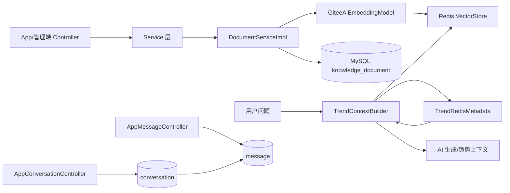
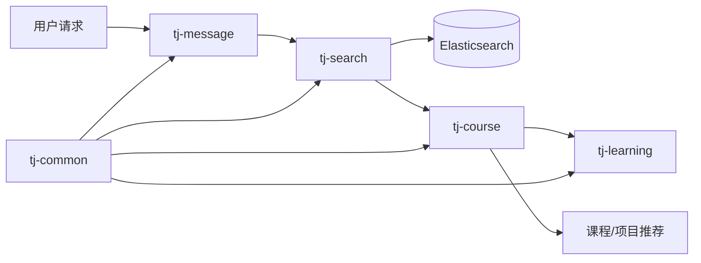

# OrangeJD 智能客服模块学习笔记

## 2026-10-03 实施校正

客服使用 B：bge-m3（1024 维）、结构分块、Redis Stack HNSW 混合检索；下面的 small/512 维配置摘录属于旧 A 基线。客服会话独立保存，不复用趋势历史，不自动写长期画像。

真实 MySQL 测试暴露了 REPEATABLE READ 下的并发漏洞：先读会话再等待互斥锁会建立旧快照。改为先取执行锁、再读会话与运行计数，两个同账号提交只能成功一个。取消与成功结果也在锁内做终态比较更新，避免迟到回答复活。

DeepSeek V4 默认思考模式在短输出预算下可能不给最终内容，并拒绝指定工具选择。客服专用请求关闭思考模式后，合成输入的 Schema 和原生函数动作都通过；原平台调用保持既有配置。参考供应商官方 Chat Completions 协议。

首轮 HTTP 三轮全为 SUCCEEDED，但目标提取漏了“学习”，因此不能计为推荐通过。执行成功、检索有效、引用存在、事实正确、条件满足必须分别验收。模型原文引文先做字符串校验，再用评分请求核对中文解释；评分仍可能出错，不能取代人工独立验收。

取消的外部 HTTP 请求未必立即停止计费，必须保留迟到用量；缺失用量不能写成零成本。当前记忆摘要是带消息区间的原始用户摘录，结构化条件另外保存，不依赖摘要猜测已确认要求。

主项目：`D:\\Orangejd`  
参考项目：`D:\\智能客服`

## 项目基线

- Java 21，Spring AI 1.0.0。
- MySQL 8.4，Redis Stack。
- 向量库使用 Spring AI Redis VectorStore。
- Embedding 使用 Gitee AI `bge-small-zh-v1.5`，默认 512 维。
- 启动类：`orange-server/src/main/java/com/orangejd/server/OrangeApplication.java`。

## 配置摘录

```xml
<!-- pom.xml -->
<java.version>21</java.version>
<spring-ai.version>1.0.0</spring-ai.version>
```

```yaml
# orange-server/src/main/resources/application-dev.yml
spring:
  datasource:
    url: ${MYSQL_URL:jdbc:mysql://localhost:3306/orangejd}
    username: ${MYSQL_USER:root}
    password: ${MYSQL_PASSWORD:123456}
  data:
    redis:
      host: ${REDIS_HOST:localhost}
      port: ${REDIS_PORT:6380}
  ai:
    vectorstore:
      redis:
        initialize-schema: true

orange:
  ai-embedding:
    endpoint: ${AI_EMBEDDING_ENDPOINT:https://ai.gitee.com/v1}
    model: ${AI_EMBEDDING_MODEL:bge-small-zh-v1.5}
```

```yaml
# compose.local.yml 中后端容器的连接
MYSQL_URL: jdbc:mysql://mysql:3306/${MYSQL_DATABASE:-orangejd}
MYSQL_USER: ${MYSQL_USER:-orangejd}
MYSQL_PASSWORD: ${MYSQL_PASSWORD:-orangejd_dev}
REDIS_HOST: redis
REDIS_PORT: 6379
```

## 知识库初始化结论

- `initialize-schema: true` 只初始化 Redis VectorStore 的索引结构。
- `ProjectKnowledgeSyncService` 首次约 60 秒后执行，之后默认每 5 分钟同步已发布项目知识。
- 完整知识库重建需要显式调用 `KnowledgeReindexService`。

## 每日复盘模板

```text
日期：
今天完成的功能：
阅读的文件：
今天真正理解的调用链：
遇到的问题：
问题根因：
对应八股：
1.
2.
3.
如果面试官问：
我的回答：
还没有理解的地方：
明天要完成：
```

## 六个核心类的调用关系

```text
OrangeApplication
  ├─ 启动 Spring Boot、缓存、定时任务和事务
  ├─ 加载 AiConfig
  │    ├─ 创建 RestTemplate
  │    ├─ 创建 GiteeAiEmbeddingModel
  │    └─ 检查 RedisVectorStore 是否就绪
  └─ 扫描 Controller、Service、Mapper

AppConversationController
  └─ 会话创建、查询、隐藏、删除
       └─ conversation Service/Mapper

AppMessageController
  └─ 消息查询、已读处理
       └─ message Service/Mapper

DocumentServiceImpl
  └─ 文档上传/导入、切块、写入 knowledge_document
       └─ EmbeddingModel → RedisVectorStore

ProjectKnowledgeSyncService
  └─ 查询已发布项目
       └─ ProjectKnowledgeDocumentWriter 生成文档
            └─ 文档写入和向量索引

GiteeAiEmbeddingModel
  └─ 调用 Gitee AI /v1/embeddings
       └─ 返回 512 维向量
```

### GiteeAiEmbeddingModel

文件：`orange-server/src/main/java/com/orangejd/server/ai/GiteeAiEmbeddingModel.java`

- 继承 Spring AI 的 `AbstractEmbeddingModel`；
- 实现 `EmbeddingModel`；
- 通过 `RestTemplate` 请求 Gitee AI；
- 默认模型为 `bge-small-zh-v1.5`；
- 默认向量维度为 512；
- Redis VectorStore 通过它生成文档和查询向量。

### AiConfig

文件：`orange-server/src/main/java/com/orangejd/server/config/AiConfig.java`

```java
@Bean
public EmbeddingModel embeddingModel(RestTemplate embeddingRestTemplate) {
    return new GiteeAiEmbeddingModel(embeddingRestTemplate, properties);
}
```

它把自定义 Embedding 实现注册为 Spring Bean，并在启动时检查 VectorStore 是否存在。

### DocumentServiceImpl

```text
上传/导入文档
  → 校验文件和来源
  → 保存 knowledge_document 元数据
  → 文档切块
  → EmbeddingModel 生成向量
  → RedisVectorStore 写入
  → 保存索引状态
```

它是人工文档、GitHub README、岗位信息等内容进入知识库的主要入口。

### ProjectKnowledgeSyncService

```text
查询已发布项目
  → 计算内容哈希
  → 判断是否需要更新
  → ProjectKnowledgeDocumentWriter 生成结构化文档
  → 写入 knowledge_document
  → 写入 Redis VectorStore
  → 更新 project_knowledge_index_status
```

### 会话控制器

`AppConversationController` 负责会话生命周期，`AppMessageController` 负责消息查询和已读状态。当前它们还不是完整的 AI 客服入口，但客服模块应优先复用这套会话和消息模型。

## 当前 RAG 链路

```text
项目数据/上传文档
  → DocumentServiceImpl 或 ProjectKnowledgeSyncService
  → 文档切块
  → GiteeAiEmbeddingModel
  → RedisVectorStore
  → TrendContextBuilder 的语义+关键词混合检索
  → 证据排序
  → 生成模型上下文
```

## Gitee 项目 AI 代码阅读记录

阅读范围：`D:\\智能客服` 下的 `tj-search`、`tj-course`、`tj-learning`、`tj-message`、`tj-common`。

搜索关键词：`rag`、`向量`、`embedding`、`vector`、`chatmemory`、`memory`、`langchain`、`langgraph`、`toolcalling`、`functioncalling`、`ai`、`大模型`、`知识库`、`推荐`。

### 八个问题对照表

| 问题 | Gitee 项目重点查看 | OrangeJD 当前结论 | 客服模块处理 |
|---|---|---|---|
| 用户问题从哪个模块进入？ | `tj-search` 的 `RecommendController`、`InterestsController` 是普通课程接口；未发现 AI 对话 Controller | 已有 `/app/conversation`、`/app/message`，未发现完整 AI 客服入口 | 复用现有会话入口，新增客服消息接口 |
| 会话消息保存在哪里？ | `tj-message/tj-message-service` 主要是通知、短信、站内消息，并非 ChatMemory | OrangeJD 已有 `conversation`、`message` 数据模型 | 直接扩展 OrangeJD 会话模型 |
| AI 调用封装在哪里？ | 指定模块中未找到 ChatClient、ChatModel 或 OpenAI 调用；根 POM 只有 Spring AI `1.0.0-M6` 声明 | OrangeJD 有自定义 AI HTTP 客户端和 Embedding 适配器 | 新增统一 `CustomerAiService` |
| 知识检索使用什么组件？ | `tj-search` 使用 Elasticsearch `RestHighLevelClient`、BoolQuery、Highlight；不是向量 RAG | OrangeJD 使用 Spring AI RedisVectorStore，并已有混合检索 | 保留 OrangeJD Redis 检索，借鉴 ES 的过滤和高亮思路 |
| 项目或课程推荐如何实现？ | `RecommendController` + `SearchServiceImpl`，按免费、发布时间、销量、分类等规则查询课程 | 有初级项目和职业项目数据、项目知识同步 | 借鉴规则筛选，再叠加用户需求槽位 |
| 是否有上下文记忆？ | 在指定模块和关键词范围内未找到 `ChatMemory` 或摘要记忆实现 | 已有消息持久化，但没有统一客服记忆服务 | 新增 `CustomerMemoryService` 和摘要压缩 |
| 是否使用工具调用？ | 未找到 `ToolCalling`、`FunctionCalling` 或工具注册代码 | 当前客服工具调用尚未统一实现 | 增加查询项目、项目详情、项目推荐工具 |
| AI 和普通业务如何分层？ | 仓库的搜索模块采用 Controller → Service → Repository → Elasticsearch；未形成 AI 分层 | OrangeJD AI 能力分散在 AI 类、Service 和趋势业务中 | 建立 Controller → CustomerService → 状态机/Graph → Retriever/Tool |

### 参考原则

```text
Gitee 项目：参考会话记忆、需求收集、工具调用、推荐流程
OrangeJD：保留 MySQL、Redis Stack、Gitee Embedding、现有混合检索
客服模块：在 OrangeJD 内新增，不复制 Gitee 的完整业务和微服务结构
```

### Gitee 项目实际代码位置

```text
D:\智能客服\pom.xml
  └─ spring-ai.version = 1.0.0-M6（仅看到版本声明）

D:\智能客服\tj-search\src\main\java\com\tianji\search\controller\RecommendController.java
  └─ /recommend/best、/new、/free 课程推荐接口

D:\智能客服\tj-search\src\main\java\com\tianji\search\controller\InterestsController.java
  └─ 用户兴趣保存、查询、按二级分类查询课程 TOP10

D:\智能客服\tj-search\src\main\java\com\tianji\search\service\impl\SearchServiceImpl.java
  └─ Elasticsearch RestHighLevelClient、BoolQuery、关键词、分类、免费条件、排序和高亮

D:\智能客服\tj-search\src\main\java\com\tianji\search\service\impl\CourseServiceImpl.java
  └─ CourseRepository + CourseClient，负责课程索引数据和课程服务协作

D:\智能客服\tj-search\pom.xml
  └─ spring-boot-starter-data-redis、Redisson、elasticsearch-rest-high-level-client

D:\智能客服\tj-message\tj-message-service
  └─ 通知、短信、站内消息模块；没有发现客服 ChatMemory
```

### 对 Gitee 项目的重新判断

这份代码可以借鉴：

- Controller → Service → Repository 的分层方式；
- Elasticsearch BoolQuery 的多条件过滤；
- 课程推荐接口的拆分方式；
- 用户兴趣保存后再查询推荐内容的业务流程；
- 搜索结果高亮和分页处理。

这份代码不能直接提供：

- 完整 RAG 问答；
- ChatMemory；
- 上下文摘要压缩；
- LangGraph 流程编排；
- Tool Calling；
- AI 客服对话入口。

因此它在 OrangeJD 中的定位应改为“搜索与推荐业务设计参考”，客服的 RAG、记忆和 Agent 能力仍然需要基于 OrangeJD 现有 Spring AI + Redis VectorStore 重新实现。

## 复盘问题

1. `EmbeddingModel` 为什么同时服务文档写入和用户查询？
2. `initialize-schema: true` 为什么不等于知识库已经有数据？
3. `DocumentServiceImpl` 和 `ProjectKnowledgeSyncService` 的数据来源有什么区别？
4. Redis VectorStore 和 `knowledge_document` 分别保存什么？
5. 为什么客服会话仍然需要 MySQL 持久化？
6. 为什么不能让 Controller 直接调用大模型？
7. `AppConversationController` 和 `AppMessageController` 如何配合？
8. `TrendContextBuilder` 中哪些逻辑应该抽取成 `KnowledgeRetriever`？
9. Gitee 项目的记忆机制可以怎样迁移到 OrangeJD？
10. 项目推荐应该由规则、SQL 还是大模型共同决定？

## 后续待办

- [ ] 找到 Gitee 项目的实际 AI Controller 入口；
- [ ] 找到 Gitee 项目的 ChatMemory 实现；
- [ ] 找到 Gitee 项目的 Tool Calling 实现；
- [ ] 完成一次 OrangeJD 知识库检索；
- [ ] 抽取通用 `KnowledgeRetriever`；
- [ ] 实现客服状态机；
- [ ] 实现上下文记忆和压缩；
- [ ] 实现项目推荐；
- [ ] 接入现有聊天界面。

## 第九步：第一天必须留下的成果

- [x] 1. `D:\智能客服` 已保存 Gitee 项目。
- [x] 2. OrangeJD 的 MySQL 和 Redis 可以启动；`/health/detail` 已确认 `db=UP`、`redis=UP`。
- [x] 3. OrangeJD 后端已至少尝试编译并成功启动，健康接口可访问。
- [x] 4. 已找到现有 RAG 入口：`AdminKnowledgeController`、`DocumentServiceImpl`、`TrendContextBuilder`、`TrendRedisMetadata`。
- [x] 5. 已找到现有会话和消息入口：`AppConversationController`、`AppMessageController`。
- [x] 6. 已找到 Gitee 项目的 AI 相关模块，并明确它适合作为业务搜索、推荐和流程参考。
- [x] 7. 已完成 OrangeJD 架构图，见下方 Mermaid 图。
- [x] 8. 已完成 Gitee 项目架构图，见下方 Mermaid 图。
- [x] 9. 已完成 OrangeJD、Gitee、QueryMind、DeepSeek Harness 对照表。
- [x] 10. 已完成一次 OrangeJD 语义知识库检索测试；三次检索稳定，但固定项目未进入 Top3，准确性未通过。
- [x] 11. 已写下并回答今天仍然不理解的五个问题。

### OrangeJD 架构图



### Gitee 项目架构图



### OrangeJD、Gitee、QueryMind、DeepSeek Harness 对照表

| 能力 | OrangeJD 当前实现 | Gitee 项目可借鉴部分 | QueryMind 可借鉴部分 | DeepSeek Harness 可借鉴部分 | 后续处理 |
| --- | --- | --- | --- | --- | --- |
| 会话与消息 | `conversation`、`message` 已存在 | 业务流程组织 | Agent 状态 | Session 状态和生命周期 | 复用并新增客服会话状态 |
| 知识检索 | Redis VectorStore | 搜索过滤、推荐排序 | RAG/工具前置判断思路 | 上下文预算 | 抽取 `KnowledgeRetriever` |
| Embedding | `GiteeAiEmbeddingModel` | 不直接复用 | 可作为工具输入 | 不涉及 | 保留现有实现 |
| 推荐 | 项目数据和业务服务 | 课程/项目推荐流程 | 工具调用决策 | 任务状态约束 | 规则筛选 + RAG 解释 + AI 追问 |
| 记忆 | 尚未统一封装 | 参考业务状态 | Agent 状态和历史 | 摘要、压缩、token 预算 | 新增 `CustomerMemoryService` |
| Tool Calling | 尚未形成客服工具层 | 参考业务动作边界 | 重点借鉴 | 参考执行状态 | 新增项目查询、条件确认工具 |

### 最小 RAG 验证记录

固定测试文件：`D:\Orangejd\rag-verification-fixture.md`。

固定问题：`有没有适合 Java 初学者、两周内可以完成的项目？`

预期项目标识：`RAG-DEMO-JAVA-001`。

已完成验证：`GET /health/detail` 返回 `db=UP`、`redis=UP`、`rag_vector_store=UP`。这证明基础设施正常，但不等于知识检索成功。

代码确认的真实写入链路：`POST /admin/knowledge/document/upload` → `DocumentServiceImpl.upload()` → 文本切片 → `EmbeddingModel` → `VectorStore.add()`；MySQL 保存 `knowledge_document` 原文和状态，Redis 保存向量和 metadata。

待补充 Embedding Key 后执行：

1. 上传 `rag-verification-fixture.md`。
2. 调用本地调试测试执行 `VectorStore.similaritySearch("有没有适合 Java 初学者、两周内可以完成的项目？")`。
3. 输出 `Document.text`、`Document.metadata`、score 和耗时。
4. 连续执行三次并填写下表。

| 测试问题 | 召回文档 | 文档来源 | 相似度 | 项目 ID | 检索耗时 | 是否返回正确项目 |
| --- | --- | --- | ---: | --- | ---: | --- |
| 有没有适合 Java 初学者、两周内可以完成的项目？ | 待执行 | 待执行：`MANUAL` / `docTitle` | 待执行 | 文档正文含 `RAG-DEMO-JAVA-001`；手工上传 metadata 尚无业务 `projectId` | 待执行 | 待执行 |

已使用 `D:\Orangejd\.env.local` 重建 backend，容器确认 `AI_EMBEDDING_KEY_SET`；语义 RAG 已执行，当前问题是召回准确性而不是配置阻塞。

### 五个问题的第一天答案

1. **当前知识库文档如何进入 Redis？** `AdminKnowledgeController.upload()` 调用 `DocumentServiceImpl.upload()`，完成切片后构造带 `docId`、`docTitle`、`chunkIndex`、`source` 的 Spring AI `Document`，再调用 `VectorStore.add()` 写入 Redis；MySQL 保存原文和文档状态。
2. **一次检索请求经过哪些类？** 问题进入检索服务后，由 `TrendContextBuilder` 组织查询，Redis VectorStore 执行相似度检索，`TrendRedisMetadata` 恢复 metadata，结果再交给上层 AI 或业务服务。
3. **conversation 和 message 如何关联？** `AppConversationController` 管理会话，`AppMessageController` 管理消息，消息通过 conversation ID 关联到会话；客服记忆应建立在这层关系之上。
4. **Gitee 项目的记忆保存在哪里？** 当前阅读结果不足以证明它有可迁移的完整 ChatMemory；它更适合借鉴搜索、推荐和业务流程。OrangeJD 的客服记忆需要自己设计并落到 MySQL/Redis。
5. **客服状态应该放在哪个模块？** 不应放在 Controller；建议放在客服领域 Service 中，由 `CustomerConversationState` 或 `CustomerMemoryService` 管理，Controller 只接收请求和返回结果。

## 新每日计划的第一天调整

第一天只完成代码地图、基础启动、固定知识准备和一次真实检索。Gitee 用于搜索/推荐业务参考，QueryMind 用于 Agent、工具和流程参考，DeepSeek Harness 用于上下文压缩、token 预算和会话治理。客服状态机、统一 ChatMemory、Tool Calling 和推荐编排从第二阶段开始实现。

### 已执行的知识库检索烟雾测试

在当前运行的 Redis VectorStore 索引 `default-index` 上执行了词法检索：`@content:(Spring Boot)`。

- 索引状态：`num_docs=7972`、`percent_indexed=1`、向量维度 `512`、距离度量 `COSINE`。
- 检索结果：返回 `11` 个命中文档。
- 代表性召回：`default:knowledge-583-0`，内容包含 `Java 17`、`Spring Boot 3.3.5` 和项目运行说明；另有 `default:knowledge-590-0` 等项目/代码知识片段。
- 结论：Redis 索引和词法召回已经真实验证；这不是带 query embedding 的语义 `similaritySearch`，因此相似度和语义召回准确率仍需补充 `AI_EMBEDDING_KEY` 后验证。

因此第 10 项拆成两层：词法检索烟雾测试已完成，语义 RAG 验证待 Embedding Key 可用后执行，不能把两者混为一次完整通过。

### 检索配置补充：为什么本地仍然能检索

当前 Redis 中已经存在约 7972 个向量文档，因此“能检索到内容”不等于当前进程刚刚成功调用了 Embedding API。`TrendContextBuilder.retrieve()` 对每一路语义检索都捕获异常；语义检索失败后仍会执行 `TrendRedisMetadata.lexical()`，使用 Redis `FT.SEARCH` 的 `@content` 词法检索返回结果。

因此当前本地可能出现两种情况：

- `VectorStore`、Redis 索引和已有文档都正常，词法兜底可以返回内容；
- 当前 Docker backend 的 `AI_EMBEDDING_KEY` 没有注入，新的上传或 query embedding 不能完成真正的语义检索。

本地 Docker 的实际检查结果是：`docker compose config` 和 `docker inspect nxz-bigorange-backend-1` 中 `AI_EMBEDDING_KEY` 均为空；容器没有挂载外部密钥文件，Redis 中也没有 `orangevc:ai-config:embedding:active` 动态配置。故此前的“能检索”应准确记录为“Redis 知识库和词法兜底可用”，语义 `similaritySearch` 是否成功还必须查看 Embedding 调用结果。

### 语义 RAG 三次实测结果（已完成）

本次使用 `D:\Orangejd\.env.local` 启动 backend，确认 Embedding Key 已进入容器；上传固定文件成功，后端日志记录：`[RAG] 向量存储完成: title=rag-verification-fixture.md, chunks=1`，MySQL 文档 ID 为 `1000`，`vector_status=DONE`。

测试类：`orange-server/src/test/java/com/orangejd/server/RagSmokeTest.java`。

测试问题：`有没有适合 Java 初学者、两周内可以完成的项目？`

| 测试问题 | 召回文档 | 文档来源 | 相似度 | 项目 ID | 检索耗时 | 是否返回正确项目 |
| --- | --- | --- | ---: | --- | ---: | --- |
| 有没有适合 Java 初学者、两周内可以完成的项目？ | ArcReel/ArcReel | Redis VectorStore；distance=0.19710797 | 0.80289203 | 未返回 | 809 ms | 否 |
| 同上 | lidge-jun/opencodex | Redis VectorStore；distance=0.19883728 | 0.80116272 | 未返回 | 197 ms | 否 |
| 同上 | Nox 片段 | Redis VectorStore；distance=0.19990063 | 0.80009937 | 未返回 | 196 ms | 否 |

三次 Top3 结果完全一致，说明语义检索链路已经真实执行且结果稳定；但固定测试问题没有召回预期项目 `RAG-DEMO-JAVA-001`，因此当前结果是“语义 RAG 可用，但项目召回准确性未通过”。下一步应检查项目知识过滤、metadata 恢复和测试问题/文档内容，而不是把结果标记为成功。


## 第十步：最小 RAG 优化（2026-09-22）

### 发现的问题

第一次三轮 `VectorStore.similaritySearch` 能稳定返回结果，但前三条都是 GitHub 项目，手工上传的 `RAG-DEMO-JAVA-001` 没有进入前三条。原因有两层：手工文档没有把正文中的项目字段写入向量元数据；客服最终证据排序只保留带仓库地址的文档，普通手工知识会被排除。

### 已完成的代码优化

1. `DocumentServiceImpl.storeDocument` 为手工文档补充 `projectId`、`catalog`、`difficulty`、`duration`、`techStack`，并使用稳定向量文档 ID `knowledge-{docId}-{chunkIndex}`。
2. 手工文档复用 `ProjectKnowledgeDocumentWriter.enrichMetadata`，与 GitHub 项目的元数据结构保持一致。
3. `TrendContextBuilder` 的语义候选窗口从 12 扩大到 50，降低知识库规模增大后相关文档被漏召回的概率。
4. 最终证据筛选允许 `source=MANUAL`，并给手工知识一个小幅权威排序加分。
5. `TrendTopicGate.projectKey` 优先使用 `projectId`，避免同一项目的多个分块重复占据推荐位。

### 优化后的验证

测试文档重新上传后，Redis 键 `default:knowledge-1001-0` 中确认保存了：

- `source=MANUAL`
- `projectId=RAG-DEMO-JAVA-001`
- `catalog=初级项目`
- `difficulty=初级`
- `duration=两周`
- `techStack=Java、Spring Boot、MySQL`

三轮直接向量检索仍用于观察底层向量结果；端到端 `TrendContextBuilder.retrieve` 的最终证据已返回：

| 项目 | 结果 |
| --- | --- |
| 召回文档 | `rag-verification-fixture.md` |
| 文档来源 | `MANUAL` |
| 项目 ID | `RAG-DEMO-JAVA-001` |
| 证据位置 | `E1`，`documentKey=1000:0` |
| 检索状态 | `USED` |
| 结论 | 正确返回固定 Java 初学者项目 |

本次验证说明：向量库写入、元数据恢复、手工知识进入客服证据链三个环节已经打通。后续还需要补充旧手工文档的批量重建，以及按用户约束（语言、周期、难度）的结构化重排。

### 最后一处数据一致性修正

本地 Redis 曾残留一个旧的手工向量，它没有 `projectId`。最终证据筛选现已要求手工知识必须具备 `projectId` 才能进入客服证据；这样旧数据不会覆盖新上传的结构化文档。后端已重新构建并启动，健康检查结果为 `db=UP`、`redis=UP`、`rag_vector_store=UP`。

## GitHub 知识与最终证据说明（2026-09-22）

自动同步的项目知识分两类：`BEGINNER_PROJECT` / `CAREER_PROJECT` 由项目表同步，`sourceRef` 使用 `beginner:{id}` 或 `career:{id}`，因此会解析出 `projectId`；排行榜自动抓取的 GitHub README 走 `source=GITHUB`，`sourceRef` 是仓库名（如 `owner/repo`），不会写业务 `projectId`，但会通过标题、正文或 `repositoryUrl` 保留仓库身份。

知识库内容不会全部进入最终客服证据。必须先通过语义或词法检索、相似度阈值、主题门控，再经过最终证据筛选；最终最多保留 3 条，并按项目去重。当前最终筛选接受带 `repositoryUrl` 的 GitHub 项目，以及带 `projectId` 的结构化手工知识。没有命中主题、未进入候选窗口、相似度不足、缺少可识别仓库地址、重复项目超出名额的内容都会被排除。

## GitHub 项目自动映射已实施（2026-09-22）

本次增加 `ProjectIdentityResolver`：GitHub README 入库和知识重建时，会标准化 `owner/repository`，优先匹配职业项目，再匹配初级项目；匹配成功写入 `projectId`、`projectType=CAREER_PROJECT/BEGINNER_PROJECT`、`mappingStatus=AUTO_MATCHED`、`mappingMethod=FULL_NAME`，未匹配文档保留 `mappingStatus=UNMAPPED`。

同时增加职业项目按 `full_name` 查询，Redis 元数据恢复字段包含 `externalRepo`、`projectType`、`mappingStatus`、`mappingMethod`，最终客服证据也会返回项目类型和映射状态。

代码编译成功，后端健康检查为 `db=UP`、`redis=UP`、`rag_vector_store=UP`。已执行知识库全量重建：572 个文档、5647 个分块完成向量重建，跳过 88 个无内容文档。数据库统计显示已有 GitHub 文档可以通过仓库名与初级项目表自动匹配。

## 知识库代码与本地实测复盘（2026-09-28）

### 结论与测试边界

知识库基础设施可复用，当前证据质量尚不能直接支撑可靠客服。本次使用已有 `.env.local` 对应的容器配置，恢复 mysql、redis、backend；未重建索引、未上传文档、未修改业务源码。后端正常启动会运行其原有定时任务，因此不能将整个服务运行过程视为零写入；审计脚本只读取数据。健康接口 db/redis/rag_vector_store 均 UP。后端默认启动命令已完成编译安装，但其跳过测试，不能等同全部测试通过。

独立 Java 程序调用项目真实 GiteeAiEmbeddingModel、Spring AI RedisVectorStore、TrendContextBuilder，不另启动 Spring 容器。连接现有 Redis 索引，调用真实 Embedding；没有执行最终大模型回答，因此以下结论针对检索和进入 Prompt 的证据，不代表端到端客服回答验收。

原始材料：`docs/knowledge-audit-2026-09-28/`，包含 retrieval-results.json（全文、原始和恢复后的 metadata、score、trace）、inventory.json、unit-tests.txt，以及独立测试 Java/Python 源码。程序中的凭证来自环境变量，不包含密钥。

### 现有数据盘点

| 来源 | 文档数 | MySQL 记录切片数 | Redis 实际切片数 |
|---|---:|---:|---:|
| GitHub | 375（294 DONE、81 PENDING） | 3101 | 3281 |
| 初级项目 | 39 | 376 | 408 |
| 职业项目 | 62 | 1677 | 1809 |
| 岗位知识 | 95 | 144 | 148 |
| 手工资料 | 1 | 1 | 1 |
| 合计 | 572 | 5299 | 5647 |

索引 default-index，前缀 default:，HNSW / FLOAT32 / 512 维 / COSINE，索引错误数为 0。索引仅有 content 和 embedding；JSON 中存在元数据并不代表支持对应字段的索引过滤。

按 docId 对账：220 份文档数量不一致；未发现指向不存在 MySQL 文档的孤儿切片。7 份 DONE 文档（55、56、57、58、60、64、65）没有 Redis 切片，content/original_content 都为 NULL。不能把全部数量差异理解为重复向量。

历史笔记记录曾重建出 5647 个切片；当前重建代码不回写逐文档 chunk_count，解释了数量漂移的可能来源。缺失正文的文档会被跳过，却保留 DONE 状态，已由代码与实际数据交叉验证。

GitHub 的 3281 个切片中，148 个带 projectId/projectType，3133 个为 UNMAPPED。未映射不必然是错误，外部仓库可能未被平台收录。初级/职业项目切片均有 projectId，但都没有 projectType。手工验证文档 1001 的 Redis 元数据没有 projectId；正文仍包含 RAG-DEMO-JAVA-001。该字符串是验证标识，不能直接当作平台真实项目主键。

### 三次真实向量检索

问题：有没有适合 Java 初学者、两周内可以完成的项目？
参数：topK=3、similarityThreshold=0.0，用于观察原始排序，不作为正式客服阈值。

| 次数 | 第一名 | 来源 | Document.score | 耗时 | 是否召回预期验证文档 |
|---|---|---|---:|---:|---|
| 1 | rag-verification-fixture.md | MANUAL | 0.8331673741 | 1103ms | 是 |
| 2 | rag-verification-fixture.md | MANUAL | 0.8331673741 | 310ms | 是 |
| 3 | rag-verification-fixture.md | MANUAL | 0.8331673741 | 307ms | 是 |

三次结果相同。第二、三名分别为 ArcReel/ArcReel 和 bashalarmistalt/decimen-optical-transfer，说明高分不等于满足 Java、初级、两周等业务约束。原始 metadata 只有 distance/vector_score；应用额外恢复 Redis JSON 元数据后才取得来源、docId 等。distance=0.16683263；Document.score≈1-distance，不能把 distance 当相似度，score 也不是正确率。

### 进入业务检索后的结果

使用 Java、初学者、两周、优先初级项目的 TrendAnalysisInput，实际调用 retrieve：候选 100 条、最终 3 条，约 632.5ms。最终是 llama_index、ruflo、Claude-of-Duty，未包含验证文档；前两条证据主体是疑似 Base64 编码串，三条都走 RAW_FALLBACK，但 trace 仍标 HIGH。

原因已定位：

1. DocumentServiceImpl 上传路径调用 enrichManualMetadata，buildVectorDocuments 重建路径却未调用。当前验证文档缺 projectId，与此缺陷一致；结合历史成功记录与后来重建记录，重建导致字段丢失是高度吻合的解释，不能当作本次重放已证实的历史事件。
2. TrendContextBuilder 最终要求仓库 URL，或者 MANUAL 且有 projectId。适合项目证据的规则不适合平台 FAQ，会误杀普通帮助文档。
3. retrievalQueries 依赖 topics；没有 topics 的普通问题返回 NO_TOPIC；构造查询未完整保留时间等结构化约束。
4. TrendTopicGate 把 Java 等通用语言列为 GENERAL，语言主题无法阻止不相关内容进入；词法通道也会忽略 Java。
5. sanitizeChunks 主要检查长度，没有过滤内嵌图片编码等噪声。只检索到噪声也会被包装为最终证据。
6. confidence 按选中文档数量计算，至少两条即 HIGH，不是相关性评估。
7. 排序表达式的 sourceBoost 只乘在 MANUAL 加分项上，不会正确提升初级项目基础得分；对应现有测试失败。

### 其他探针与边界

- 直接搜索 RAG-DEMO-JAVA-001，向量 Top3 未返回验证文档：精确编号应增加精确/关键词通道，不应仅依赖向量。
- “什么是 RAG？”原始 Top3 为 glicol、Slic3r、qt，最高分约 0.809，当前语料与排序不能保证定义类问答。
- “如何重置 OrangeJD 的登录密码？”Top3 为 VPN 安装、Claude Skills、系统安装资料，最高分约 0.825。该探针提示需要平台帮助知识及无证据处理；本次没有生成答案，不能声称模型已产生幻觉，也不能仅凭 Top3 判定全库绝无相关文档。
- 不带 topics 的 FAQ 输入，经现有 retrieve 得到 NO_TOPIC。
- 25 项现有知识库相关单元测试：24 通过、1 失败。失败：TrendContextBuilderWeightedRetrievalTest.beginnerPreferenceBoostsUnifiedResultsWithoutFilteringGeneralKnowledge:94。

### 后续修改顺序与验收

1. 统一上传、同步、重建的元数据构造；projectId/projectType 仅绑定真实平台实体，测试标识另存；知识文档不强制有 projectId。验收：同一文档上传与重建后业务元数据一致，普通 FAQ 可以成为证据。
2. 修正文档向量化状态与切片数回写，失败保留原因；补充按 docId 对账。验收：成功记录和 Redis 数量一致，空正文不再显示成功；未映射仓库与失败文档分别统计。
3. 增加 Markdown 清洗与按标题分块，去除 data URI、内嵌图片编码、导航徽章等噪声，保留有用代码与原文来源。超长文档不得静默丢尾部。验收：已观察到的编码噪声不再成为证据，短 FAQ 和文末信息可被索引。
4. 为客服新增独立检索入口，区分知识问答与项目推荐；问答无需 topics/projectId，推荐通过平台项目查询校验语言、难度、周期、发布状态。保留用户原问题，增加编号/关键词检索，修复 sourceBoost 排序；不要直接改变趋势分析全部语义。
5. 证据统一保留 docId、chunkId、source、title、可选项目关联、检索分数与采用/淘汰原因；相关性不足时返回无可靠证据。取消按数量判 HIGH 的可靠性假象，阈值用正负样本校准。
6. 修复完成后再考虑受控重建和历史补数：先验证影子索引/可回滚切换，避免先清空唯一索引导致服务中断。81 份 PENDING 文档先确认是否可重新获取，不盲目重试全库。

第一批回归集应覆盖：三次目标文档召回、手工 FAQ 无 projectId、上传重建一致、精确编号、Java/JavaScript 区分、初级优先、周期不符、缺失正文、图片编码、无答案问题。验收既看原始召回，也看最终证据；两者必须分别记录。先完成这些知识库修复，再接客服追问、记忆和上下文压缩。

## 2026-10-03：客服 v4.1 的补充学习记录

以上是历史审计记录，当前新客服已使用B版独立链路；不能把历史Top3、词面过滤结论直接当成当前验收结果。本轮实现与证据详见 `docs/customer/CHAT-V3.md`、`docs/customer/acceptance/customer-v41-summary.json`。

- 模型理解与Java执行是两层：模型提出带原话依据的结构化条件，Java做单位换算、来源、范围和冲突检查。一个字段有疑问就澄清该字段，不让其他合法条件和聊天一起失败。“半年以内”是180天上限，因此已记录两个月的项目可以满足此周期条件；资料没写周期则只能标为待核实。
- 召回位置很重要：从全库取TopK后再按项目筛选，可能已经丢掉目标项目。现在先把选中项目转换为有效文档ID，给向量、词法和名称检索都加范围，再取候选。空范围必须返回无资料，不能忽然扩大到全库。
- 推荐相关性和可推荐性分开：B提供语义排名，业务库负责身份、发布状态和条件。未知事实可解释地展示，已知冲突不能靠高相似度抵消。语义权重只是初始工程参数，效果需要独立问题集标定。
- 证据预算也会引入偏差：按顺序拼接容易让第一个项目占满上下文；改为项目分组、轮流分配、缩短片段。同一仓库的业务介绍和README使用共同预算。
- 多轮失败不一定是模型问题：模型能正确给出比较位置[1,3]，后端只取第一个正则匹配仍会把它改坏。已修复，并保存实际展示的项目顺序和最近追问，让后续“第二个”“刚学”等短句有对应上下文。
- 验收分层：108项后端测试中102通过、6跳过；11项前端单测、3项模拟浏览器测试、构建和类型检查通过。另有6次真实模型合成测试，报告10,759 Token；它验证意图和条件处理，不能替代真实账号、项目证据和引用的全链路验收。

## 2026-10-03：从用户真实对话修复到 v4.2

会话25的问题不在“半年没理解”：数据库已保存180天。无结果是目标被绑定为学习专区，而学习专区没有已发布Java项目；统一文案又错误地说“条件未放宽”。模型随后猜测是刚学难度限制，但状态根本没有difficulty。取消原本不存在的限制被正则拒绝，用户回复“确认”又因缺少本轮原话依据而循环。这说明单条语义测试不能代表完整对话正确。

本轮把条件查询与筛选诊断做成独立系统事实分支，保存实际条件变化、取消字段和可确认操作；不得让模型猜测“为什么没改”“为什么没结果”。耗时从数据库返回毫秒，修复分钟时间相减带来的0/60秒显示。

用户进一步明确：客服必须像趋势分析一样可以推荐未发布、仅抓取入库的项目。因此旧“仅PUBLISHED”准入规则已被替代：接入有效候选记录与READY GitHub文档，按仓库去重，保留资料不全标识与引用校验。没有通过条件检查的项目不能说已经满足条件；已知下架、失效、删除不因扩大范围而重新出现。

当前快照：学习基础表190（39发布、136候选、15无效）；求职档案69（62发布、7候选，关联基础表）；GitHub文档368，对应351仓库，其中336没有专区记录。新客服有效仓库总范围去重为511。Java＋180天：4个已满足记录条件，343个缺少相关字段；后者不能称作343个Java项目。

放宽建议必须是反事实计算：复制条件，在同一候选集上只变更指定字段，调用同一过滤器计数。统计不受展示Top3影响；多个档案/README不重复计数；数字区分已满足与待核实；建议展示后不自动应用。真实HTTP验证Java＋7天时，放宽为21天后有1个通过条件检查的候选，改为TypeScript后14个。用户明确选择后才改变会话条件。

本轮后端124项中117通过、7跳过，最后16项守卫回归通过；前端14项单测、3项浏览器测试、构建和类型检查通过。真实模型8次合成测试17,800 Token；真实本地HTTP三轮均成功且零模型调用。完整真实证据生成与引用仍需单独验收。实现、边界和报告见 `docs/customer/CHAT-V3.md` 的v4.2记录。

## 2026-10-03：八画像对照后的 v4.5–v4.6 修复

Java＋RAG＋半年案例中，180天已经被理解，失败点是多主题数组与后端旧字符串协议不一致。应首先对齐模型工具 Schema、Java归一化和历史兼容，不能用更长的提示词或额外追问掩盖接口类型错误。拒绝日志应记录字段、值类型和原因，便于区分模型误解与程序契约不一致。

思考模式的输出预算包含思考内容，1500 Token 可能全部被思考占用，留下空正文或截断JSON。现按动作、证据生成、核验分别限制预算，并保留 finish_reason、实际模型与失败重试用量；扩大预算仍受单次45秒及整轮90秒约束，需用实测费用和延迟验证代价。

第一轮修复后八次均成功结束，但四次把“小功能起步”等清晰偏好当成不明硬条件追问；另外选出的片段多为徽章和空标题。这说明成功终态不是推荐质量。v4.6 用独立原话偏好保存实践方向，明确硬要求仍校验；已限定项目文档范围后，不再往证据查询叠加所有仓库名称，避免名称加分优先选出标题。片段过滤只改变选择，不改引用原文。

卡片丰富度必须来自可验证资料：可补功能、部署依赖、限制与实践入口，但不能把资源合集当作作品、把未知主语言猜为Java，或把引用编号存在当成事实正确。修复及真实调用结果见 `docs/customer/repair-v45.md` 与 `docs/customer/repair-comparison.md`；开发集复测不能替代独立上线验收。

这次最终验证推进到v4.11：全阶段思考即使增加到8192 Token仍出现截断，后来保留聊天/条件理解的思考模式，把证据摘取和核验设为普通模式，引用定位与事实防线不变。八画像最终8/8成功、无截断重试，平均13.83秒；17张卡片中13张有本轮引用。33条引用的数据库原文与偏移核对通过，仍不能等同于现实事实100%正确。人工复核曾发现Go CLI被当作Java探索候选、教程合集被当成作品、生态组件描述覆盖父项目简介，均补充了对应规则和确定性反例测试。

模型提案和业务执行之间的适配应允许无语义差异的空白归一化，并保存还原后的用户原话；不能通过删除否定词、替换语言或修改数字来“容错”。没有资料支持的字段保留未知，有引用也不自动允许导入。最终后台144项中137通过、7跳过，另有四轮真实合成对话验证问候、180天改60天、状态恢复及请求去重。此为开发集回归，仍需独立验收与持续容量测试后再讨论迁移A。


## 2026-10-04：自由主题推荐的用途核对

检索表达不是用户条件。用户的原始主题应保留，模型生成的中英文同义词、子场景只用于召回；不能把查询扩展结果写回硬条件。向量相似、关键词出现都只是进入候选池的依据，项目主要功能是否相关需要另行核对。比如依赖 NumPy 不等于数据分析应用，文档站使用某框架也不等于应用本身使用它。

本轮新增有界的用途核对：最多12个候选，输入继续受6000字符保守预算限制，只接受已提供项目标识、规定关系类型及给定用途说明中的连续引文。模型判断不是确定性真值，引文存在只证明出处；上线前仍要人工检查用途关系与上游资料可靠性。核对结果绑定当前主题、项目身份和资料摘要哈希，后续查看/导入时资料变化使旧结论失效。语言、周期、资源、下架等继续单独校验。

初次真实复测发现600字符直接截取README又截到了徽章和图片链接。因此先去展示噪声再分配预算，并从B召回与业务用途说明共同选候选。首轮还把“等我同意才修改条件”当作未理解的项目硬要求，说明需要区分项目条件与客服执行规则；真实的未知硬要求仍必须澄清。两次迭代及最终指标保存在 docs/customer/repair-v45.md 和 free-topics-v413、free-topics-v414。不能把服务完成率、返回项目数、引文存在率混成推荐准确率。


## 2026-10-04：执行失败不是业务否定

用途核对失败时保存空proofs，随后按proofs过滤所有项目，会把“未知”误判成“全不符合”。本次将失败、尚未执行、成功为空和成功有结果分开，并对旧会话缺scope记录提供兼容。诊断必须检查上游阶段是否成功，不能只看候选列表是否为空。用户问执行过程时不应重新搜索，也不应修改条件。

供应商内容审核拒绝需要记录安全分类、有限抑制相同请求并排查来源，不能无休止原样重试或通过改写绕过审核。一次补测只证实同组资料被拒绝，不能定位触发句；故障注入测试通过也不代表模型接口或推荐质量已经恢复。全流程审查和改进优先级见 docs/customer/repair-v45.md 的v4.16节。


## 2026-10-04：复用判断，不复用过期资格

用途缓存回答的是“项目功能是否符合这个方向”，不能代替语言、周期、资源、下架状态的当前校验。改变周期可以复用用途判断，但必须重新执行周期筛选；改变主题或资料则失效。未送入模型的候选不是否定样本。单次返回空也只代表已审查范围。

硬条件前移能防止无关语言占满候选窗口，但也容易让无结果建议失去数据，因此要保留与正式推荐分开的反事实候选路径。不同批次的模型排名只有相对意义，不能直接比较两个“第一名”。推荐进度应该作为可追溯的执行状态保存，恢复中断事实不等于自动重新执行。详见repair-v45.md的v4.17节。


### 2026-10-04：v4.18 将稳定的项目用途证据移出整批在线核对

会话内缓存只能改善重复请求，不能解决首次核对失败。此次将经过来源阅读的公共功能事实做成版本化账本，绑定仓库、文本哈希、文档版本和原话范围；先执行硬条件，再用有效事实补充候选。用途相关、满足业务条件、有本轮引用和允许正式导入是四个独立判断。首批只有五个仓库，仍需扩展覆盖和后台复核；不能将快照筛选通过当成供应商生成稳定性通过。审核失败后不裁剪拒绝批次再次提交，独立可信的本地结果可以继续展示。详见 docs/customer/source-purpose-v418/README.md。
