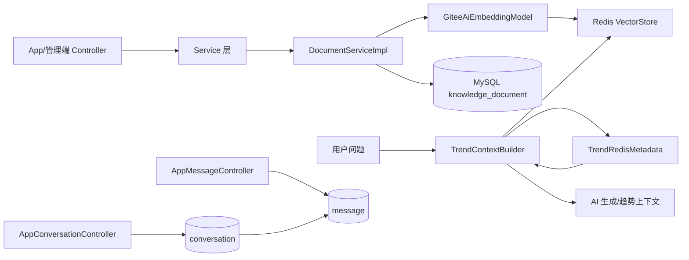
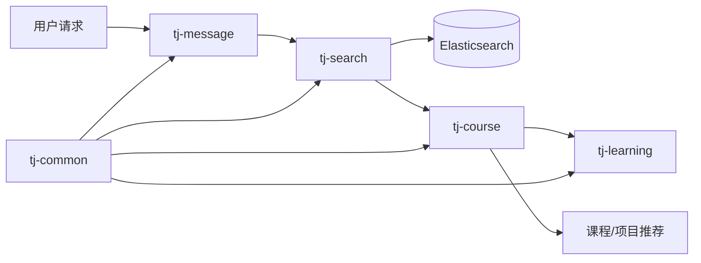

# OrangeJD 智能客服模块学习笔记
已新增 `langgraph4j-core:1.8.27`、统一执行接口、旧执行器和图执行器。图内有 20 个具名业务节点，复用现有模型、B 检索、条件和证据规则；正式回答由图外 `CustomerStore.complete` 提交。每轮独立图线程和 MySQL Saver，检查点只用于诊断，**不自动恢复、不提供重放**。默认仍为 LEGACY，验收完成之前不切换全部用户。

管理端新增“客服运行”：运行列表、节点路径、模型/工具摘要、检查点位置及受审计的原文查看。原文默认关闭，另需有效管理员身份和明确查看理由，审计失败不返回正文。权限测试和模拟浏览器测试不等同于真实管理员会话已验收。

| 新报告/代码入口 | 位置及用途 |
|---|---|
| 接入实现说明 | [IMPLEMENTATION.md](docs/customer/langgraph4j/IMPLEMENTATION.md)：节点职责、状态、提交边界、治理与观测限制 |
| 验收状态 | [ACCEPTANCE.md](docs/customer/langgraph4j/ACCEPTANCE.md)：通过、失败、跳过和待验证分别记录 |
| 切换与回退 | [OPERATIONS.md](docs/customer/langgraph4j/OPERATIONS.md)：LEGACY/LANGGRAPH4J 配置、全量切换前条件、两级回退 |
| 冻结旧实现 | `docs/customer/langgraph4j/baseline/CustomerConversation.java.txt` 与测试类 `FrozenCustomerConversation` |
| 后端回归 | `docs/customer/langgraph4j/regression.log`：包含冻结旧实现、图分支、状态、限额、模型尝试及架构检查 |
| MySQL 实测 | `docs/customer/langgraph4j/persistence.json`、`persistence.log`，脚本 `scripts/customer_graph_persistence.py` |
| 固定响应性能 | `docs/customer/langgraph4j/overhead.json`：每引擎预热 10 轮后 100 轮、2 并发，不是实际模型容量结论 |
| 真实模型对照 | `acceptance-cases.json`、`provider-manifest.json`、`provider-acceptance.json`、`provider-acceptance.log`，均在 `docs/customer/langgraph4j/`；未生成的报告表示尚未完成，不补造结果 |
| 用户端 HTTP | `docs/customer/langgraph4j/http-smoke.json`：真实接口、重复请求、应用 Token 被管理端拒绝；不包含登录凭据 |
| 前端 | 同目录 `admin-tests.log`、`admin-typecheck.log`、`admin-build.log`、`browser.log` 与 PNG；浏览器回归使用合成响应，不替代真实登录验收 |

首轮固定响应 MySQL 基准记录：旧编排 P95 178 ms，图编排 261 ms，新增 83 ms；小连接池执行后活动连接数为 0。它说明该组本机、固定响应负载下新增开销在 200 ms 目标内，**不能推导模型回答会更快、更准确，或服务器已满足持续容量目标**。

最终补测：每检查点额外写计时记录曾导致新增 P95 888 ms，失败报告保留；改成内存累计、随运行结果一次保存后，旧 P95 199 ms、图 P95 274 ms、新增 75 ms。真实 MySQL 12 项通过；最终确定性回归 257 项通过、18 项按条件跳过。

真实模型 80 轮：旧编排 34/40、新图 35/40，未达到 36/40 门槛。双方各 10 轮检索故障，不能把降级后仍出项目当作正常 B 检索通过；旧/新分别报告 208,566 / 222,244 Token，金额仍 UNKNOWN。失败分析和最终发布缺口见上述 ACCEPTANCE.md。本轮已修复原有诊断状态 25 字符超过数据库 24 字符的问题，但保留修复前的 80 轮结果，不虚称已经复测成功。

本次测试过程中发现管理端本地地址仍指向 8080，而 Docker 后端实际映射 18080。已通过仅本地 `.env.development.local` 固定正确地址；生产配置未改。用户已完成管理员登录，但浏览器控制工具异常，真实会话操作的未完成项须在验收报告中单独列出。

## 2026-10-07：B 版知识库客服现状与编排改造前基线

> 本节依据当前工作区源码、配置默认值和已有 v4.19 验收文件整理。本次仅更新学习笔记，没有修改业务代码、调用模型、重建索引、查询实时文档数量或重新进行运行验收。下文历史章节中的 A 版模型、旧客服策略、项目数量和阶段测试结果，不能直接当作今天的运行状态。

### 1. 当前技术栈与已实现边界

当前客服由四部分协作：**模型理解表达，Java 校验并保存条件，自定义 Java 流程调度业务，业务数据库与 B 版 RAG 提供项目事实和知识证据。**

| 部分 | 当前实现 | 需要注意的边界 |
|---|---|---|
| 平台后端 | Java 21、Spring Boot 3.3.5、MyBatis、MySQL、Flyway | 平台鉴权、事务、会话与业务规则仍在 Java 中 |
| AI／RAG 基础 | Spring AI 1.0.0，已引入 Redis 向量存储、RAG 等依赖；B 检索由平台服务实现 | 引入 Spring AI 不等于使用了完整 Advisor 编排或 Alibaba Graph |
| 客服编排 | `CustomerConversation` 自定义流程；源码标识 `customer-v4.19-composite-turns` | 当前没有接入 Spring AI Alibaba Graph、LangGraph4j 或 Python LangGraph 作为客服运行时 |
| 模型调用 | `CustomerModel` → `ExternalAiClient`；配置默认模型标识 `deepseek-flash` | 历史讨论中的 V4.1 Flash 是业务称呼；具体供应商地址、实际返回模型以部署配置和调用记录为准 |
| 用户界面 | Vue 客服独立模块、会话历史、项目卡片、来源展示、取消与删除会话 | 过程提示使用 SSE，当前不将内部推理、Token 用量作为聊天气泡内容展示 |
| 访问范围 | `allAuthenticatedUsers` 默认 true，仍需 `enabled` 且登录 | 默认配置 `enabled=false`；不能仅凭源码默认值断言某个部署已对所有账号开启 |

参考过 Spring AI Alibaba Examples、DeepSeek Harness、QueryMind 等项目的设计机制，不代表运行时依赖了它们的完整工程。B 版是在 OrangeJD 中实现的独立知识与检索链路；旧 A 索引、旧入口并未因本轮讨论被替换。

### 2. B 版知识数据与检索链路

客服检索入口会核验活动索引策略：`bge-m3`、1024 维、`STRUCTURE_M3_512_768_64_V1`、`HNSW_HYBRID`。不匹配时明确报错，不静默切回 small 模型或 A 索引。

- **文档来源与原文：** 旧知识导入桥接优先读取 `originalContent`，为空再读 `content`。该字段只能说明入口保存的内容；若上游已经翻译或生成中文介绍，B 接收到的仍是处理后的文本，不能说全库已经恢复 GitHub 外文全文。B 的这条桥接路径本身不统一再翻译一次。
- **结构分块：** `RagBTokenChunker` 使用随代码提供的 bge-m3 tokenizer；以章节、段落、句子等边界组织连续原文，目标约 512 Token，硬上限 768 Token，同章节重叠最多约 64 Token。保留章节路径和原文偏移，处理代码围栏；不是固定 500 字符切割，也不是用 LLM 对每段做语义分块。
- **向量与索引：** 使用 bge-m3 的稠密向量进入 Redis Stack。HNSW 用于向量近邻搜索；混合检索还包含词法和名称通道，不能把 HNSW 本身称作完整混合检索算法，也不能认为选用 bge-m3 就自动启用了其所有稀疏／多向量能力。
- **融合：** `RagBFusionScorer` 的 RRF 常数为 60，向量排名权重 1、词法排名权重 0.2。只有查询显式匹配项目名称时，才加 `3/(60+名称排名)`（无该路排名则为零）及 0.1 名称奖励；不存在的通道排名贡献为零。
- **偏好与筛选：** 检索层在请求了对应偏好时叠加来源偏好，混合路由当前加分量为 0.002；客服业务层还会独立检查条件与排序。这些不是正确率或概率，不应把检索分数和业务匹配度混为一谈。
- **去重与多样性：** 去掉同源重复段落和近重复片段；项目推荐显式启用来源多样性，先选不同来源，再补充同源其他片段。它仍受召回窗口限制，不保证全库所有合格项目都进入候选。
- **查询参数：** 普通知识问答使用 topK=8、阈值 0.55；项目初次召回 topK=20 并开启多样性；已选项目的补充证据限定文档范围，topK=20。底层融合候选上限默认 80，属于另一层参数；topK 不是最终推荐卡片数，也不是模型调用次数。
- **证据门槛：** 当前 `answerPolicy` 包含“至少两个章节或总正文至少 500 字符”的启发式门槛。该门槛只参与资料可用性判断，不证明事实正确；仍需要后续引用和声明核对。
- **数据治理：** 文档、版本、片段、索引代际分别管理；检索检查来源和版本有效性。本文不重新统计活动代际、文档与项目数量，旧章节中的数量仍是当时快照。

知识来源还包括岗位与手工资料，但项目推荐召回限定学习、求职和 GitHub 项目来源。平台规则问题另限定平台 FAQ 来源，不能把随便召回的 README 当作平台政策。

### 3. 当前一轮客服请求如何编排

```text
Vue 提交 message＋requestId
    ↓
AppCustomerController：服务端取得登录身份
    ↓
CustomerStore／CustomerRuns：权限、归属、去重、并发与排队
    ↓
CustomerConversation.execute
    ├─ 加载会话条件、账号确认画像、近期历史与上轮进度
    ├─ 确定性路由或模型输出结构化动作
    ├─ Java 校验条件、解析指代与项目反馈，保存确认状态
    ├─ 闲聊／条件说明／解释／追问／问答／推荐／详情／比较／诊断
    └─ 最终检查项目与来源有效性，整理回答与业务结果
    ↓
CustomerStore：事务保存结果、会话状态与消息
    ↓
SSE 状态事件／运行查询 → Vue 展示回答、卡片和引用
```

当前采用**模型提出动作、Java 控制执行**的有界工作流。三个 Skill 名称是代码注册的业务标识，不意味着已引入通用 Agent 引擎。不是每一步都调用模型，也不是模型自主不断选择工具的通用循环。

当前主要意图为 `CHAT`、`QUESTION`、`COLLECT`、`RECOMMEND`、`DETAIL`、`COMPARE`、`STATE`、`DIAGNOSE`、`EXPLAIN`。简单状态或过程问题可以直接路由；普通问候的实际回复由模型动作结果提供。v4.19 允许一段只读前置说明加一个主业务动作，尚不是任意多任务规划。

### 4. 条件理解、画像与记忆

- 模型收到当前消息、确认画像、会话状态及裁剪后的历史，输出意图、条件修改、画像默认值、项目位置、待确认项等结构化数据；关键提案需要用户原话依据。
- `CustomerState` 校验类型、单位、来源、范围、冲突和清除操作。单个字段有问题时保留其他可确认条件，不因一个字段失败丢掉整轮信息。
- 本轮明确修改优先于旧条件；画像用于填补未指定的默认值。临时对话条件不自动写回长期画像。
- “半年内”对应最长 180 天，允许两个月的项目；“至少”“恰好”“区间”分别表达下限、等值与上下限。模型理解与 Java 单位校验需要共同验证，不能只靠列举话术。
- 宽泛主题、软偏好和资料尚未查清不应自动成为待确认硬条件；当前若存在待确认项，推荐／收集／详情／比较分支会优先澄清。因此待确认项识别过严仍可能阻断体验，需要回归测试。
- 用户明确要求推荐时不必先补全画像。明确违反硬条件的项目排除；缺失信息保留未知，允许展示标明限制的探索候选，但不宣称已完全满足条件。
- `lastCandidates` 保存展示顺序和身份，`focusedProject` 保存当前焦点；查看详情不覆盖原列表编号。会话排除项目与正式筛选条件分开记录。
- 历史从最近 40 条消息中按完整运行轮次裁剪，近期窗口预算为 1400 个保守估算单位；不足部分最多保留六条带消息／运行 ID 的用户摘录。原始消息留在数据库；摘录不是完整长期记忆，也不能把历史建议变成确认条件。

### 5. 推荐、知识问答与输出防线

**推荐链路：** 查询规划／缓存 → B 项目召回 → 业务候选与硬条件 → 用途证据、有效缓存或模型核对 → 选择候选 → 项目范围内检索章节 → 生成证据说明 → 核对声明与引用 → 有预算时补充实践建议 → 最终校验。

候选不只来自已发布专区项目：客服业务池还包含符合当前有效性规则的候选记录与 READY GitHub 项目文档，按仓库身份处理重复。**业务候选范围不等于每个 RAG 来源的检索准入范围**：B 对学习／求职等来源还保留自己的发布／有效性检查；不能据此声称所有未发布业务候选都有可用向量证据。已知删除、下架、失效项目不能因扩大来源范围而重新成为有效推荐。

用途核对使用 `CustomerPurposeCatalog`、会话缓存与在线审核组合。来源事实具备 DRAFT、REVIEWED、REVOKED、STALE 生命周期；自动抽取只提出草稿，不自动批准。用途相关、硬条件满足、有本轮引用、允许导入是不同判断，不能互相代替。

**知识问答：** B 检索 → 检查资料门槛 → 分配证据预算 → 模型生成声明 → 引用定位与事实支持核对 → 保存可支持的回答。平台 FAQ 不强制关联项目 ID，但必须来自规定的平台资料。

现有失败与降级原则：

1. 核对失败不是不匹配；新候选核对失败，不应使已有有效用途依据自动失效。
2. 无有效候选才进入条件诊断；调整建议使用临时条件验证，用户确认后才更新正式条件，不向用户堆砌内部候选计数。
3. 补充证据或生成失败时，可以保留业务库中已核实的项目事实，但清空不可靠引用、标注限制并禁止导入正式方案。
4. 卡片中的学习路径与实践方向属于建议；项目功能、语言、依赖等事实需要有效依据，不能为了丰富卡片编造信息。
5. 提交前重新检查项目状态、条件和用途事实版本；过期项目移除或返回资料变化提示。
6. 最终校验不通过仍应保存明确的限制／失败结果，不能保存为合格推荐。运行 `SUCCEEDED` 不等于推荐正确，`businessOutcome` 另外表达业务结果。

### 6. 当前运行治理、模型预算与存储

| 项目 | 当前代码行为／默认值 |
|---|---|
| 请求去重 | 同会话相同 requestId＋相同消息返回原运行；消息不同返回冲突 |
| 并发与队列 | 每账号一个活动运行；默认全局两个执行、两个等待；排队计入期限 |
| 总期限 | 默认 90 秒；单次模型最长 45 秒，且不得超过剩余时间 |
| 阶段期限 | QUERY_PLAN 12 秒；PURPOSE_REVIEW／EVIDENCE 30 秒；VERIFY／ADVICE 20 秒；ACTION 使用模型期限；重试共享阶段期限 |
| 工具限制 | 每轮最多五次业务工具，知识检索最多两次；本轮相同工具参数可复用结果 |
| 输入估算 | 默认上限 6000；当前 `CustomerModel.estimate` 按 Unicode 码点保守估算，不是供应商精确 tokenizer |
| 输出预算 | ACTION／PURPOSE_REVIEW／ADVICE 默认 4096，EVIDENCE／VERIFY 默认 2048，QUERY_PLAN 等默认 1500；截断后的有限重试可按代码规则提高预算，不能说所有调用都固定 1500 |
| 重试 | 每个逻辑模型调用最多两次尝试；仅规定的可重试错误、动作格式或截断情况；供应商审核拒绝不按同批内容无休止重试 |
| 思考模式 | ACTION 按客服配置；PURPOSE_REVIEW 代码指定开启；QUERY_PLAN／ADVICE 关闭；EVIDENCE／VERIFY 独立配置，默认关闭 |
| 用量记录 | 记录成功、失败、重试及迟到上报；金额缺失为 UNKNOWN，Embedding 用量当前可能 NOT_REPORTED |
| 取消与重启 | 取消／超时先进入终态，拒绝迟到成功覆盖；启动恢复将未完成运行标记 INTERRUPTED，不自动重放不确定步骤 |
| SSE | 立即发送运行状态，随后约每 500ms 检查阶段变化；不是将未经校验的模型正文直接逐 Token 发布 |

注意配置与验收快照的区别：`application.yml`／Compose 默认 `thinking=false`、`native-actions=false`，而保存的 v4.19 语义测试记录为 `deepseek-flash`、ACTION 思考开启、原生动作调用。本次未读取实际运行容器的配置，不能将某次测试模式当作所有部署当前模式。

业务数据主要位于 `customer_session`、`customer_run`、`customer_message`、`customer_step` 与执行锁表；V43 增加来源事实及事件记录。`CustomerStore.checkpoint()` 只是保存会话状态，不保存 Java 调用栈或可恢复的图节点；现有工具计数、缓存和证据集合主要位于本轮内存上下文中。

### 7. 已有验证证据与未验证事项

以下为 `docs/customer/orchestration-v419/` 已保存报告的结果，**不是 2026-10-07 本次重新执行的结果**：

| 已有证据 | 结果 | 能说明什么／不能说明什么 |
|---|---|---|
| 后端 clean verify | 534 项，0 失败、0 错误、11 条件跳过 | 523 项实际通过；不能把跳过算通过 |
| 两个前端 | lint、类型检查、测试、构建通过 | 历史工程检查；不替代今天的运行检查 |
| 浏览器与离线评测 | 六项模拟浏览器 E2E、六项 Python 评测测试通过 | 不等于六次真实模型客服端到端通过 |
| 真实模型语义探针 | 八个合成案例，8/8，通过八次调用，报告 Token 合计 44,666；理解阶段 1.549–4.730 秒 | 验证动作／条件协议；不包含真实账号历史、项目证据或完整推荐质量，金额 UNKNOWN |
| 真实 MySQL 持久化 | 独立测试库从 V40 升级至 V43，事务、去重和事实版本验证通过 | 未修改真实用户数据；不代表服务重启自动续接已实现 |
| 本地 HTTP | 三个确定性状态／解释请求成功，重复请求返回原运行，历史六条消息，零模型调用 | 验证部分链路；不是整套真实生成性能报告 |

报告明确 `releaseApproved=false`。仍需独立验证真实推荐与引用质量、来源事实覆盖、持续容量、服务器部署与回退。早期 A/B、八画像、RAGAS 等记录可以作为历史证据，但未冻结相同代码、模型、语料和配置时不能直接拼成当前综合通过率。

### 8. 当前编排问题与 LangGraph4j 讨论边界

已识别的工程改进点：主流程职责集中；多个可变 Map 共享状态；错误处理和提前返回分散；复合任务仅支持有限组合；缺少节点级恢复；现有内存工具预算不能直接用于跨重启续接。语义理解、主题扩展、证据门槛和事实覆盖仍需独立评测，不能认为换框架即可解决。

**截至本记录：仅讨论过 LangGraph4j 架构，没有加入依赖、拆分图节点或切换客服运行。** 当前没有必要为了编排新增 Python 在线服务；如采用 LangGraph4j，可在现有 Spring Boot 进程内直接调用 Java 服务。框架负责节点与条件路由，历史保留与压缩由上下文模块负责，实际模型调用仍经过 `CustomerModel`。

建议方向（待后续实施确认，不是现状）：

- 先抽取推荐子流程，再以配置开关对照旧 Java 调度与 LangGraph4j 调度；不把整个旧推荐方法包成一个节点。
- 保留 B 分块、Embedding、索引、检索、项目业务与最终校验；不重建知识库、不删除 A。
- 节点按查询规划、候选查询、用途核对、筛选、证据生成、验证、诊断组织；节点不等于模型调用。
- 正式会话状态由 MySQL 管理，图只保存本轮快照与中间结果；模型提案必须经 Java 校验，检索失败不撤销用户已确认的条件修改。
- 一轮共享期限、工具计数、缓存与用量；保留现有模型重试，避免框架再次叠加；初期顺序执行，不直接并行操作当前可变上下文。
- 初期重启仍明确中断；检查点与回答提交分别设计，只有幂等、取消、数据版本与不确定外部调用测试通过后才启用自动恢复。
- 先验证等价迁移，再修改提示词或排序策略；用同模型、同资料、同测试案例比较，不能以“使用了框架”证明质量提高。

尚需锁定：正式依赖版本与兼容性、首期节点范围、图状态字段与更新权限、检查点存储／清理方式、恢复边界、新旧开关与试用账号、失败分支输出以及质量／成本验收门槛。之前完整 Python LangGraph＋独立 Redis 的方案属于讨论过的备选，并非当前部署或已经确定要执行的方案。

### 9. 代码与报告阅读入口

- 主流程、运行治理、会话提交：`orange-server/src/main/java/com/orangejd/server/customer/CustomerConversation.java`、`CustomerRuns.java`、`CustomerStore.java`。
- 理解与上下文：同目录 `CustomerState.java`、`CustomerDialogue.java`、`CustomerHistory.java`、`CustomerTurnPlan.java`、`CustomerProjectFeedback.java`。
- 模型、工具、业务与证据：同目录 `CustomerModel.java`、`CustomerTools.java`、`CustomerProjects.java`、`CustomerPurposeCatalog.java`、`CustomerEvidence.java`。
- B 检索与分块：`orange-server/src/main/java/com/orangejd/server/ragb/service/RagBSearchService.java`、`retrieval/RagBFusionScorer.java`、`ingest/RagBTokenChunker.java`。
- 详细实现及历史验收：[v4.19 说明](docs/customer/orchestration-v419/README.md)、[汇总报告](docs/customer/orchestration-v419/verification.json)、[语义探针](docs/customer/orchestration-v419/semantic-probe.json)、[HTTP 记录](docs/customer/orchestration-v419/http-smoke.json)。

### 10. 为什么选择当前设定：选型依据而非默认最优
**

| 当前选择 | 选择理由与已有证据 | 代价与保留意见 |
|---|---|---|
| bge-m3、1024 维 | 五模型真实对照中，双语语义证据覆盖和综合排名领先；适配中文需求与英文／混合 README，也改善英文查中文资料 | 纯中文业务题并非总胜 small；供应商延迟高于 small 中位数；向量存储增大 |
| 结构分块 target512／cap768／overlap≤64 Token | 用章节和文本边界保留事实上下文、原文偏移；M3-512 比共同短块的指标点估计更好、块数更少 | 512 并非逐块固定长度；相对短块的 MRR 提升区间含零，不能说 512 是统计上唯一最优值 |
| Redis Stack | 复用平台已有技术和运维经验，在一套系统中提供向量与词法检索，配合独立 B 索引代际 | 属于工程选型，未做过与 Milvus、Qdrant、pgvector 的同条件性能优胜实验 |
| HNSW 向量索引 | 兼顾后续扩容，避免每次全库向量扫描；小规模实验中 ANN Top8 与精确余弦一致 | 近似索引有内存和召回权衡；当前规模不意味着必须用 HNSW，也未证明任何规模下都优于 FLAT |
| 向量为主的加权 RRF＋显式名称加分 | 保留语义检索，同时支持明确点名项目；消融发现旧词法／名称权重会破坏语义排序 | 0.2 权重来自探索性调参；混合方案未在所有语义题上胜过纯向量，后续需独立集复核 |
| 按任务启用来源多样性 | 推荐需要多个项目，问答则可能需要同一项目多个章节 | 全局多样性曾明显损伤事实召回，不能统一应用到所有请求 |
| 原文优先、查询不默认翻译 | M3 可直接跨语言检索；真实盲翻译对照未显示普遍收益，并增加调用 | 查询翻译实验不等于“全文入库翻译有无收益”的实验；旧中文内容仍需单独追溯 |
| 保留 Java 硬条件与引用校验 | 语义相似、RRF 分数、模型用途判断不能保证满足用户限制或事实正确 | 增加业务查询与校验耗时；不能只依据检索分数直接生成合格推荐 |

### 11. 五模型与分块实验：M3 的选择来自什么测试

来源：[五模型与分块报告](docs/rag-b/model-chunk-experiment/report.md)、[实验设计与分块范围](docs/rag-b/model-chunk-experiment/preflight-report.md)。准备报告中的“尚未调用／金额未知”是准备时状态，已完成结果和费用补充以正式报告为准。

- **语料：** 68 份 READY 文档，原分块 1,307 个，原文 460,577 字符；不是后来完整 565 份文档的实验。
- **题集：** 50 个来源定位回归题＋30 个事实的中英文问句，共 110 题；主质量表只统计 60 个语义证据题。题目由助手依据资料编写并在调用前冻结，不是独立业务盲测。
- **对照：** small、large、M3、Qwen3-0.6B、Qwen3-4B 先接收相同的 target256／cap384 结构块；再测试长输入模型自己的分块及查询指令，合计 18 组质量结果。查询指令只加入问题，不加入文档。
- **隔离变量：** 使用归一化 float32 的精确余弦 Top8，统一来源范围；没有 HNSW、RRF、业务硬条件、Reranker 或 LLM 回答。共同文本组用于观察模型差异，各模型最佳方案则同时包含分块／指令影响。

| 模型与当轮最佳候选 | 块数 | 60 题证据命中@8 | 证据 MRR@8 | 二值证据 nDCG@8 |
|---|---:|---:|---:|---:|
| small，原 500 字符，无查询指令 | 1,307 | 58.3%（35/60） | 0.466 | 0.466 |
| large，共同256结构块＋查询指令 | 1,627 | 90.0%（54/60） | 0.699 | 0.738 |
| **M3，512结构块，无查询指令** | **1,391** | **100%（60/60）** | **0.828** | **0.847** |
| Qwen3-0.6B，512结构块＋查询指令 | 1,364 | 95.0%（57/60） | 0.710 | 0.754 |
| Qwen3-4B，768结构块＋查询指令 | 1,336 | 91.7%（55/60） | 0.717 | 0.744 |

这支持优先选择 M3，而不是依据参数规模认为 4B 一定最好。Qwen3-4B 的512块方案命中率为93.3%、MRR为0.711，768只是MRR点估计稍高。Gitee当时返回small512维，其余四模型1024维；不能把其他部署的默认维度直接带入本实验。

M3 的关键优势来自双语覆盖：英文查中文业务资料，small 命中为0/20、M3为20/20；中文查 README，small为6/10、M3为10/10。但纯中文业务题的 MRR 是 small 0.925、M3 0.834，不能说 M3 每类都更好。实际用户语言分布若与实验的中英文各半不同，综合得分必须重新解释。

分块选择的证据和限制：

- M3 共同短块 → 512结构块：命中率96.7%→100%，MRR 0.795→0.828，块数1,627→1,391。较长结构块有利于保留上下文是设计动机，本轮只证明组合方案的结果，未证明唯一因果。
- small原字符块 → 短结构块：命中率58.3%→56.7%，MRR 0.466→0.409，说明“结构分块”并非无条件提升。
- 原small块在该语料中的最大长度468 Token，未发现必然超出原模型容量的证据，不能把旧方案问题全部归结为输入被截断。
- M3-512仍有552块短于32 Token；相对原B的1,307块增加约6.4%，并非减少了原库存储。短字段合并、标题增强和超长表格处理仍是后续实验项。
- 按30个事实组做配对bootstrap：M3-512相对small的MRR差约0.363，探索性95%区间[0.253,0.471]；相对M3短块差约0.033，区间[-0.009,0.080]。后者含零，且配置选择效应未校正，不能把0.828当作独立验收保证。

### 12. HNSW、融合权重、多样性与翻译的后续实验

来源：[混合检索决策报告](docs/rag-b/model-chunk-experiment/hybrid-translation/decision-report.json)、[盲翻译报告](docs/rag-b/model-chunk-experiment/hybrid-translation/blind-translation/report.json)。

扩展题集共140题：50个名称定位题＋原60个双语语义题＋30个中文改写题。新增改写仍对应原事实，不是独立语料。隔离 Redis 实验比较 HNSW 与精确检索，再重放混合排序与来源多样性；不包含 Java 全部业务守卫或生成。

**HNSW：** EF_RUNTIME=64与128在这140题的Top8均与精确余弦一致。这说明该次排序退化不应首先归因于近似搜索丢失，而不是证明所有数据上的ANN召回为100%。

| M3-512 的90个语义题配置 | 证据命中@8 | MRR@8 |
|---|---:|---:|
| 原始问题、单路向量 | 96.7% | 0.815 |
| 当时旧混合排序 | 67.8% | 0.506 |
| 当时旧混合排序＋全局来源多样性 | 57.8% | 0.470 |
| 仅显式名称加分＋词法权重0.2 | 94.4% | 0.699 |
| 上一方案再加全局来源多样性 | 65.6% | 0.618 |

这解释了为什么修正名称门控、降低词法权重，并把多样性限定到需要多个项目的任务。**修正后的混合方案仍未超过单路向量的语义题MRR，因此“混合必然更好”不成立。** 名称定位题、事实问答和项目推荐必须分别评估；不应该用一个总分掩盖任务冲突。代码中的当前0.2权重与这一探索方向一致，但不是所有后续版本已重新盲测的证明。

阈值0.55在该实验中是兼容参数及敏感性检查，不是对M3独立标定出的最优阈值；它不是55%的事实正确概率。Top8适合作为固定比较窗口，Top20用于客服候选或证据查询，最终受上下文预算限制；这些值仍需按真实任务校准，不是模型固有常数。

**是否默认翻译查询：** 最初使用预写英文配对问题，M3双查询的90题MRR仅比原文提高约0.0086，配对区间含零。随后真正对60个中文问题盲翻译：原始向量命中95%、MRR 0.8267；中英文双查询命中仍95%、MRR降至0.8006，差值区间[-0.0765,0.0180]。六次批量翻译估计费用约0.01248美元，批次总耗时约19.65秒；批量耗时不能冒充单次在线翻译延迟。

因此不默认给每个请求增加翻译，可把特定失败类型的选择性翻译留作后续对照。该结论仅针对查询翻译；没有证明“原文与整篇中文译文分别入库”的效果完全相同，更没有证明数据库 `original_content` 一定未经翻译。

### 13. 全库规模下的 A/B 结果：更接近上线数据，但仍不是当前客服完整验收

来源：[M3全库综合报告](docs/rag-b/m3-full-corpus/comparison-report.json)。该轮记录的B活动代际为 `20261002164953-ec113424`，不是本次实时读取的活动代际。

- 565份可导入旧资料：203份有 `original_content`，362份回退到 `content`；B中565份唯一文档、8,660块，报告无入库失败。
- 全部块重新核对 tokenizer 与原文偏移：8,303块有章节，Token中位数115、P95为599、最大768；最大实际重叠64 Token，审计无失败。目标512不等于平均长度512。
- A保留5,647个向量，未因B构建而减少。Redis报告的向量索引大小A约13.98MB、B约39.02MB；这是特定索引字段，不是进程总内存，两边文档表示、块数和维度不同，不能将差值只归因于模型维度。

**同为Top8、阈值0.55的受控检索对照：** A直接VectorStore，B为完整混合检索，无显式来源过滤；不是仅替换Embedding的因果实验。90题是复用诊断题。

| 指标 | A | B（M3＋结构分块） |
|---|---:|---:|
| 90题来源命中@8 | 44.4%（40/90） | 87.8%（79/90） |
| 90题来源MRR@8 | 0.347 | 0.652 |
| 90题来源＋词面事实锚点命中@8 | 24.4%（22/90） | 82.2%（74/90） |
| 90题事实锚点MRR@8 | 0.195 | 0.507 |
| 50题名称定位来源命中@8 | 46.0% | 98.0% |
| 60题旧业务规则通过率 | 36.7%（22/60） | 100%（60/60） |

报告还测了“平台原生输出”，A最多返回3张压缩卡、B最多8个片段，不能因汇总键仍叫Recall@8就当作公平Top8对照。原生90题来源命中A33.3%、B87.8%，只适合说明各自当时入口的输出覆盖。

**为什么早期60题能100%，后来90题低一些：** 2026-09-29的60题主要检查定位、来源和规则，53题标来源，部分直接含项目名称，没有真实回答生成；后续语义题要求找特定事实，且全库扩展增加干扰。指标、题目难度、语料规模与检索路径不同，不能把下降直接解释为模型退化。中文翻译与英文锚点不一致也可能使A的词面事实指标偏低。

**短时性能：** 全库报告中独立B检索在并发1／4／8、每组24请求下，P95约526／585／956ms，均无错误；只是检索，不含客服多轮模型生成。在另一个逐请求先A后B的混合负载实验中，测得不同的P95，存在资源竞争和顺序影响，不能据此挑选最优数字或认定B始终更快。短时突发并发8不代表当前客服放开了8个并发，也不代表持续容量达标。

该轮覆盖当时数据库全量，不等于完成登录、画像、完整推荐、引用和导入的真实产品链路。后续v4.19又改变了编排与检索多样性，不能把本表直接冠为今天的全流程通过率。

### 14. RAGAS：回答质量、引用质量与分母

来源：[RAGAS汇总](docs/rag-b/m3-full-corpus/ragas/summary.json)和全库报告的 `pairedRagas`。使用18道复用诊断题、相同生成提示词／模型进行A/B对照，评分模型记录为 `deepseek-v4-pro`；不是当前客服Flash各阶段的完整评测。A有13题形成生成回答、5题空上下文，B有18题。

下面优先使用同题有效样本，避免直接比较A的13题与B的18题平均分：

| RAGAS指标 | 配对题数 | A均值 | B均值 | 解释 |
|---|---:|---:|---:|---|
| Context precision | 13 | 0.679 | 0.619 | 评分器判断的相关上下文排序／精度；本轮B较低，说明更多证据也可能引入噪声 |
| Context recall | 13 | 0.513 | 0.744 | 检索上下文对参考事实的覆盖；B更高 |
| Faithfulness | 13 | 0.703 | 0.907 | 回答声明是否得到整组上下文支持；不等于每个引用绑定正确 |
| Factual correctness | 18 | 0.339 | 0.428 | 对参考答案的事实比较分数；不是人工判定的回答准确率 |

B全部18题单独均值分别为0.638、0.759、0.929、0.428；前三项不能不说明分母就与A13题直接比较。未定义／错误评分单独统计，不填成0或1。参考答案由本地资料构造，题集非独立，生成与评分使用同一模型存在相关偏差；短参考也可能漏计其他正确答案。

**引用检查的教训：** A的17次引用、B的54次引用，编号存在性均100%，但定向复核仍发现“不支持的能力推断”和“事实在C6、句子却引用C5”的情况。个别问题的关键原文已在B库中，失败发生在片段选择或生成归因，不应简单归因于没有入库。不能用编号合法率、全上下文忠实度代替逐句引用支持率，也不能把1−Faithfulness当作事实错误率。

### 15. 当前评估指标应该怎样读

评估按层分别报告，不把它们合成一个未经定义的“RAG准确率”：

| 层次／指标 | 含义与当前口径 | 不能证明什么 |
|---|---|---|
| 来源Recall@8 | 当前脚本实际为题目级命中率：前8出现至少一个可接受来源的题数／有来源标注的题数 | 不是“所有相关片段中召回了多少”，不证明找到所需事实 |
| 证据／词面锚点Recall@8 | 来源正确且片段含规范化后的标注事实锚点，题目级计命中 | 可能漏算同义、翻译或其他正确项目；不是语义蕴含判断 |
| MRR@8 | 每题首个合格结果名次r≤8计1/r，无命中计0，再取平均；来源MRR与事实MRR分别计算 | 不是回答准确率，也不是平均排名，不能用1/MRR推算平均名次 |
| nDCG@8 | 对多个相关结果的排序作折扣并按理想排序归一化；本实验使用二值证据标注 | 受标注完整性、重复相关片段和分块方式影响 |
| 业务条件满足／严格通过 | 语言、来源、周期、资源等约束及预期回答／拒答行为 | 不代表自然语言回答事实正确；必须注明规则版本与未知值策略 |
| 引用就绪／可追溯 | 有可定位来源、文档、章节、片段等信息 | 不代表已经生成正确引用或引用支持该句 |
| 引用编号合法／逐句支持 | 前者只查ID存在；后者核对该句事实是否由所引片段支持 | 两者不可混报，人工抽查还要说明抽样范围 |
| RAGAS四项 | 辅助衡量上下文、参考事实与回答支持 | 评分模型不是独立事实裁判，均值需带有效样本数 |
| 拒答与继续对话 | 分开检查应拒答是否拒答、应回答是否误拒，以及是否仍能合理引导 | 单看拒答率越高或运行成功率越高均不代表质量越好 |
| 延迟、错误率、成本 | 分开记录Embedding、检索、生成、核验和整轮的P50/P95、重试、Token、金额 | 检索毫秒级不能当成完整客服时延；未知费用不能记为零 |

MRR例子：四题首个证据在第1、2、5名，另一题前8无命中，则MRR@8=(1+1/2+1/5+0)/4=0.425，题目级命中率=75%。箭头↑只表示越高越好。M3的小集MRR0.828不代表回答准确率82.8%。

传统片段级Recall@K需标注每题全部相关片段集合，再计算召回相关片段占比；当前主要报告题目级来源／锚点命中，应保留原报告名称但明确口径。中英文同事实题和同题多次重复应按事实组分析，不能当成完全独立样本。

### 16. 选型成本与接下来需要补齐的证据

来源：[模型成本复核](docs/rag-b/model-chunk-experiment/cost-report.md)。五模型质量实验加延迟复测合计1,130次成功Embedding请求，15,599项向量输入，无文本生成调用；正数报告Token合计1,190,107，但356次请求用量为0或缺失，不能据此精确对比计费用量。

2026-10-02成本报告依据当时Gitee公开说明，把该轮Embedding接口费判断为0元；这不是账户账单核验，也不代表存储、Redis、生成和评分免费。本次没有重新核对2026-10-07价格，不能把历史政策当作永久定价。

当时每模型30次单查询＋2次预热，交错测试：small P50/P95为206/309ms，large 599/798ms，M3 348/426ms，Qwen3-0.6B 165/403ms，Qwen3-4B 286/419ms。M3的选择是质量与可接受查询延迟的权衡，Qwen3-0.6B仍是速度候选；这些不含Redis和生成，也不是长期供应商SLA。

小集float32向量本体估算M3约5.43MiB、small约2.55MiB，约2.13倍；不含文本、元数据、HNSW和代际共存。全库应看实际索引和进程内存，不外推小集估算。

全库RAGAS报告合计408次请求，其中生成31次、评分377次；当时价格下估算总额约0.238–0.476美元，属于整轮评测估算，不是每次客服请求费用，也未核验实际扣费。当前Java客服账目仍需对未返回用量与价格未知保留UNKNOWN。

后续优先补齐：独立业务题和真实语言分布、同义／跨语言可接受证据标注、按任务比较单路与混合检索、0.55阈值与候选预算校准、短块合并对照、逐句引用支持抽查、完整多轮推荐与导入验收、持续负载及费用核对。模型Rerank、默认翻译或换向量数据库都应先证明收益；图编排重构也不能替代这些检索与回答评测。

上述报告位于本地工作区，其中部分实验材料尚未纳入Git；笔记保存的是可核对的历史摘要。若要交付完整可复现实验包，需要另行检查并选择性归档语料哈希、题集、配置、逐题结果和脚本，不能直接提交原始文档、调用缓存或账户数据。

---

### 17. 当前 RAG 能力核对：混合检索、改写、精排、引用与拒答

2026-10-07再次按当前工作区代码核对。以下区分B检索服务、实验台回答器和正式客服；同属B链路，不代表所有入口采用相同生成与校验逻辑。本节没有重新运行模型或查询线上数据库。

| 能力 | 当前实现 | 边界与需要改善之处 |
|---|---|---|
| 混合检索 | `RagBRedisStackRepository`以向量、正文全文、标题／仓库名称三路召回，交给加权RRF融合 | HNSW只负责向量一路；代码未显式配置独立BM25服务，不应将其直接描述成已标定的BM25方案 |
| Rerank | 有融合排序、名称加分、业务偏好、去重和来源多样性；客服有模型用途核对 | 未接入专用Cross-encoder或Embedding供应商的Rerank接口；用途筛选不等于片段相关性精排 |
| Query Rewrite | 客服推荐阶段调用模型把方向扩展为最多三个检索表达，保留原主题；有主题别名和宽泛方向子主题处理 | 扩展词拼为一个查询，不是分别向量化、召回后再融合的Multi-query；普通问答没有统一的上下文独立问题改写 |
| 来源引用 | 文档、版本、片段、章节、原文偏移；本轮证据ID和摘录ID | 来源可定位不代表声明得到支持，需要逐句核验 |
| 无答案拒答 | 区分无匹配、证据不足、检索失败；不支持的声明剔除，仍可继续讨论需求 | 基础充分性包含章节数／字数启发式，可能误拒短而准确的证据，也可能接受长而无关的资料 |

当前默认检索预算：每路128候选、融合80候选；客服知识问答Top8，项目召回和项目证据Top20；向量阈值0.55。RRF平滑参数60，向量权重1、词法权重0.2；明确名称命中才增加名称排名项与固定加分。偏好不代替硬条件，最终还核对文档READY、活动版本、来源有效性和业务约束。来源多样性按任务开启，不应用于所有事实问答。上述数字是代码默认／调用参数，不代表本次重新读取部署覆盖配置。

`CustomerPurpose.PLAN_PROMPT`要求最多三个、每项最多60字符的用途短语，采用中文术语及英文对等表达，不改语言、时间等条件。`query()`把原主题与通过基本格式检查的扩展词用分隔符拼接；检索扩展不直接写成用户确认条件。宽泛方向可以包含子方向，具体方向不能无限泛化。模型仍可能扩展错误，所以候选随后要核对实际用途与原话场景。

普通问答在`CustomerConversation.answer()`中主要将本轮message交给知识检索；“它怎么部署”“刚才那个支持什么”等表达仍需结合焦点项目和历史形成明确问题。应保留原问句、改写句、条件版本及改写原因，并用指代／歧义回归题验证，不应把所有话都无条件交给模型改写。

正式客服事实链路为：检索片段→证据预算裁剪→服务端划分摘录并分配ID→模型生成中文事实并选择摘录→Java核对证据身份与原文→模型VERIFY检查摘录是否支持事实→仅保留通过的事实及引用。实验台`RagBCitationValidator`仍有词面重合检查，与正式客服的摘录及语义核验不能混为一谈；两种办法均不构成事实正确保证。

`RagBSearchService.answerPolicy()`当前以“至少两个不同文档／章节组合，或总字符数≥500”作为允许回答的基础条件之一。这是覆盖启发式，不是问题可回答性判断。改进应围绕问题所需事实及证据覆盖，长度只用于预算管理。无可靠证据时拒绝断言平台／项目事实，不等于结束对话；业务身份有效的项目仍可展示已知字段与待核实项，证据或条件不满足时不能进入正式方案。检索故障不能冒充无结果，未完成用途核对不能自动建议用户放宽条件。

代码依据：[混合检索](orange-server/src/main/java/com/orangejd/server/ragb/retrieval/RagBRedisStackRepository.java)、[融合评分](orange-server/src/main/java/com/orangejd/server/ragb/retrieval/RagBFusionScorer.java)、[查询规划](orange-server/src/main/java/com/orangejd/server/customer/CustomerPurpose.java)、[客服编排](orange-server/src/main/java/com/orangejd/server/customer/CustomerConversation.java)、[证据协议](orange-server/src/main/java/com/orangejd/server/customer/CustomerEvidence.java)。

### 18. 数据库、知识库规模与评测层次如何选择

| 存储 | 职责 | 为什么选择及限制 |
|---|---|---|
| MySQL | 业务项目、文档、版本、分块、代际、会话、运行与步骤等正式记录 | 沿用平台事务和关联查询能力；承担可回查的数据基础，不能将Redis检索结果当作全部业务真值 |
| Redis Stack | 向量、全文检索所需文本与元数据、独立B代际索引 | 复用既有技术和运维；A/B命名空间隔离便于并行和回退；没有与专用向量库同条件比较后胜出的证据 |
| 本地评测材料 | 题集、配置、逐题结果、分析报告 | 便于复现与对照；部分未纳入Git，仍需选择性归档及保护原文／账户数据 |

565份文档是第13节全库实验时可导入资料的全量，不是人为设定的最优容量或系统上限；文档数量不等于独立项目数量，更不等于平台所有项目表的行数。8,660个B块与5,647个A向量来自不同表示和分块方案。前期68份资料用于控制模型实验成本、隔离变量，后期全量用于增加真实干扰候选并验证入库与检索；两阶段结果不能混用。203份有original_content、362份回退content只说明字段可用性，不证明203份全部是未翻译的GitHub原文。以上为历史快照，本次未重新统计实时数据库。

评测分四层：①模型／分块，比较相同文本下的模型与各组合方案；②检索消融，比较精确与HNSW、混合权重、多样性、查询翻译；③全库检索与业务规则；④回答引用及真实产品链路。第11至16节已保存数值、口径、分母与成本限制，后续应沿用这些分层，避免把“60题规则100%”写成完整客服100%。

当前判断：历史全库B的90题来源命中87.8%、事实锚点命中82.2%，明显高于该轮A，但不是线上回答准确率；配对RAGAS的B忠实度0.907高于A0.703，Context precision却低于A。需要独立题集、可接受同义／跨语言证据标注、逐句引用核对、多轮修改和方案导入验收。短时检索并发测试不能代替整轮模型调用的持续容量测试。

### 19. 当前可观测性：能追查单次运行，尚未形成完整运营闭环

| 维度 | 当前已经具备 | 尚缺的能力 |
|---|---|---|
| 会话／运行 | `customer_session/message/run/step`、状态、错误码、取消、超时、重启中断 | 统一的跨线程、跨阶段追踪及可检索时间线 |
| 检索解释 | 活动代际、候选与选中数、排除原因、召回路由与名次、来源位置 | 分任务长期聚合、排名变化与质量退化告警 |
| 模型调用 | 阶段、请求／返回模型、尝试次数、耗时、错误、供应商用量 | 失败缺失用量与供应商账单核对，统一模型／工具子调用追踪 |
| 成本 | 按阶段汇总输入、输出、推理、缓存Token及用量完整标志 | `costUsd`仍可为UNKNOWN；不是自动精确计费系统 |
| 事实防线 | 记录构建Prompt时的证据、被剔除声明、VERIFY输入及结果 | 独立抽样人工检查、误拒与误通过长期统计 |
| 系统监控 | Micrometer、Prometheus暴露端点，部分平台指标 | 未确认部署了客服专属仪表盘和告警，不能从依赖存在推断已经运营监控 |
| 用户反馈 | SSE运行状态及断线后查询原运行 | 用户看到“正在查找”不等于后台有完整性能追踪 |

具体缺口：`TrendLabObservation`是实验台按需开启的ThreadLocal阶段计时。没有开启时不收集；`CustomerTools`又在线程池执行，不能假设上下文自动传递到工作线程。即使代码有`B.embeddingAndVector`等计时名称，也不能声称每次普通客服请求已有细分耗时。目前该项还把Embedding与向量搜索合计，定位供应商与Redis瓶颈需要进一步拆开。

应持续分开统计执行终态与业务结果：运行SUCCEEDED可能只是成功返回“证据不足”，不能计为问题已解决。监控应同时看整轮和阶段P50/P95、错误／重试、无匹配、证据不足、用途核对不可用、引用剔除、同步积压、用量完整率；误拒答和事实错误则依赖带标注评测或抽检，不能仅从状态码推断。

代码依据：[调用用量](orange-server/src/main/java/com/orangejd/server/customer/CustomerUsage.java)、[模型尝试记录](orange-server/src/main/java/com/orangejd/server/customer/CustomerModel.java)、[工具执行](orange-server/src/main/java/com/orangejd/server/customer/CustomerTools.java)、[实验阶段计时](orange-server/src/main/java/com/orangejd/server/service/TrendLabObservation.java)。步骤记录已有问题／证据等内容，后续应明确管理权限、脱敏、保留期限；默认不把全文画像、文档和提示词复制到外部观测服务。

### 20. LangGraph4j能否改善可观测性：能提供结构，不能自动补齐监控

本节是后续架构建议，**当前客服仍是自定义Java编排，尚未接入LangGraph4j**。名称为LangGraph4j，与LangChain4j、Python LangGraph不是同一个库。2026-10-07核对[LangGraph4j官方核心说明](https://langgraph4j.github.io/langgraph4j/1.8/core/core-library/)：图以节点、条件边和状态组织执行；stream可输出节点执行后的状态变化，配置检查点可保存及查看执行状态。[官方Streaming说明](https://langgraph4j.github.io/langgraph4j/main/core/streaming/)说明流式接入方式。具体采用版本、接口兼容与检查点存储仍需实施时固定并测试。

这些机制有助于统一收集“执行到哪里、走哪条分支、状态怎样变化”，但引入依赖不会自动产生当前Java服务内部的检索细分计时、账单、质量评分或告警。下表为本平台的适配建议，不是框架已自动提供的产品功能。

| 需要回答的问题 | 图编排可带来的帮助 | 平台仍需实现 |
|---|---|---|
| 为什么没有推荐？ | 路由与节点边界明确，可区分检索、用途核对、条件过滤和引用校验 | 每个节点输出业务原因、候选变化与关联证据，避免只记SUCCESS |
| 慢在哪一步？ | 便于统一包装每个节点 | 记录开始／结束／异常时间，并拆开Embedding、Redis、模型重试；节点完成事件本身不足以定位内部等待 |
| 为什么半年没有生效？ | 可在状态历史中关联理解与条件更新步骤 | 保存经脱敏的条件前后差异、来源、版本和校验理由，而不是只存模型文本 |
| 为什么成本变高？ | 能按图节点关联调用 | CustomerModel记录每次真实尝试和供应商用量，成本表／账单另行核对，未知仍标UNKNOWN |
| 证据是否正确？ | 可追踪哪些证据流入生成／核验节点 | 保留来源与版本、逐句引用检查、独立评测及人工核验 |
| 能否回放／恢复？ | 检查点支持查看状态并为恢复提供基础 | 持久化适配、权限隔离、版本兼容、幂等与预算；不能把恢复理解为模型调用必然恰好执行一次 |

推荐的渐进接入方式：

1. **先统一观测协议。** 每次运行关联runId、sessionId、traceId，节点记录nodeName、executionId、attempt、开始／结束时间、状态和业务结果；检索附代际、配置、证据ID，模型附真实模型、用量与错误。配置／Prompt／图版本共同留存。runId等高基数字段放日志和追踪，不作为Prometheus标签。
2. **再拆出图节点。** 上下文准备、意图理解、条件更新、查询规划、项目检索、用途核对、证据检索、生成、核验、保存分开；普通聊天和知识问答使用明确分支。继续调用CustomerModel、CustomerTools和B服务，节点包装器统一记录，不把整个CustomerConversation包成一个黑盒节点。
3. **连接现有存储与前端。** 节点事件映射customer_step与现有SSE；MySQL正式会话和回答仍是平台记录，检查点另记执行进度。前端只展示可理解的阶段与已校验答案，不发送内部完整状态。异常开始／结束由包装器补齐，不能仅消费成功节点输出。
4. **补齐运行监控。** 用现有Micrometer／Prometheus汇总低基数指标；需要更完整追踪时再评估OpenTelemetry及可视化后端。跨Future／线程池显式传播观测上下文，LangGraph4j不能自动修复现有ThreadLocal断链。可先本地保存，不以外部SaaS为前提。
5. **首阶段保留受控恢复边界。** 检查点只用于排查，不直接开启生产自动重放。正式恢复前验证同会话归属、条件版本、数据代际、剩余期限与调用幂等；模型／工具已执行但结果尚未落盘的窗口需要单独处理，避免重复请求和费用。

观测验收：对普通聊天、条件修改、无结果、供应商异常、取消、超时分别执行固定案例；从runId能查到完整路径、条件变更、候选流失位置、生成证据、全部尝试和终态。工具跨线程调用仍关联同一trace；Token汇总与调用记录一致，缺失用量明确显示；故障节点有失败记录，取消／超时后迟到结果不覆盖终态；普通用户不能读取他人检查点或后台原文。P95和费用变化需同题同模型比较，不把“图看起来清晰”当作性能改善证明。

结论：**如果只需要更清楚的日志和指标，现有Java也能补齐，没必要仅为此迁移框架；如果同时需要拆分复杂编排、检查分支与状态，LangGraph4j能让这些观测点更一致、更容易维护。** 它不会自动提高召回、修复引用或降低费用。优先落实统一观测协议与独立评测，再用同一协议比较新旧编排。

---

<a id="experiment-report-index"></a>

### 21. 实验报告位置索引（2026-10-07核对）

本索引覆盖本地已发现的RAG、智能分析、客服及其早期相关评测。所有链接指向当前工作区 `D:\Orangejd`，以“先读汇总，再看逐题与调用记录”为顺序。这里只整理位置，没有重跑实验，也没有重新批准历史验收结论。源码快照、运行日志和中间文件保留在对应目录，不在此逐一列出数百个文件。

#### 21.1 最常用的查找入口

| 想查什么 | 优先打开 |
|---|---|
| 为什么选择bge-m3和512结构分块 | [五模型与分块报告](D:/Orangejd/docs/rag-b/model-chunk-experiment/report.md) |
| Embedding调用量、价格口径与延迟 | [成本报告](D:/Orangejd/docs/rag-b/model-chunk-experiment/cost-report.md)、[单查询延迟](D:/Orangejd/docs/rag-b/model-chunk-experiment/single-query-latency.json) |
| HNSW、融合权重、来源多样性为什么调整 | [混合检索决策报告](D:/Orangejd/docs/rag-b/model-chunk-experiment/hybrid-translation/decision-report.json) |
| 中文查询要不要翻译 | [真实盲翻译报告](D:/Orangejd/docs/rag-b/model-chunk-experiment/hybrid-translation/blind-translation/report.json) |
| 完整语料下A/B质量差距 | [M3全库综合报告](D:/Orangejd/docs/rag-b/m3-full-corpus/comparison-report.json) |
| RAGAS分数与引用问题 | [评分汇总](D:/Orangejd/docs/rag-b/m3-full-corpus/ragas/summary.json)、[定向引用复核](D:/Orangejd/docs/rag-b/m3-full-corpus/targeted-review.json) |
| 智能分析接A与B有什么不同 | [智能分析A/B报告](D:/Orangejd/docs/rag-b/trend-ab-20261003/report.md) |
| B为什么更慢／更贵，是否逐环节验证 | [原因对照报告](D:/Orangejd/docs/rag-b/trend-cause-20261003/report.md)、[统计](D:/Orangejd/docs/rag-b/trend-cause-20261003/statistics.md)、[失败分析](D:/Orangejd/docs/rag-b/trend-cause-20261003/failure-analysis.md) |
| 智能分析＋B与客服＋B同画像差异 | [八画像双产品报告](D:/Orangejd/docs/customer/analysis-b-vs-customer-b-20261003/report.md) |
| 当前v4.19有哪些验证、哪些尚未通过 | [v4.19说明](D:/Orangejd/docs/customer/orchestration-v419/README.md)、[验证汇总](D:/Orangejd/docs/customer/orchestration-v419/verification.json) |

#### 21.2 B知识库、模型、数据来源与检索实验

| 实验／材料 | 汇总或阅读入口 | 原始结果／补充材料及用途 |
|---|---|---|
| B模块设计与运行说明 | [RAG B README](D:/Orangejd/docs/rag-b/README.md) | 设计及操作说明，不是一次独立质量评测 |
| 第一轮质量与成本 | [first-round-report.md](D:/Orangejd/docs/rag-b/first-round-report.md) | [first-round-result.json](D:/Orangejd/docs/rag-b/first-round-result.json)；查最早A元数据统计校正与初始问题 |
| 60题基准 | [benchmark-v1-report.md](D:/Orangejd/docs/rag-b/benchmark-v1-report.md) | [benchmark-v1-result.json](D:/Orangejd/docs/rag-b/benchmark-v1-result.json)；旧小集定位和业务规则，不等于回答准确率 |
| 第二轮与冷启动 | [second-round-report.md](D:/Orangejd/docs/rag-b/second-round-report.md) | [常规结果](D:/Orangejd/docs/rag-b/second-round-result.json)、[冷启动结果](D:/Orangejd/docs/rag-b/second-round-cold-result.json) |
| Gitee模型可用性探测 | [模型目录快照](D:/Orangejd/docs/rag-b/gitee-model-catalogue.json) | [实际探测](D:/Orangejd/docs/rag-b/gitee-rag-model-probes.json)；历史可用性，不保证今天仍可调用 |
| original_content来源核查 | [content-origin-audit.json](D:/Orangejd/docs/rag-b/content-origin-audit.json) | 查字段内容是否已被上游翻译／生成，不能依据字段名断言原文语言 |
| 早期全量导入、融合与去重修正 | [full-original-validation/comparison-report.json](D:/Orangejd/docs/rag-b/full-original-validation/comparison-report.json) | [目录](D:/Orangejd/docs/rag-b/full-original-validation)：`baseline-*`与`fixed-*`分别保存修正前后检索、业务规则、负载、回答；另有导入清单、索引统计、`answer-evidence-review.json`与`canonical-retrieval-assessment.json`。此轮不能混作后续M3全库结果 |
| 五模型／18种配置组合 | [正式报告](D:/Orangejd/docs/rag-b/model-chunk-experiment/report.md)、[准备报告](D:/Orangejd/docs/rag-b/model-chunk-experiment/preflight-report.md) | [目录](D:/Orangejd/docs/rag-b/model-chunk-experiment)：`dataset.json`题集、`manifest.json`配置清单、`summary.json`汇总、`chunk-audit.json`审计；各模型与指令组合分别有JSON |
| Embedding成本和单查询延迟 | [cost-report.md](D:/Orangejd/docs/rag-b/model-chunk-experiment/cost-report.md) | [cost-summary.json](D:/Orangejd/docs/rag-b/model-chunk-experiment/cost-summary.json)、[single-query-latency.json](D:/Orangejd/docs/rag-b/model-chunk-experiment/single-query-latency.json) |
| 混合检索／近似索引／多样性消融 | [decision-report.json](D:/Orangejd/docs/rag-b/model-chunk-experiment/hybrid-translation/decision-report.json) | [目录](D:/Orangejd/docs/rag-b/model-chunk-experiment/hybrid-translation)：`ablation-summary.json`、`ablation--*.json`、`summary.json`、`dataset.json`及各模型配置；`paired-english-queries.json`是预写英文配对，不是真实盲翻译 |
| 真实盲翻译对照 | [blind-translation/report.json](D:/Orangejd/docs/rag-b/model-chunk-experiment/hybrid-translation/blind-translation/report.json) | [目录](D:/Orangejd/docs/rag-b/model-chunk-experiment/hybrid-translation/blind-translation)：`raw_vector.json`、`blind_dual_vector.json`等组别、`translations.json`、`text-calls.jsonl`；查翻译开销与逐次结果 |
| 早期RAGAS准备材料 | [protocol.json](D:/Orangejd/docs/rag-b/ragas-ab/protocol.json) | [目录](D:/Orangejd/docs/rag-b/ragas-ab)：`reference-review.json`、`retrieval-snapshot.json`、`samples.json`；该目录未发现评分汇总，不能当作完成版RAGAS报告 |
| bge-m3＋结构分块全库 | [comparison-report.json](D:/Orangejd/docs/rag-b/m3-full-corpus/comparison-report.json) | [目录](D:/Orangejd/docs/rag-b/m3-full-corpus)：`corpus-audit.json`、`import-manifest.json`、`chunk-audit.json`、`index-stats.json`、`rebuild.json`；查当时565文档／8660块快照 |
| 全库公平检索与原生输出 | [controlled-retrieval.json](D:/Orangejd/docs/rag-b/m3-full-corpus/controlled-retrieval.json)、[native-quality.json](D:/Orangejd/docs/rag-b/m3-full-corpus/native-quality.json) | 同目录`m3-full-retrieval.json`和`m3-full-business-ab.json`；受控Top8与原生不同输出数量必须分开读 |
| 全库短时容量 | [m3-full-load.json](D:/Orangejd/docs/rag-b/m3-full-corpus/m3-full-load.json)、[platform-load.json](D:/Orangejd/docs/rag-b/m3-full-corpus/platform-load.json) | 检索负载，不是完整客服持续容量 |
| 全库RAGAS与引用 | [ragas/summary.json](D:/Orangejd/docs/rag-b/m3-full-corpus/ragas/summary.json) | [评分目录](D:/Orangejd/docs/rag-b/m3-full-corpus/ragas)：`results.json`逐题、`samples.json`输入、`calls.jsonl`调用；上级`targeted-review.json`为定向复核，配对统计在全库综合报告 |
| 旧平台链路验收 | [acceptance-report.json](D:/Orangejd/docs/rag-b/platform-acceptance/acceptance-report.json) | [目录](D:/Orangejd/docs/rag-b/platform-acceptance)：`component-chain-probes.json`、`live-guards.json`、`browser-fixture-results.json`；历史验收与模拟浏览器范围需单独识别 |

#### 21.3 智能分析与客服产品对照

| 实验 | 优先阅读 | 数据与复查入口 |
|---|---|---|
| 智能分析接A／B | [报告](D:/Orangejd/docs/rag-b/trend-ab-20261003/report.md)、[内容复核](D:/Orangejd/docs/rag-b/trend-ab-20261003/content-review.md) | [目录](D:/Orangejd/docs/rag-b/trend-ab-20261003)：`protocol.md`、`cases.json`、`summary.json`、`outputs.md`；逐题`*-A.json`／`*-B.json`；另有前后快照、代码清单与审计 |
| A／B成本耗时逐环节归因 | [报告](D:/Orangejd/docs/rag-b/trend-cause-20261003/report.md)、[统计](D:/Orangejd/docs/rag-b/trend-cause-20261003/statistics.md)、[失败分析](D:/Orangejd/docs/rag-b/trend-cause-20261003/failure-analysis.md) | [目录](D:/Orangejd/docs/rag-b/trend-cause-20261003)：`protocol.md`、`schedule.json`、`summary.json`；`dry-*`检索准备、`full-*`完整链路、`replay-*`冻结请求重放、`no-knowledge-*`去知识证据对照；不可混成同一组 |
| 智能分析＋B／智能客服＋B八画像两轮 | [报告](D:/Orangejd/docs/customer/analysis-b-vs-customer-b-20261003/report.md)、[逐请求卡片](D:/Orangejd/docs/customer/analysis-b-vs-customer-b-20261003/outputs.md) | [目录](D:/Orangejd/docs/customer/analysis-b-vs-customer-b-20261003)：`protocol.md`、`cases.json`、`summary.json`、`condition-checks.json`、`audit.json`；`P*-analysisB.json`／`P*-customerB.json`为逐题结果，`inflight-*`为过程中间快照 |

#### 21.4 客服模型、语义、版本修复与运行验收

| 实验／阶段 | 汇总或阅读入口 | 补充材料／边界 |
|---|---|---|
| 初版实施与验收 | [IMPLEMENTATION.md](D:/Orangejd/docs/customer/IMPLEMENTATION.md)、[ACCEPTANCE.md](D:/Orangejd/docs/customer/ACCEPTANCE.md) | [acceptance目录](D:/Orangejd/docs/customer/acceptance)；记录当时边界，不能将旧白名单和旧结论作为当前配置 |
| Flash思考开关对照 | [FLASH-THINKING-COMPARISON.md](D:/Orangejd/docs/customer/FLASH-THINKING-COMPARISON.md) | [flash-thinking-comparison.json](D:/Orangejd/docs/customer/acceptance/flash-thinking-comparison.json)、同目录相关日志；是合成对照，不等于线上验收 |
| 问候失败、半年和思考兼容修复 | [CHAT-V3.md](D:/Orangejd/docs/customer/CHAT-V3.md) | [问候记录](D:/Orangejd/docs/customer/acceptance/customer-existing-greeting.json)、[周期思考探针](D:/Orangejd/docs/customer/acceptance/customer-duration-thinking.json)；同目录`customer-half-year-tests.log`等 |
| 初版真实登录／模型／HTTP／浏览器 | [验收目录](D:/Orangejd/docs/customer/acceptance) | `baseline.json`、`login.json`、`provider.json`、`http-smoke.json`、`browser.json`；浏览器模拟与真实模型调用分别核对 |
| 并发、超时与取消 | [capacity.json](D:/Orangejd/docs/customer/acceptance/capacity.json)、[cancelled-run.json](D:/Orangejd/docs/customer/acceptance/cancelled-run.json) | 同目录`capacity-results.json`、`capacity-before-fix.json`、`capacity-before-fix-results.json`、`capacity-before-fix-summary.json`，保留修复前后区别 |
| 持久化／Flyway／事务 | [persistence.json](D:/Orangejd/docs/customer/acceptance/persistence.json) | 较新记录另见[v4.19 persistence](D:/Orangejd/docs/customer/orchestration-v419/persistence/persistence.json)；不要仅看日志退出码 |
| v4／v4.1语义及上下文 | [CHAT-V3.md](D:/Orangejd/docs/customer/CHAT-V3.md) | [v4汇总](D:/Orangejd/docs/customer/acceptance/customer-v4-summary.json)、[v4.1汇总](D:/Orangejd/docs/customer/acceptance/customer-v41-summary.json)；同目录有`synthetic`题集和逐轮结果 |
| v4.2条件操作与项目数量 | [v4.2汇总](D:/Orangejd/docs/customer/acceptance/customer-v42-summary.json) | [资料盘点](D:/Orangejd/docs/customer/acceptance/customer-v42-inventory.json)、[数量快照](D:/Orangejd/docs/customer/acceptance/customer-v42-live-counts.json)、[HTTP诊断](D:/Orangejd/docs/customer/acceptance/customer-v42-http-diagnostics.json) |
| v4.3界面与删除会话 | [界面报告](D:/Orangejd/docs/customer/acceptance/customer-v43-ui-report.md) | [删除冒烟](D:/Orangejd/docs/customer/acceptance/customer-v43-deletion-smoke.json)，同目录`customer-v43-*.png`为桌面／手机截图 |
| v4.4多目标与卡片 | [改进报告](D:/Orangejd/docs/customer/acceptance/customer-v44-improvements.md) | [目标语义结果](D:/Orangejd/docs/customer/acceptance/customer-v44-goals-synthetic.json)、[排名结果](D:/Orangejd/docs/customer/acceptance/customer-v44-live-rank.json)及截图 |
| 八画像之后的系列修复 | [repair-v45.md](D:/Orangejd/docs/customer/repair-v45.md)、[repair-comparison.md](D:/Orangejd/docs/customer/repair-comparison.md) | [repair-comparison.json](D:/Orangejd/docs/customer/repair-comparison.json)；文档后续还有v4.12–v4.17补记，应按内部章节版本阅读 |
| v4.5–v4.8真实修复轮次 | [v4.5](D:/Orangejd/docs/customer/repair-v45-live)、[v4.6](D:/Orangejd/docs/customer/repair-v46-live)、[v4.7](D:/Orangejd/docs/customer/repair-v47-live)、[v4.8](D:/Orangejd/docs/customer/repair-v48-live) | 各目录`cases.json`及逐题结果；对应测试／执行日志位于`docs/customer`根目录，不是每轮都有单独Markdown报告 |
| v4.9–v4.11真实修复轮次 | [v4.9](D:/Orangejd/docs/customer/repair-v49-live)、[v4.10](D:/Orangejd/docs/customer/repair-v410-live)、[v4.11](D:/Orangejd/docs/customer/repair-v411-live) | 各目录题集和逐题结果；v4.9有`source-manifest.json`，v4.10有`source-audit.json`，v4.11两者都有 |
| v4.12 AI应用／RAG／无结果前后对照 | [summary.json](D:/Orangejd/docs/customer/repair-v412-live/summary.json) | [目录](D:/Orangejd/docs/customer/repair-v412-live)中的`before-*`／`after-*`，与下面自由主题批次分开 |
| 自由主题v4.12 | [summary.json](D:/Orangejd/docs/customer/free-topics-v412/summary.json) | [目录](D:/Orangejd/docs/customer/free-topics-v412)：`cases.json`、自由主题／具体主题逐题JSON及`.partial.json` |
| 自由主题v4.13 | [comparison.json](D:/Orangejd/docs/customer/free-topics-v413/comparison.json) | [目录](D:/Orangejd/docs/customer/free-topics-v413)：题集、逐题结果、`source/`当时源码快照 |
| 自由主题v4.14，含环境中断 | [environment-interruption.json](D:/Orangejd/docs/customer/free-topics-v414/environment-interruption.json) | [目录](D:/Orangejd/docs/customer/free-topics-v414)：题集、部分结果和源码快照；不能把`.partial.json`当完整通过证据 |
| 自由主题v4.15与人工复核 | [comparison.json](D:/Orangejd/docs/customer/free-topics-v415/comparison.json)、[manual-review.json](D:/Orangejd/docs/customer/free-topics-v415/manual-review.json) | [目录](D:/Orangejd/docs/customer/free-topics-v415)：题集、逐题结果、Vue请求重放及负载文件 |
| v4.16用途审核失败与恢复分类 | [verification.json](D:/Orangejd/docs/customer/review-recovery-v416/verification.json) | [供应商探针](D:/Orangejd/docs/customer/review-recovery-v416/provider-probe.json)、[HTTP冒烟](D:/Orangejd/docs/customer/review-recovery-v416/http-smoke.json)；错误分类通过不等于真实推荐已恢复 |
| v4.17编排与用途判断缓存 | [verification.json](D:/Orangejd/docs/customer/orchestration-v417/verification.json) | [HTTP冒烟](D:/Orangejd/docs/customer/orchestration-v417/http-smoke.json)，设计说明在`repair-v45.md`后续章节 |
| v4.18来源用途事实优先 | [README](D:/Orangejd/docs/customer/source-purpose-v418/README.md)、[verification.json](D:/Orangejd/docs/customer/source-purpose-v418/verification.json) | [corpus-probe.json](D:/Orangejd/docs/customer/source-purpose-v418/corpus-probe.json)、[HTTP冒烟](D:/Orangejd/docs/customer/source-purpose-v418/http-smoke.json) |
| v4.19组合请求与事实生命周期 | [README](D:/Orangejd/docs/customer/orchestration-v419/README.md)、[verification.json](D:/Orangejd/docs/customer/orchestration-v419/verification.json) | [语义探针](D:/Orangejd/docs/customer/orchestration-v419/semantic-probe.json)、[HTTP冒烟](D:/Orangejd/docs/customer/orchestration-v419/http-smoke.json)、[持久化](D:/Orangejd/docs/customer/orchestration-v419/persistence/persistence.json)；报告的releaseApproved需单独查看 |
| 所有登录用户开放访问 | [all-users-access-smoke.json](D:/Orangejd/docs/customer/all-users-access-smoke.json) | [测试日志](D:/Orangejd/docs/customer/all-users-tests.log)；访问权限通过不等于推荐质量通过 |

#### 21.5 更早的RAG、压缩与生成实验（不要与B版混用）

| 实验／材料 | 报告入口 | 结果位置与提醒 |
|---|---|---|
| 最小RAG操作验证 | [RAG最小验证操作记录.md](D:/Orangejd/RAG最小验证操作记录.md) | [rag-verification-fixture.md](D:/Orangejd/rag-verification-fixture.md)是固定样例资料，不是实验结论 |
| 2026-09-28旧知识库审计 | [审计目录](D:/Orangejd/docs/knowledge-audit-2026-09-28) | `inventory.json`数据盘点、`retrieval-results.json`检索、`unit-tests.txt`测试；本笔记后文有对应复盘 |
| 早期平台指标评估 | [RESULTS.md](D:/Orangejd/resume-evaluation/RESULTS.md) | [results目录](D:/Orangejd/resume-evaluation/results)：`SUMMARY.json`、`rag_summary.json`、`rag_aggregate_rows.json`等 |
| 第二轮RAG质量 | [QUALITY_RESULTS.md](D:/Orangejd/resume-evaluation/QUALITY_RESULTS.md) | [quality-results目录](D:/Orangejd/resume-evaluation/quality-results)、`QUALITY_SUMMARY.json` |
| AiToolRouter执行治理 | [ROUTER_RESULTS.md](D:/Orangejd/resume-evaluation/ROUTER_RESULTS.md) | 旧平台调用治理，不是当前LangGraph4j实验 |
| RAG开／关A/B | [RAG_AB_TEST_REPORT.md](D:/Orangejd/resume-evaluation/rag-ab-results/RAG_AB_TEST_REPORT.md) | [目录](D:/Orangejd/resume-evaluation/rag-ab-results)：`ab_report.json`、`ab_outputs.json`及执行／清理记录；这里A/B表示开关对照，不是后来的A库／B库 |
| 旧RAG v4与Gitee生成对照 | [GITEE_RAG_V4_FINAL_REPORT.md](D:/Orangejd/resume-evaluation/GITEE_RAG_V4_FINAL_REPORT.md) | [目录](D:/Orangejd/resume-evaluation/gitee-rag-v4-results)：`report.json`、`on-*`／`off-*`、`diagnostic-round/`；“v4”不是客服v4或M3版B |
| Evidence Card证据压缩 | [EVIDENCE_CARD_REPORT.md](D:/Orangejd/resume-evaluation/EVIDENCE_CARD_REPORT.md) | [第一批](D:/Orangejd/resume-evaluation/evidence-card-results)、[v2](D:/Orangejd/resume-evaluation/evidence-card-results-v2)、[v3](D:/Orangejd/resume-evaluation/evidence-card-results-v3)，各有`report.json` |
| 自适应证据回退 | [ADAPTIVE_EVIDENCE_REPORT.md](D:/Orangejd/resume-evaluation/ADAPTIVE_EVIDENCE_REPORT.md) | [adaptive-evidence-results/report.json](D:/Orangejd/resume-evaluation/adaptive-evidence-results/report.json) |
| 无RAG与自适应RAG质量 | [OFF_VS_ADAPTIVE_QUALITY_REPORT.md](D:/Orangejd/resume-evaluation/OFF_VS_ADAPTIVE_QUALITY_REPORT.md) | [off-adaptive-results/report.json](D:/Orangejd/resume-evaluation/off-adaptive-results/report.json) |
| 生成结果对照 | [GENERATION_COMPARISON_REPORT.md](D:/Orangejd/resume-evaluation/generation-results/GENERATION_COMPARISON_REPORT.md)、[QUALITATIVE_REVIEW.md](D:/Orangejd/resume-evaluation/generation-results/QUALITATIVE_REVIEW.md) | [generation-results目录](D:/Orangejd/resume-evaluation/generation-results)：`generation-summary.json`、`EXPERIMENT_PROGRESS.md`和逐项输出 |
| 检索门控 | [RETRIEVAL_GATE_REPORT.md](D:/Orangejd/resume-evaluation/retrieval-gate-results/RETRIEVAL_GATE_REPORT.md) | [retrieval-gate-results目录](D:/Orangejd/resume-evaluation/retrieval-gate-results) |
| 学习／求职业务数据相关验证 | [新手榜单报告](D:/Orangejd/docs/新手友好榜单本地验证报告.md)、[职业榜单报告](D:/Orangejd/docs/职业成长榜单本地验证报告.md) | 业务候选来源的关联材料，不替代RAG或客服验收 |

#### 21.6 题集、脚本和复现入口

| 类别 | 已存在的入口 |
|---|---|
| B基础／60题题集 | [evaluation-dataset.json](D:/Orangejd/orange-server/src/main/resources/rag-b/evaluation-dataset.json)、[evaluation-benchmark-v1.json](D:/Orangejd/orange-server/src/main/resources/rag-b/evaluation-benchmark-v1.json) |
| 客服开发／验收题集及评分 | [cases-v1.json](D:/Orangejd/docs/customer/cases-v1.json)、[customer_evaluation.py](D:/Orangejd/scripts/customer_evaluation.py)、[run_customer_cases.py](D:/Orangejd/scripts/run_customer_cases.py) |
| 早期B基准 | [run_rag_b_first_round.py](D:/Orangejd/scripts/run_rag_b_first_round.py)、[run_rag_b_benchmark.py](D:/Orangejd/scripts/run_rag_b_benchmark.py)、[run_rag_b_second_round.py](D:/Orangejd/scripts/run_rag_b_second_round.py) |
| 模型／分块／延迟／成本 | [run_rag_model_chunk_experiment.py](D:/Orangejd/scripts/run_rag_model_chunk_experiment.py)、[measure_rag_model_query_latency.py](D:/Orangejd/scripts/measure_rag_model_query_latency.py)、[summarize_rag_embedding_cost.py](D:/Orangejd/scripts/summarize_rag_embedding_cost.py) |
| 混合与翻译 | [run_rag_m3_hybrid_translation_experiment.py](D:/Orangejd/scripts/run_rag_m3_hybrid_translation_experiment.py)、[run_rag_blind_translation_experiment.py](D:/Orangejd/scripts/run_rag_blind_translation_experiment.py) |
| 全量导入与M3全库 | [run_rag_b_full_original_validation.py](D:/Orangejd/scripts/run_rag_b_full_original_validation.py)、[run_rag_b_m3_full_corpus.py](D:/Orangejd/scripts/run_rag_b_m3_full_corpus.py)、[evaluate_rag_m3_full_corpus.py](D:/Orangejd/scripts/evaluate_rag_m3_full_corpus.py) |
| RAGAS | [prepare_ragas_ab.py](D:/Orangejd/scripts/prepare_ragas_ab.py)、[run_ragas_m3_full_ab.py](D:/Orangejd/scripts/run_ragas_m3_full_ab.py)、[requirements-ragas.txt](D:/Orangejd/scripts/requirements-ragas.txt) |
| 智能分析A/B及原因对照 | [run_trend_rag_ab.py](D:/Orangejd/scripts/run_trend_rag_ab.py)、[run_trend_cause_probe.py](D:/Orangejd/scripts/run_trend_cause_probe.py) |
| 分析／客服同画像 | [run_analysis_customer_b_compare.py](D:/Orangejd/scripts/run_analysis_customer_b_compare.py)、[report_analysis_customer_b.py](D:/Orangejd/scripts/report_analysis_customer_b.py) |
| 自由主题与修复 | [customer_free_topics_eval.py](D:/Orangejd/scripts/customer_free_topics_eval.py)、[compare_customer_free_topics.py](D:/Orangejd/scripts/compare_customer_free_topics.py)、[report_customer_repair.py](D:/Orangejd/scripts/report_customer_repair.py)、[audit_customer_repair.py](D:/Orangejd/scripts/audit_customer_repair.py) |
| 客服模型与运行验收 | [customer_flash_thinking_compare.py](D:/Orangejd/scripts/customer_flash_thinking_compare.py)、[customer_local_acceptance.py](D:/Orangejd/scripts/customer_local_acceptance.py)、[customer_local_capacity.py](D:/Orangejd/scripts/customer_local_capacity.py)、[run_customer_persistence.py](D:/Orangejd/scripts/run_customer_persistence.py) |
| 更早实验脚本 | [resume-evaluation目录](D:/Orangejd/resume-evaluation)中的`run_*`、`summarize_*`及对应报告；不能直接拿旧入口运行当前客服 |

**阅读约定：** `report.md`／`README.md`先看设计、结论和限制；`summary.json`／`comparison.json`／`verification.json`看统计；`cases.json`／`dataset.json`看题目和预期；逐题JSON看真实结果；`calls.jsonl`看调用与用量；`before/after`及`baseline/fixed`是对照阶段；`.partial.json`、`inflight-*`和`progress`不是最终验收。`source/`只是当时源码快照，不能替代当前生产源码。

**保存与复现边界：** 文件存在只证明本地留有材料，不证明实验成功、数据仍新鲜或已经提交Git；有些目录包含模型输入、证据、会话和逐次调用记录，不自动外发。复现前先核对脚本、供应商、费用上限、数据快照、索引代际与副作用，不能把“汇总报告脚本”和“真实调用／导入／清理脚本”一律直接运行。本次仅更新索引，未搬动报告、提交Git或启动实验。

---

以下保留原有学习与审计记录，按各段注明的时间、版本和实验范围理解。

## 2026-10-03 实施校正

客服使用 B：bge-m3（1024 维）、结构分块、Redis Stack HNSW 混合检索；下面的 small/512 维配置摘录属于旧 A 基线。客服会话独立保存，不复用趋势历史，不自动写长期画像。

真实 MySQL 测试暴露了 REPEATABLE READ 下的并发漏洞：先读会话再等待互斥锁会建立旧快照。改为先取执行锁、再读会话与运行计数，两个同账号提交只能成功一个。取消与成功结果也在锁内做终态比较更新，避免迟到回答复活。

DeepSeek V4 默认思考模式在短输出预算下可能不给最终内容，并拒绝指定工具选择。客服专用请求关闭思考模式后，合成输入的 Schema 和原生函数动作都通过；原平台调用保持既有配置。参考供应商官方 Chat Completions 协议。

首轮 HTTP 三轮全为 SUCCEEDED，但目标提取漏了“学习”，因此不能计为推荐通过。执行成功、检索有效、引用存在、事实正确、条件满足必须分别验收。模型原文引文先做字符串校验，再用评分请求核对中文解释；评分仍可能出错，不能取代人工独立验收。

取消的外部 HTTP 请求未必立即停止计费，必须保留迟到用量；缺失用量不能写成零成本。当前记忆摘要是带消息区间的原始用户摘录，结构化条件另外保存，不依赖摘要猜测已确认要求。

主项目：`D:\\Orangejd`  
参考项目：`D:\\智能客服`

## 项目基线

- Java 21，Spring AI 1.0.0。
- MySQL 8.4，Redis Stack。
- 向量库使用 Spring AI Redis VectorStore。
- Embedding 使用 Gitee AI `bge-small-zh-v1.5`，默认 512 维。
- 启动类：`orange-server/src/main/java/com/orangejd/server/OrangeApplication.java`。

## 配置摘录

```xml
<!-- pom.xml -->
<java.version>21</java.version>
<spring-ai.version>1.0.0</spring-ai.version>
```

```yaml
# orange-server/src/main/resources/application-dev.yml
spring:
  datasource:
    url: ${MYSQL_URL:jdbc:mysql://localhost:3306/orangejd}
    username: ${MYSQL_USER:root}
    password: ${MYSQL_PASSWORD:123456}
  data:
    redis:
      host: ${REDIS_HOST:localhost}
      port: ${REDIS_PORT:6380}
  ai:
    vectorstore:
      redis:
        initialize-schema: true

orange:
  ai-embedding:
    endpoint: ${AI_EMBEDDING_ENDPOINT:https://ai.gitee.com/v1}
    model: ${AI_EMBEDDING_MODEL:bge-small-zh-v1.5}
```

```yaml
# compose.local.yml 中后端容器的连接
MYSQL_URL: jdbc:mysql://mysql:3306/${MYSQL_DATABASE:-orangejd}
MYSQL_USER: ${MYSQL_USER:-orangejd}
MYSQL_PASSWORD: ${MYSQL_PASSWORD:-orangejd_dev}
REDIS_HOST: redis
REDIS_PORT: 6379
```

## 知识库初始化结论

- `initialize-schema: true` 只初始化 Redis VectorStore 的索引结构。
- `ProjectKnowledgeSyncService` 首次约 60 秒后执行，之后默认每 5 分钟同步已发布项目知识。
- 完整知识库重建需要显式调用 `KnowledgeReindexService`。

## 每日复盘模板

```text
日期：
今天完成的功能：
阅读的文件：
今天真正理解的调用链：
遇到的问题：
问题根因：
对应八股：
1.
2.
3.
如果面试官问：
我的回答：
还没有理解的地方：
明天要完成：
```

## 六个核心类的调用关系

```text
OrangeApplication
  ├─ 启动 Spring Boot、缓存、定时任务和事务
  ├─ 加载 AiConfig
  │    ├─ 创建 RestTemplate
  │    ├─ 创建 GiteeAiEmbeddingModel
  │    └─ 检查 RedisVectorStore 是否就绪
  └─ 扫描 Controller、Service、Mapper

AppConversationController
  └─ 会话创建、查询、隐藏、删除
       └─ conversation Service/Mapper

AppMessageController
  └─ 消息查询、已读处理
       └─ message Service/Mapper

DocumentServiceImpl
  └─ 文档上传/导入、切块、写入 knowledge_document
       └─ EmbeddingModel → RedisVectorStore

ProjectKnowledgeSyncService
  └─ 查询已发布项目
       └─ ProjectKnowledgeDocumentWriter 生成文档
            └─ 文档写入和向量索引

GiteeAiEmbeddingModel
  └─ 调用 Gitee AI /v1/embeddings
       └─ 返回 512 维向量
```

### GiteeAiEmbeddingModel

文件：`orange-server/src/main/java/com/orangejd/server/ai/GiteeAiEmbeddingModel.java`

- 继承 Spring AI 的 `AbstractEmbeddingModel`；
- 实现 `EmbeddingModel`；
- 通过 `RestTemplate` 请求 Gitee AI；
- 默认模型为 `bge-small-zh-v1.5`；
- 默认向量维度为 512；
- Redis VectorStore 通过它生成文档和查询向量。

### AiConfig

文件：`orange-server/src/main/java/com/orangejd/server/config/AiConfig.java`

```java
@Bean
public EmbeddingModel embeddingModel(RestTemplate embeddingRestTemplate) {
    return new GiteeAiEmbeddingModel(embeddingRestTemplate, properties);
}
```

它把自定义 Embedding 实现注册为 Spring Bean，并在启动时检查 VectorStore 是否存在。

### DocumentServiceImpl

```text
上传/导入文档
  → 校验文件和来源
  → 保存 knowledge_document 元数据
  → 文档切块
  → EmbeddingModel 生成向量
  → RedisVectorStore 写入
  → 保存索引状态
```

它是人工文档、GitHub README、岗位信息等内容进入知识库的主要入口。

### ProjectKnowledgeSyncService

```text
查询已发布项目
  → 计算内容哈希
  → 判断是否需要更新
  → ProjectKnowledgeDocumentWriter 生成结构化文档
  → 写入 knowledge_document
  → 写入 Redis VectorStore
  → 更新 project_knowledge_index_status
```

### 会话控制器

`AppConversationController` 负责会话生命周期，`AppMessageController` 负责消息查询和已读状态。当前它们还不是完整的 AI 客服入口，但客服模块应优先复用这套会话和消息模型。

## 当前 RAG 链路

```text
项目数据/上传文档
  → DocumentServiceImpl 或 ProjectKnowledgeSyncService
  → 文档切块
  → GiteeAiEmbeddingModel
  → RedisVectorStore
  → TrendContextBuilder 的语义+关键词混合检索
  → 证据排序
  → 生成模型上下文
```

## Gitee 项目 AI 代码阅读记录

阅读范围：`D:\\智能客服` 下的 `tj-search`、`tj-course`、`tj-learning`、`tj-message`、`tj-common`。

搜索关键词：`rag`、`向量`、`embedding`、`vector`、`chatmemory`、`memory`、`langchain`、`langgraph`、`toolcalling`、`functioncalling`、`ai`、`大模型`、`知识库`、`推荐`。

### 八个问题对照表

| 问题 | Gitee 项目重点查看 | OrangeJD 当前结论 | 客服模块处理 |
|---|---|---|---|
| 用户问题从哪个模块进入？ | `tj-search` 的 `RecommendController`、`InterestsController` 是普通课程接口；未发现 AI 对话 Controller | 已有 `/app/conversation`、`/app/message`，未发现完整 AI 客服入口 | 复用现有会话入口，新增客服消息接口 |
| 会话消息保存在哪里？ | `tj-message/tj-message-service` 主要是通知、短信、站内消息，并非 ChatMemory | OrangeJD 已有 `conversation`、`message` 数据模型 | 直接扩展 OrangeJD 会话模型 |
| AI 调用封装在哪里？ | 指定模块中未找到 ChatClient、ChatModel 或 OpenAI 调用；根 POM 只有 Spring AI `1.0.0-M6` 声明 | OrangeJD 有自定义 AI HTTP 客户端和 Embedding 适配器 | 新增统一 `CustomerAiService` |
| 知识检索使用什么组件？ | `tj-search` 使用 Elasticsearch `RestHighLevelClient`、BoolQuery、Highlight；不是向量 RAG | OrangeJD 使用 Spring AI RedisVectorStore，并已有混合检索 | 保留 OrangeJD Redis 检索，借鉴 ES 的过滤和高亮思路 |
| 项目或课程推荐如何实现？ | `RecommendController` + `SearchServiceImpl`，按免费、发布时间、销量、分类等规则查询课程 | 有初级项目和职业项目数据、项目知识同步 | 借鉴规则筛选，再叠加用户需求槽位 |
| 是否有上下文记忆？ | 在指定模块和关键词范围内未找到 `ChatMemory` 或摘要记忆实现 | 已有消息持久化，但没有统一客服记忆服务 | 新增 `CustomerMemoryService` 和摘要压缩 |
| 是否使用工具调用？ | 未找到 `ToolCalling`、`FunctionCalling` 或工具注册代码 | 当前客服工具调用尚未统一实现 | 增加查询项目、项目详情、项目推荐工具 |
| AI 和普通业务如何分层？ | 仓库的搜索模块采用 Controller → Service → Repository → Elasticsearch；未形成 AI 分层 | OrangeJD AI 能力分散在 AI 类、Service 和趋势业务中 | 建立 Controller → CustomerService → 状态机/Graph → Retriever/Tool |

### 参考原则

```text
Gitee 项目：参考会话记忆、需求收集、工具调用、推荐流程
OrangeJD：保留 MySQL、Redis Stack、Gitee Embedding、现有混合检索
客服模块：在 OrangeJD 内新增，不复制 Gitee 的完整业务和微服务结构
```

### Gitee 项目实际代码位置

```text
D:\智能客服\pom.xml
  └─ spring-ai.version = 1.0.0-M6（仅看到版本声明）

D:\智能客服\tj-search\src\main\java\com\tianji\search\controller\RecommendController.java
  └─ /recommend/best、/new、/free 课程推荐接口

D:\智能客服\tj-search\src\main\java\com\tianji\search\controller\InterestsController.java
  └─ 用户兴趣保存、查询、按二级分类查询课程 TOP10

D:\智能客服\tj-search\src\main\java\com\tianji\search\service\impl\SearchServiceImpl.java
  └─ Elasticsearch RestHighLevelClient、BoolQuery、关键词、分类、免费条件、排序和高亮

D:\智能客服\tj-search\src\main\java\com\tianji\search\service\impl\CourseServiceImpl.java
  └─ CourseRepository + CourseClient，负责课程索引数据和课程服务协作

D:\智能客服\tj-search\pom.xml
  └─ spring-boot-starter-data-redis、Redisson、elasticsearch-rest-high-level-client

D:\智能客服\tj-message\tj-message-service
  └─ 通知、短信、站内消息模块；没有发现客服 ChatMemory
```

### 对 Gitee 项目的重新判断

这份代码可以借鉴：

- Controller → Service → Repository 的分层方式；
- Elasticsearch BoolQuery 的多条件过滤；
- 课程推荐接口的拆分方式；
- 用户兴趣保存后再查询推荐内容的业务流程；
- 搜索结果高亮和分页处理。

这份代码不能直接提供：

- 完整 RAG 问答；
- ChatMemory；
- 上下文摘要压缩；
- LangGraph 流程编排；
- Tool Calling；
- AI 客服对话入口。

因此它在 OrangeJD 中的定位应改为“搜索与推荐业务设计参考”，客服的 RAG、记忆和 Agent 能力仍然需要基于 OrangeJD 现有 Spring AI + Redis VectorStore 重新实现。

## 复盘问题

1. `EmbeddingModel` 为什么同时服务文档写入和用户查询？
2. `initialize-schema: true` 为什么不等于知识库已经有数据？
3. `DocumentServiceImpl` 和 `ProjectKnowledgeSyncService` 的数据来源有什么区别？
4. Redis VectorStore 和 `knowledge_document` 分别保存什么？
5. 为什么客服会话仍然需要 MySQL 持久化？
6. 为什么不能让 Controller 直接调用大模型？
7. `AppConversationController` 和 `AppMessageController` 如何配合？
8. `TrendContextBuilder` 中哪些逻辑应该抽取成 `KnowledgeRetriever`？
9. Gitee 项目的记忆机制可以怎样迁移到 OrangeJD？
10. 项目推荐应该由规则、SQL 还是大模型共同决定？

## 后续待办

- [ ] 找到 Gitee 项目的实际 AI Controller 入口；
- [ ] 找到 Gitee 项目的 ChatMemory 实现；
- [ ] 找到 Gitee 项目的 Tool Calling 实现；
- [ ] 完成一次 OrangeJD 知识库检索；
- [ ] 抽取通用 `KnowledgeRetriever`；
- [ ] 实现客服状态机；
- [ ] 实现上下文记忆和压缩；
- [ ] 实现项目推荐；
- [ ] 接入现有聊天界面。

## 第九步：第一天必须留下的成果

- [x] 1. `D:\智能客服` 已保存 Gitee 项目。
- [x] 2. OrangeJD 的 MySQL 和 Redis 可以启动；`/health/detail` 已确认 `db=UP`、`redis=UP`。
- [x] 3. OrangeJD 后端已至少尝试编译并成功启动，健康接口可访问。
- [x] 4. 已找到现有 RAG 入口：`AdminKnowledgeController`、`DocumentServiceImpl`、`TrendContextBuilder`、`TrendRedisMetadata`。
- [x] 5. 已找到现有会话和消息入口：`AppConversationController`、`AppMessageController`。
- [x] 6. 已找到 Gitee 项目的 AI 相关模块，并明确它适合作为业务搜索、推荐和流程参考。
- [x] 7. 已完成 OrangeJD 架构图，见下方 Mermaid 图。
- [x] 8. 已完成 Gitee 项目架构图，见下方 Mermaid 图。
- [x] 9. 已完成 OrangeJD、Gitee、QueryMind、DeepSeek Harness 对照表。
- [x] 10. 已完成一次 OrangeJD 语义知识库检索测试；三次检索稳定，但固定项目未进入 Top3，准确性未通过。
- [x] 11. 已写下并回答今天仍然不理解的五个问题。

### OrangeJD 架构图



### Gitee 项目架构图



### OrangeJD、Gitee、QueryMind、DeepSeek Harness 对照表

| 能力 | OrangeJD 当前实现 | Gitee 项目可借鉴部分 | QueryMind 可借鉴部分 | DeepSeek Harness 可借鉴部分 | 后续处理 |
| --- | --- | --- | --- | --- | --- |
| 会话与消息 | `conversation`、`message` 已存在 | 业务流程组织 | Agent 状态 | Session 状态和生命周期 | 复用并新增客服会话状态 |
| 知识检索 | Redis VectorStore | 搜索过滤、推荐排序 | RAG/工具前置判断思路 | 上下文预算 | 抽取 `KnowledgeRetriever` |
| Embedding | `GiteeAiEmbeddingModel` | 不直接复用 | 可作为工具输入 | 不涉及 | 保留现有实现 |
| 推荐 | 项目数据和业务服务 | 课程/项目推荐流程 | 工具调用决策 | 任务状态约束 | 规则筛选 + RAG 解释 + AI 追问 |
| 记忆 | 尚未统一封装 | 参考业务状态 | Agent 状态和历史 | 摘要、压缩、token 预算 | 新增 `CustomerMemoryService` |
| Tool Calling | 尚未形成客服工具层 | 参考业务动作边界 | 重点借鉴 | 参考执行状态 | 新增项目查询、条件确认工具 |

### 最小 RAG 验证记录

固定测试文件：`D:\Orangejd\rag-verification-fixture.md`。

固定问题：`有没有适合 Java 初学者、两周内可以完成的项目？`

预期项目标识：`RAG-DEMO-JAVA-001`。

已完成验证：`GET /health/detail` 返回 `db=UP`、`redis=UP`、`rag_vector_store=UP`。这证明基础设施正常，但不等于知识检索成功。

代码确认的真实写入链路：`POST /admin/knowledge/document/upload` → `DocumentServiceImpl.upload()` → 文本切片 → `EmbeddingModel` → `VectorStore.add()`；MySQL 保存 `knowledge_document` 原文和状态，Redis 保存向量和 metadata。

待补充 Embedding Key 后执行：

1. 上传 `rag-verification-fixture.md`。
2. 调用本地调试测试执行 `VectorStore.similaritySearch("有没有适合 Java 初学者、两周内可以完成的项目？")`。
3. 输出 `Document.text`、`Document.metadata`、score 和耗时。
4. 连续执行三次并填写下表。

| 测试问题 | 召回文档 | 文档来源 | 相似度 | 项目 ID | 检索耗时 | 是否返回正确项目 |
| --- | --- | --- | ---: | --- | ---: | --- |
| 有没有适合 Java 初学者、两周内可以完成的项目？ | 待执行 | 待执行：`MANUAL` / `docTitle` | 待执行 | 文档正文含 `RAG-DEMO-JAVA-001`；手工上传 metadata 尚无业务 `projectId` | 待执行 | 待执行 |

已使用 `D:\Orangejd\.env.local` 重建 backend，容器确认 `AI_EMBEDDING_KEY_SET`；语义 RAG 已执行，当前问题是召回准确性而不是配置阻塞。

### 五个问题的第一天答案

1. **当前知识库文档如何进入 Redis？** `AdminKnowledgeController.upload()` 调用 `DocumentServiceImpl.upload()`，完成切片后构造带 `docId`、`docTitle`、`chunkIndex`、`source` 的 Spring AI `Document`，再调用 `VectorStore.add()` 写入 Redis；MySQL 保存原文和文档状态。
2. **一次检索请求经过哪些类？** 问题进入检索服务后，由 `TrendContextBuilder` 组织查询，Redis VectorStore 执行相似度检索，`TrendRedisMetadata` 恢复 metadata，结果再交给上层 AI 或业务服务。
3. **conversation 和 message 如何关联？** `AppConversationController` 管理会话，`AppMessageController` 管理消息，消息通过 conversation ID 关联到会话；客服记忆应建立在这层关系之上。
4. **Gitee 项目的记忆保存在哪里？** 当前阅读结果不足以证明它有可迁移的完整 ChatMemory；它更适合借鉴搜索、推荐和业务流程。OrangeJD 的客服记忆需要自己设计并落到 MySQL/Redis。
5. **客服状态应该放在哪个模块？** 不应放在 Controller；建议放在客服领域 Service 中，由 `CustomerConversationState` 或 `CustomerMemoryService` 管理，Controller 只接收请求和返回结果。

## 新每日计划的第一天调整

第一天只完成代码地图、基础启动、固定知识准备和一次真实检索。Gitee 用于搜索/推荐业务参考，QueryMind 用于 Agent、工具和流程参考，DeepSeek Harness 用于上下文压缩、token 预算和会话治理。客服状态机、统一 ChatMemory、Tool Calling 和推荐编排从第二阶段开始实现。

### 已执行的知识库检索烟雾测试

在当前运行的 Redis VectorStore 索引 `default-index` 上执行了词法检索：`@content:(Spring Boot)`。

- 索引状态：`num_docs=7972`、`percent_indexed=1`、向量维度 `512`、距离度量 `COSINE`。
- 检索结果：返回 `11` 个命中文档。
- 代表性召回：`default:knowledge-583-0`，内容包含 `Java 17`、`Spring Boot 3.3.5` 和项目运行说明；另有 `default:knowledge-590-0` 等项目/代码知识片段。
- 结论：Redis 索引和词法召回已经真实验证；这不是带 query embedding 的语义 `similaritySearch`，因此相似度和语义召回准确率仍需补充 `AI_EMBEDDING_KEY` 后验证。

因此第 10 项拆成两层：词法检索烟雾测试已完成，语义 RAG 验证待 Embedding Key 可用后执行，不能把两者混为一次完整通过。

### 检索配置补充：为什么本地仍然能检索

当前 Redis 中已经存在约 7972 个向量文档，因此“能检索到内容”不等于当前进程刚刚成功调用了 Embedding API。`TrendContextBuilder.retrieve()` 对每一路语义检索都捕获异常；语义检索失败后仍会执行 `TrendRedisMetadata.lexical()`，使用 Redis `FT.SEARCH` 的 `@content` 词法检索返回结果。

因此当前本地可能出现两种情况：

- `VectorStore`、Redis 索引和已有文档都正常，词法兜底可以返回内容；
- 当前 Docker backend 的 `AI_EMBEDDING_KEY` 没有注入，新的上传或 query embedding 不能完成真正的语义检索。

本地 Docker 的实际检查结果是：`docker compose config` 和 `docker inspect nxz-bigorange-backend-1` 中 `AI_EMBEDDING_KEY` 均为空；容器没有挂载外部密钥文件，Redis 中也没有 `orangevc:ai-config:embedding:active` 动态配置。故此前的“能检索”应准确记录为“Redis 知识库和词法兜底可用”，语义 `similaritySearch` 是否成功还必须查看 Embedding 调用结果。

### 语义 RAG 三次实测结果（已完成）

本次使用 `D:\Orangejd\.env.local` 启动 backend，确认 Embedding Key 已进入容器；上传固定文件成功，后端日志记录：`[RAG] 向量存储完成: title=rag-verification-fixture.md, chunks=1`，MySQL 文档 ID 为 `1000`，`vector_status=DONE`。

测试类：`orange-server/src/test/java/com/orangejd/server/RagSmokeTest.java`。

测试问题：`有没有适合 Java 初学者、两周内可以完成的项目？`

| 测试问题 | 召回文档 | 文档来源 | 相似度 | 项目 ID | 检索耗时 | 是否返回正确项目 |
| --- | --- | --- | ---: | --- | ---: | --- |
| 有没有适合 Java 初学者、两周内可以完成的项目？ | ArcReel/ArcReel | Redis VectorStore；distance=0.19710797 | 0.80289203 | 未返回 | 809 ms | 否 |
| 同上 | lidge-jun/opencodex | Redis VectorStore；distance=0.19883728 | 0.80116272 | 未返回 | 197 ms | 否 |
| 同上 | Nox 片段 | Redis VectorStore；distance=0.19990063 | 0.80009937 | 未返回 | 196 ms | 否 |

三次 Top3 结果完全一致，说明语义检索链路已经真实执行且结果稳定；但固定测试问题没有召回预期项目 `RAG-DEMO-JAVA-001`，因此当前结果是“语义 RAG 可用，但项目召回准确性未通过”。下一步应检查项目知识过滤、metadata 恢复和测试问题/文档内容，而不是把结果标记为成功。


## 第十步：最小 RAG 优化（2026-09-22）

### 发现的问题

第一次三轮 `VectorStore.similaritySearch` 能稳定返回结果，但前三条都是 GitHub 项目，手工上传的 `RAG-DEMO-JAVA-001` 没有进入前三条。原因有两层：手工文档没有把正文中的项目字段写入向量元数据；客服最终证据排序只保留带仓库地址的文档，普通手工知识会被排除。

### 已完成的代码优化

1. `DocumentServiceImpl.storeDocument` 为手工文档补充 `projectId`、`catalog`、`difficulty`、`duration`、`techStack`，并使用稳定向量文档 ID `knowledge-{docId}-{chunkIndex}`。
2. 手工文档复用 `ProjectKnowledgeDocumentWriter.enrichMetadata`，与 GitHub 项目的元数据结构保持一致。
3. `TrendContextBuilder` 的语义候选窗口从 12 扩大到 50，降低知识库规模增大后相关文档被漏召回的概率。
4. 最终证据筛选允许 `source=MANUAL`，并给手工知识一个小幅权威排序加分。
5. `TrendTopicGate.projectKey` 优先使用 `projectId`，避免同一项目的多个分块重复占据推荐位。

### 优化后的验证

测试文档重新上传后，Redis 键 `default:knowledge-1001-0` 中确认保存了：

- `source=MANUAL`
- `projectId=RAG-DEMO-JAVA-001`
- `catalog=初级项目`
- `difficulty=初级`
- `duration=两周`
- `techStack=Java、Spring Boot、MySQL`

三轮直接向量检索仍用于观察底层向量结果；端到端 `TrendContextBuilder.retrieve` 的最终证据已返回：

| 项目 | 结果 |
| --- | --- |
| 召回文档 | `rag-verification-fixture.md` |
| 文档来源 | `MANUAL` |
| 项目 ID | `RAG-DEMO-JAVA-001` |
| 证据位置 | `E1`，`documentKey=1000:0` |
| 检索状态 | `USED` |
| 结论 | 正确返回固定 Java 初学者项目 |

本次验证说明：向量库写入、元数据恢复、手工知识进入客服证据链三个环节已经打通。后续还需要补充旧手工文档的批量重建，以及按用户约束（语言、周期、难度）的结构化重排。

### 最后一处数据一致性修正

本地 Redis 曾残留一个旧的手工向量，它没有 `projectId`。最终证据筛选现已要求手工知识必须具备 `projectId` 才能进入客服证据；这样旧数据不会覆盖新上传的结构化文档。后端已重新构建并启动，健康检查结果为 `db=UP`、`redis=UP`、`rag_vector_store=UP`。

## GitHub 知识与最终证据说明（2026-09-22）

自动同步的项目知识分两类：`BEGINNER_PROJECT` / `CAREER_PROJECT` 由项目表同步，`sourceRef` 使用 `beginner:{id}` 或 `career:{id}`，因此会解析出 `projectId`；排行榜自动抓取的 GitHub README 走 `source=GITHUB`，`sourceRef` 是仓库名（如 `owner/repo`），不会写业务 `projectId`，但会通过标题、正文或 `repositoryUrl` 保留仓库身份。

知识库内容不会全部进入最终客服证据。必须先通过语义或词法检索、相似度阈值、主题门控，再经过最终证据筛选；最终最多保留 3 条，并按项目去重。当前最终筛选接受带 `repositoryUrl` 的 GitHub 项目，以及带 `projectId` 的结构化手工知识。没有命中主题、未进入候选窗口、相似度不足、缺少可识别仓库地址、重复项目超出名额的内容都会被排除。

## GitHub 项目自动映射已实施（2026-09-22）

本次增加 `ProjectIdentityResolver`：GitHub README 入库和知识重建时，会标准化 `owner/repository`，优先匹配职业项目，再匹配初级项目；匹配成功写入 `projectId`、`projectType=CAREER_PROJECT/BEGINNER_PROJECT`、`mappingStatus=AUTO_MATCHED`、`mappingMethod=FULL_NAME`，未匹配文档保留 `mappingStatus=UNMAPPED`。

同时增加职业项目按 `full_name` 查询，Redis 元数据恢复字段包含 `externalRepo`、`projectType`、`mappingStatus`、`mappingMethod`，最终客服证据也会返回项目类型和映射状态。

代码编译成功，后端健康检查为 `db=UP`、`redis=UP`、`rag_vector_store=UP`。已执行知识库全量重建：572 个文档、5647 个分块完成向量重建，跳过 88 个无内容文档。数据库统计显示已有 GitHub 文档可以通过仓库名与初级项目表自动匹配。

## 知识库代码与本地实测复盘（2026-09-28）

### 结论与测试边界

知识库基础设施可复用，当前证据质量尚不能直接支撑可靠客服。本次使用已有 `.env.local` 对应的容器配置，恢复 mysql、redis、backend；未重建索引、未上传文档、未修改业务源码。后端正常启动会运行其原有定时任务，因此不能将整个服务运行过程视为零写入；审计脚本只读取数据。健康接口 db/redis/rag_vector_store 均 UP。后端默认启动命令已完成编译安装，但其跳过测试，不能等同全部测试通过。

独立 Java 程序调用项目真实 GiteeAiEmbeddingModel、Spring AI RedisVectorStore、TrendContextBuilder，不另启动 Spring 容器。连接现有 Redis 索引，调用真实 Embedding；没有执行最终大模型回答，因此以下结论针对检索和进入 Prompt 的证据，不代表端到端客服回答验收。

原始材料：`docs/knowledge-audit-2026-09-28/`，包含 retrieval-results.json（全文、原始和恢复后的 metadata、score、trace）、inventory.json、unit-tests.txt，以及独立测试 Java/Python 源码。程序中的凭证来自环境变量，不包含密钥。

### 现有数据盘点

| 来源 | 文档数 | MySQL 记录切片数 | Redis 实际切片数 |
|---|---:|---:|---:|
| GitHub | 375（294 DONE、81 PENDING） | 3101 | 3281 |
| 初级项目 | 39 | 376 | 408 |
| 职业项目 | 62 | 1677 | 1809 |
| 岗位知识 | 95 | 144 | 148 |
| 手工资料 | 1 | 1 | 1 |
| 合计 | 572 | 5299 | 5647 |

索引 default-index，前缀 default:，HNSW / FLOAT32 / 512 维 / COSINE，索引错误数为 0。索引仅有 content 和 embedding；JSON 中存在元数据并不代表支持对应字段的索引过滤。

按 docId 对账：220 份文档数量不一致；未发现指向不存在 MySQL 文档的孤儿切片。7 份 DONE 文档（55、56、57、58、60、64、65）没有 Redis 切片，content/original_content 都为 NULL。不能把全部数量差异理解为重复向量。

历史笔记记录曾重建出 5647 个切片；当前重建代码不回写逐文档 chunk_count，解释了数量漂移的可能来源。缺失正文的文档会被跳过，却保留 DONE 状态，已由代码与实际数据交叉验证。

GitHub 的 3281 个切片中，148 个带 projectId/projectType，3133 个为 UNMAPPED。未映射不必然是错误，外部仓库可能未被平台收录。初级/职业项目切片均有 projectId，但都没有 projectType。手工验证文档 1001 的 Redis 元数据没有 projectId；正文仍包含 RAG-DEMO-JAVA-001。该字符串是验证标识，不能直接当作平台真实项目主键。

### 三次真实向量检索

问题：有没有适合 Java 初学者、两周内可以完成的项目？
参数：topK=3、similarityThreshold=0.0，用于观察原始排序，不作为正式客服阈值。

| 次数 | 第一名 | 来源 | Document.score | 耗时 | 是否召回预期验证文档 |
|---|---|---|---:|---:|---|
| 1 | rag-verification-fixture.md | MANUAL | 0.8331673741 | 1103ms | 是 |
| 2 | rag-verification-fixture.md | MANUAL | 0.8331673741 | 310ms | 是 |
| 3 | rag-verification-fixture.md | MANUAL | 0.8331673741 | 307ms | 是 |

三次结果相同。第二、三名分别为 ArcReel/ArcReel 和 bashalarmistalt/decimen-optical-transfer，说明高分不等于满足 Java、初级、两周等业务约束。原始 metadata 只有 distance/vector_score；应用额外恢复 Redis JSON 元数据后才取得来源、docId 等。distance=0.16683263；Document.score≈1-distance，不能把 distance 当相似度，score 也不是正确率。

### 进入业务检索后的结果

使用 Java、初学者、两周、优先初级项目的 TrendAnalysisInput，实际调用 retrieve：候选 100 条、最终 3 条，约 632.5ms。最终是 llama_index、ruflo、Claude-of-Duty，未包含验证文档；前两条证据主体是疑似 Base64 编码串，三条都走 RAW_FALLBACK，但 trace 仍标 HIGH。

原因已定位：

1. DocumentServiceImpl 上传路径调用 enrichManualMetadata，buildVectorDocuments 重建路径却未调用。当前验证文档缺 projectId，与此缺陷一致；结合历史成功记录与后来重建记录，重建导致字段丢失是高度吻合的解释，不能当作本次重放已证实的历史事件。
2. TrendContextBuilder 最终要求仓库 URL，或者 MANUAL 且有 projectId。适合项目证据的规则不适合平台 FAQ，会误杀普通帮助文档。
3. retrievalQueries 依赖 topics；没有 topics 的普通问题返回 NO_TOPIC；构造查询未完整保留时间等结构化约束。
4. TrendTopicGate 把 Java 等通用语言列为 GENERAL，语言主题无法阻止不相关内容进入；词法通道也会忽略 Java。
5. sanitizeChunks 主要检查长度，没有过滤内嵌图片编码等噪声。只检索到噪声也会被包装为最终证据。
6. confidence 按选中文档数量计算，至少两条即 HIGH，不是相关性评估。
7. 排序表达式的 sourceBoost 只乘在 MANUAL 加分项上，不会正确提升初级项目基础得分；对应现有测试失败。

### 其他探针与边界

- 直接搜索 RAG-DEMO-JAVA-001，向量 Top3 未返回验证文档：精确编号应增加精确/关键词通道，不应仅依赖向量。
- “什么是 RAG？”原始 Top3 为 glicol、Slic3r、qt，最高分约 0.809，当前语料与排序不能保证定义类问答。
- “如何重置 OrangeJD 的登录密码？”Top3 为 VPN 安装、Claude Skills、系统安装资料，最高分约 0.825。该探针提示需要平台帮助知识及无证据处理；本次没有生成答案，不能声称模型已产生幻觉，也不能仅凭 Top3 判定全库绝无相关文档。
- 不带 topics 的 FAQ 输入，经现有 retrieve 得到 NO_TOPIC。
- 25 项现有知识库相关单元测试：24 通过、1 失败。失败：TrendContextBuilderWeightedRetrievalTest.beginnerPreferenceBoostsUnifiedResultsWithoutFilteringGeneralKnowledge:94。

### 后续修改顺序与验收

1. 统一上传、同步、重建的元数据构造；projectId/projectType 仅绑定真实平台实体，测试标识另存；知识文档不强制有 projectId。验收：同一文档上传与重建后业务元数据一致，普通 FAQ 可以成为证据。
2. 修正文档向量化状态与切片数回写，失败保留原因；补充按 docId 对账。验收：成功记录和 Redis 数量一致，空正文不再显示成功；未映射仓库与失败文档分别统计。
3. 增加 Markdown 清洗与按标题分块，去除 data URI、内嵌图片编码、导航徽章等噪声，保留有用代码与原文来源。超长文档不得静默丢尾部。验收：已观察到的编码噪声不再成为证据，短 FAQ 和文末信息可被索引。
4. 为客服新增独立检索入口，区分知识问答与项目推荐；问答无需 topics/projectId，推荐通过平台项目查询校验语言、难度、周期、发布状态。保留用户原问题，增加编号/关键词检索，修复 sourceBoost 排序；不要直接改变趋势分析全部语义。
5. 证据统一保留 docId、chunkId、source、title、可选项目关联、检索分数与采用/淘汰原因；相关性不足时返回无可靠证据。取消按数量判 HIGH 的可靠性假象，阈值用正负样本校准。
6. 修复完成后再考虑受控重建和历史补数：先验证影子索引/可回滚切换，避免先清空唯一索引导致服务中断。81 份 PENDING 文档先确认是否可重新获取，不盲目重试全库。

第一批回归集应覆盖：三次目标文档召回、手工 FAQ 无 projectId、上传重建一致、精确编号、Java/JavaScript 区分、初级优先、周期不符、缺失正文、图片编码、无答案问题。验收既看原始召回，也看最终证据；两者必须分别记录。先完成这些知识库修复，再接客服追问、记忆和上下文压缩。

## 2026-10-03：客服 v4.1 的补充学习记录

以上是历史审计记录，当前新客服已使用B版独立链路；不能把历史Top3、词面过滤结论直接当成当前验收结果。本轮实现与证据详见 `docs/customer/CHAT-V3.md`、`docs/customer/acceptance/customer-v41-summary.json`。

- 模型理解与Java执行是两层：模型提出带原话依据的结构化条件，Java做单位换算、来源、范围和冲突检查。一个字段有疑问就澄清该字段，不让其他合法条件和聊天一起失败。“半年以内”是180天上限，因此已记录两个月的项目可以满足此周期条件；资料没写周期则只能标为待核实。
- 召回位置很重要：从全库取TopK后再按项目筛选，可能已经丢掉目标项目。现在先把选中项目转换为有效文档ID，给向量、词法和名称检索都加范围，再取候选。空范围必须返回无资料，不能忽然扩大到全库。
- 推荐相关性和可推荐性分开：B提供语义排名，业务库负责身份、发布状态和条件。未知事实可解释地展示，已知冲突不能靠高相似度抵消。语义权重只是初始工程参数，效果需要独立问题集标定。
- 证据预算也会引入偏差：按顺序拼接容易让第一个项目占满上下文；改为项目分组、轮流分配、缩短片段。同一仓库的业务介绍和README使用共同预算。
- 多轮失败不一定是模型问题：模型能正确给出比较位置[1,3]，后端只取第一个正则匹配仍会把它改坏。已修复，并保存实际展示的项目顺序和最近追问，让后续“第二个”“刚学”等短句有对应上下文。
- 验收分层：108项后端测试中102通过、6跳过；11项前端单测、3项模拟浏览器测试、构建和类型检查通过。另有6次真实模型合成测试，报告10,759 Token；它验证意图和条件处理，不能替代真实账号、项目证据和引用的全链路验收。

## 2026-10-03：从用户真实对话修复到 v4.2

会话25的问题不在“半年没理解”：数据库已保存180天。无结果是目标被绑定为学习专区，而学习专区没有已发布Java项目；统一文案又错误地说“条件未放宽”。模型随后猜测是刚学难度限制，但状态根本没有difficulty。取消原本不存在的限制被正则拒绝，用户回复“确认”又因缺少本轮原话依据而循环。这说明单条语义测试不能代表完整对话正确。

本轮把条件查询与筛选诊断做成独立系统事实分支，保存实际条件变化、取消字段和可确认操作；不得让模型猜测“为什么没改”“为什么没结果”。耗时从数据库返回毫秒，修复分钟时间相减带来的0/60秒显示。

用户进一步明确：客服必须像趋势分析一样可以推荐未发布、仅抓取入库的项目。因此旧“仅PUBLISHED”准入规则已被替代：接入有效候选记录与READY GitHub文档，按仓库去重，保留资料不全标识与引用校验。没有通过条件检查的项目不能说已经满足条件；已知下架、失效、删除不因扩大范围而重新出现。

当前快照：学习基础表190（39发布、136候选、15无效）；求职档案69（62发布、7候选，关联基础表）；GitHub文档368，对应351仓库，其中336没有专区记录。新客服有效仓库总范围去重为511。Java＋180天：4个已满足记录条件，343个缺少相关字段；后者不能称作343个Java项目。

放宽建议必须是反事实计算：复制条件，在同一候选集上只变更指定字段，调用同一过滤器计数。统计不受展示Top3影响；多个档案/README不重复计数；数字区分已满足与待核实；建议展示后不自动应用。真实HTTP验证Java＋7天时，放宽为21天后有1个通过条件检查的候选，改为TypeScript后14个。用户明确选择后才改变会话条件。

本轮后端124项中117通过、7跳过，最后16项守卫回归通过；前端14项单测、3项浏览器测试、构建和类型检查通过。真实模型8次合成测试17,800 Token；真实本地HTTP三轮均成功且零模型调用。完整真实证据生成与引用仍需单独验收。实现、边界和报告见 `docs/customer/CHAT-V3.md` 的v4.2记录。

## 2026-10-03：八画像对照后的 v4.5–v4.6 修复

Java＋RAG＋半年案例中，180天已经被理解，失败点是多主题数组与后端旧字符串协议不一致。应首先对齐模型工具 Schema、Java归一化和历史兼容，不能用更长的提示词或额外追问掩盖接口类型错误。拒绝日志应记录字段、值类型和原因，便于区分模型误解与程序契约不一致。

思考模式的输出预算包含思考内容，1500 Token 可能全部被思考占用，留下空正文或截断JSON。现按动作、证据生成、核验分别限制预算，并保留 finish_reason、实际模型与失败重试用量；扩大预算仍受单次45秒及整轮90秒约束，需用实测费用和延迟验证代价。

第一轮修复后八次均成功结束，但四次把“小功能起步”等清晰偏好当成不明硬条件追问；另外选出的片段多为徽章和空标题。这说明成功终态不是推荐质量。v4.6 用独立原话偏好保存实践方向，明确硬要求仍校验；已限定项目文档范围后，不再往证据查询叠加所有仓库名称，避免名称加分优先选出标题。片段过滤只改变选择，不改引用原文。

卡片丰富度必须来自可验证资料：可补功能、部署依赖、限制与实践入口，但不能把资源合集当作作品、把未知主语言猜为Java，或把引用编号存在当成事实正确。修复及真实调用结果见 `docs/customer/repair-v45.md` 与 `docs/customer/repair-comparison.md`；开发集复测不能替代独立上线验收。

这次最终验证推进到v4.11：全阶段思考即使增加到8192 Token仍出现截断，后来保留聊天/条件理解的思考模式，把证据摘取和核验设为普通模式，引用定位与事实防线不变。八画像最终8/8成功、无截断重试，平均13.83秒；17张卡片中13张有本轮引用。33条引用的数据库原文与偏移核对通过，仍不能等同于现实事实100%正确。人工复核曾发现Go CLI被当作Java探索候选、教程合集被当成作品、生态组件描述覆盖父项目简介，均补充了对应规则和确定性反例测试。

模型提案和业务执行之间的适配应允许无语义差异的空白归一化，并保存还原后的用户原话；不能通过删除否定词、替换语言或修改数字来“容错”。没有资料支持的字段保留未知，有引用也不自动允许导入。最终后台144项中137通过、7跳过，另有四轮真实合成对话验证问候、180天改60天、状态恢复及请求去重。此为开发集回归，仍需独立验收与持续容量测试后再讨论迁移A。


## 2026-10-04：自由主题推荐的用途核对

检索表达不是用户条件。用户的原始主题应保留，模型生成的中英文同义词、子场景只用于召回；不能把查询扩展结果写回硬条件。向量相似、关键词出现都只是进入候选池的依据，项目主要功能是否相关需要另行核对。比如依赖 NumPy 不等于数据分析应用，文档站使用某框架也不等于应用本身使用它。

本轮新增有界的用途核对：最多12个候选，输入继续受6000字符保守预算限制，只接受已提供项目标识、规定关系类型及给定用途说明中的连续引文。模型判断不是确定性真值，引文存在只证明出处；上线前仍要人工检查用途关系与上游资料可靠性。核对结果绑定当前主题、项目身份和资料摘要哈希，后续查看/导入时资料变化使旧结论失效。语言、周期、资源、下架等继续单独校验。

初次真实复测发现600字符直接截取README又截到了徽章和图片链接。因此先去展示噪声再分配预算，并从B召回与业务用途说明共同选候选。首轮还把“等我同意才修改条件”当作未理解的项目硬要求，说明需要区分项目条件与客服执行规则；真实的未知硬要求仍必须澄清。两次迭代及最终指标保存在 docs/customer/repair-v45.md 和 free-topics-v413、free-topics-v414。不能把服务完成率、返回项目数、引文存在率混成推荐准确率。


## 2026-10-04：执行失败不是业务否定

用途核对失败时保存空proofs，随后按proofs过滤所有项目，会把“未知”误判成“全不符合”。本次将失败、尚未执行、成功为空和成功有结果分开，并对旧会话缺scope记录提供兼容。诊断必须检查上游阶段是否成功，不能只看候选列表是否为空。用户问执行过程时不应重新搜索，也不应修改条件。

供应商内容审核拒绝需要记录安全分类、有限抑制相同请求并排查来源，不能无休止原样重试或通过改写绕过审核。一次补测只证实同组资料被拒绝，不能定位触发句；故障注入测试通过也不代表模型接口或推荐质量已经恢复。全流程审查和改进优先级见 docs/customer/repair-v45.md 的v4.16节。


## 2026-10-04：复用判断，不复用过期资格

用途缓存回答的是“项目功能是否符合这个方向”，不能代替语言、周期、资源、下架状态的当前校验。改变周期可以复用用途判断，但必须重新执行周期筛选；改变主题或资料则失效。未送入模型的候选不是否定样本。单次返回空也只代表已审查范围。

硬条件前移能防止无关语言占满候选窗口，但也容易让无结果建议失去数据，因此要保留与正式推荐分开的反事实候选路径。不同批次的模型排名只有相对意义，不能直接比较两个“第一名”。推荐进度应该作为可追溯的执行状态保存，恢复中断事实不等于自动重新执行。详见repair-v45.md的v4.17节。


### 2026-10-04：v4.18 将稳定的项目用途证据移出整批在线核对

会话内缓存只能改善重复请求，不能解决首次核对失败。此次将经过来源阅读的公共功能事实做成版本化账本，绑定仓库、文本哈希、文档版本和原话范围；先执行硬条件，再用有效事实补充候选。用途相关、满足业务条件、有本轮引用和允许正式导入是四个独立判断。首批只有五个仓库，仍需扩展覆盖和后台复核；不能将快照筛选通过当成供应商生成稳定性通过。审核失败后不裁剪拒绝批次再次提交，独立可信的本地结果可以继续展示。详见 docs/customer/source-purpose-v418/README.md。


## 2026-10-04：组合请求与事实记忆的边界

用户一句话可以包含“解释原因、修改周期、继续推荐”，因此单一意图分支不能直接吞掉其他动作。本轮采用有限的前置说明加业务任务，不开放自由工具循环。查看详情不应改变原推荐列表的编号；焦点、排除理由与正式条件分别保存。历史应按完整轮裁剪，摘要保存来源消息标识，不能将历史建议升级为硬条件。

事实处理要区分提取、审核、有效性三个步骤。关键词只能提出待审核原文，审核需绑定当前来源版本和哈希，下架或变更使证明立即失效。召回多样性用显式参数表达，不依赖查询文字是否带“推荐”。评测区分执行完成与业务效果；无预期和无费用数据都应明确保留未知。实现与测试记录：docs/customer/orchestration-v419/README.md。

## 2026-10-08：本地 BGE-M3 下载与 B 库接入

按用户要求先复测 Gitee，固定合成短句调用在约20秒后超时；因此继续下载本地模型，程序、下载包与模型缓存均位于 `D:\Orangejd\.local-models`。Ollama官方便携版为v0.40.0，下载包已核对官方SHA256。实际模型为F16的 `bge-m3:orangejd-v1`，约1.16 GB、1024维，在RTX5070 Laptop 8GB显卡上运行。服务仅监听127.0.0.1，Docker Desktop后端实测通过host.docker.internal访问。

接入保留Spring AI 1.0.0的EmbeddingModel接口，使用可中断HTTP适配器，没有引入LangChain4j、升级框架或更换客服聊天模型。查询与批量入库均使用本地模型，但仍保留整轮期限、取消、无隐藏重试和有限输出检查。模型摘要固定在配置和索引代际中，每次请求前核查标签；维度、归一化与超长输入都有明确校验。

同名模型并不保证不同服务的向量完全相同。12个旧片段抽查最低余弦相似度约0.9851，因此本次建立独立代际，完整重建565份READY文档、8660个片段，数量和快照校验后切换。旧B云端代际及A索引保留。V45增加embedding_provider和embedding_revision，防止修改全局配置后误用旧向量。旧代际统计栏仍是219文档／6227片段，实查其关联数据已为565文档／8660片段；本次不是新增这些文档，而是重新生成本地向量并校正新代际统计。

保持 `STRUCTURE_M3_512_768_64_V1`、HNSW混合检索、融合排序、TopK和引用规则。未启用M3 sparse或ColBERT。首次20条两并发Embedding短测P50约36ms、P95约2772ms、最大4855ms，不能仅报告最快时间；新索引8条两并发完整检索均返回结果，125至338ms，名称查询查回真实来源。这些是可用性短测，不等于持续容量或回答准确性验收。

报告索引：[本地接入与操作说明](docs/rag-b/local-m3-20261008/README.md)、[Embedding短测与旧向量对照](docs/rag-b/local-m3-20261008/benchmark.json)、[完整重建与检索验收](docs/rag-b/local-m3-20261008/integration.json)、`integration.log`、`regression.log`。后续HTTP与数据库验收写入同目录或其persistence子目录，不覆盖此前80轮模型报告。启动脚本为 `scripts/start_local_embedding.ps1 -Warmup`；验收与配置脚本为 `scripts/local_m3_acceptance.py`。

本地Embedding免供应商逐次费用，硬件、电力和运维成本未测量；DeepSeek生成费用仍按原模型记录。本次不据此宣称LangGraph4j已通过全量发布验收，不修改LEGACY/LANGGRAPH4J开关。仅回改provider配置不能切回旧代际，需要同步恢复代际、文档版本和分块映射。模型服务没有注册系统开机任务，重启后先运行D盘启动脚本并预热；服务器上线需单独部署。

最终验证：新代际 `local-m3-1791424349362` 已激活，重建约354秒；客服/B库/架构回归340通过、20跳过，无失败；隔离MySQL12项通过，空库及旧库迁移均到V45。后端健康UP，用户端和管理端HTTP200，账号5的会话、重复请求与权限检查通过。HTTP报告：[本地Embedding切换后的协议验收](docs/customer/langgraph4j/local-m3-20261008-http-smoke.json)；数据库报告目录：`docs/rag-b/local-m3-20261008/persistence/`。本轮HTTP检查使用确定性查看条件分支，不调用DeepSeek，不代替回答质量验收。

### 同日补充：模型与平台统一启动

日常入口改为根目录 `start-local.cmd`（双击），或 `powershell -NoProfile -ExecutionPolicy Bypass -File scripts/start_local.ps1`。脚本使用Compose解析后的实际配置，包括环境变量优先级；启用B且provider为OLLAMA时，先复用或启动D盘Ollama服务，核查固定摘要，预热并检查1024维、有限数值和归一化，再启动前后端、MySQL、Redis，等待后端健康UP和两个页面HTTP200。默认等待600秒，首次编译可能较慢。不会自动下载、重建索引或切换编排。

`start_local_embedding.ps1` 不带 `-Warmup` 也能启动模型HTTP服务；`-Warmup` 使权重提前加载，避免首个用户查询承担冷启动耗时。统一入口默认执行预热。原脚本保留用于单独排查，以及IDE的启动前任务。单独执行Compose或IDE启动Java不自动管理Windows宿主机进程；本次不注册开机任务。Compose停止后本地模型仍驻留，不等同于系统开机自启。

验证记录集中保存于 [统一启动检查](docs/rag-b/local-m3-20261008/startup-verification.json)；只包含本地模型预热、摘要拦截与HTTP可用性，不包含新的聊天生成质量验收。

启动后继续复验发现：原容器的临时客服配置没有写入 `.env.local`，统一启动重建后 `CUSTOMER_ENABLED` 回到默认false。健康检查UP并不能证明客服开放；登录后可见“客服暂不可用”并返回403。已将既定的启用、全登录用户开放、LEGACY、deepseek-flash、思考模式及原生动作配置保存到 `.env.local`，启动入口在关闭客服时新增明确提示。后续必须同时检查运行时开关与真实登录页面，不能仅验证端口。

检索复验新增只读 `verify` 模式，并使用独立报告目录保留首次建库结果。本轮同一代际565份文档／8660片段，8条两并发查询全部返回8个片段，耗时150–792ms，名称查询成功追溯到真实文档；没有建新代际、调用云端模型或重评回答质量。报告位于 `docs/rag-b/local-m3-20261008/startup-test/integration.json` 及 `verification.log`。

修复后运行时确认客服启用且向全部登录用户开放，模型deepseek-flash、思考和原生动作开启、编排LEGACY。用户正常登录后，浏览器中新建会话、提交本地STATE条件查询、收到回复及刷新恢复均通过。自动审批拒绝了凭据诊断及可能外发画像的操作；核对确定性STATE路由没有模型调用后，通过正常登录页面完成该分支验证。未再次检验请求去重，也没有进行真实模型回答质量评分。汇总：[启动与登录页面复验](docs/rag-b/local-m3-20261008/startup-test/summary.json)，截图：同目录 `customer-ready.png`。

### 2026-10-08：本地M3后的LangGraph4j首批真实链路测试

运行独立测试进程，复用真实模型、B索引、MySQL检查点及CustomerRuns调度，使用合成owner和空画像，不读取真实账号画像或已有聊天历史，不切换所有用户的执行器。4类用例各执行LEGACY与LANGGRAPH4J一次，共8轮：闲聊、RAG证据问答、Python＋RAG＋求职＋半年、自定义店铺用途。用例沿用此前冻结的小批集，属于开发烟测，不作为新的独立验收集。

- LANGGRAPH4J自动行为检查4/4通过，LEGACY3/4通过；8轮均进入SUCCEEDED终态，检索故障为0。SUCCEEDED是运行终态，不代表业务问题解决。
- 图问答5.752秒、6个引用；图推荐19.037秒、3个真实仓库参考和7个引用。条件保存为Python、RAG、求职、180天。三个参考分别为infiniflow/ragflow、QuivrHQ/quivr、chatchat-space/Langchain-Chatchat；语言及周期仍未知，matchStatus为NEEDS_VERIFICATION，全部importable=false，不能声称严格条件已经满足。
- 旧编排推荐返回RELEVANCE_UNAVAILABLE，用途核对首次4096输出Token全部用于思考，finish_reason=length；随后在剩余阶段预算内重试遇到ResourceAccessException。该场景耗时36.703秒。图编排同阶段另一次调用成功，不能将单次供应商差异当成图框架天然提升准确性或稳定性的证据。
- 图四轮各保存8、18、13、8个检查点，最大状态1012字节；记录可定位理解、检索、用途审核、证据生成、核验和提交前验证。此次没有生产自动恢复或节点重放。
- LEGACY共9次模型尝试、2次失败，已报告34269 Token，1次失败缺用量；图共11次尝试、0次失败，已报告37194 Token。图多执行了推荐成功后的生成、核验与建议，不能据此认定框架本身增加模型次数。金额未知，失败请求的未知费用不记为零；本地Embedding没有供应商逐次计费，硬件成本未测量。
- 小批门槛要求两套均4/4且无检索故障，整体未过，因此没有启动后续80轮，没有修改Prompt、模型、思考策略、分块或推荐规则，也没有切换页面运行引擎。

另在禁网、不传生产凭据的容器内执行82项确定性回归，全部通过、0跳过、0失败；覆盖图全部意图、证据路由、迟到取消、排队与重复提交、工具期限及本地Embedding协议。该回归不等同于真实供应商故障注入、完整多轮详情／比较、持续容量、管理员浏览器、服务器发布或24小时观察。

报告索引：[真实8轮汇总](docs/customer/langgraph4j/local-m3-20261008/smoke/summary.json)、[逐轮结果](docs/customer/langgraph4j/local-m3-20261008/smoke/provider-acceptance.json)、[节点与检查点诊断](docs/customer/langgraph4j/local-m3-20261008/smoke/diagnostics.json)、[卡片身份和未知字段](docs/customer/langgraph4j/local-m3-20261008/smoke/project-metadata.json)、[禁网回归状态](docs/customer/langgraph4j/local-m3-20261008/checks/execution.json)及同目录checks.log。测试脚本为 `customer_graph_repair_acceptance.py --report-root` 与 `customer_graph_checks.py --report-dir`，旧报告不会被覆盖。


## 2026-10-08：用途核对输出与重试预算修复

本轮从 LangGraph4j 本地 Embedding 小批的 S03 失败继续：用途核对原来强制思考，第一轮 4096 Token 全耗在推理，之后补试网络失败。修复中又发现，非思考输出仍可能复制 200 字符的英文摘录，或把 CAREER_PROJECT 的标识写成 EXTERNAL_PROJECT，原来的整批拒绝导致合格候选也全部丢失。

最终采用独立用途预算：默认非思考、2048 输出 Token、30 秒共享阶段期限、首次调用预留约 10 秒补试，最多两个尝试；剩余时间不足、取消、审核拒绝不得继续。协议错误先反馈服务器生成的约束错误码，补试候选及用户输入保持不变。补试仍包含坏条目时只接收逐项通过身份、关系、长度、连续原文检查的证据，其他候选保持待核对，不存为“不相关”。没有有效条目仍明确返回核对不可用。用途部分核对提示在最终输出合并，避免被资料不足提示覆盖。普通聊天思考、B 检索策略与硬条件检查不变。

已验证：最终离线回归 112 项通过、无失败或跳过；固定 8 轮小批两套编排各 4/4。推荐题各生成 3 个真实项目、9 条引用，语言与周期仍标为未知，全部禁止导入正式方案。8 轮小批的 LEGACY／LangGraph4j 整轮约 16.8／14.5 秒，用途核对含补试约 4.0／3.2 秒；小样本不能作为稳定性或框架效果高低的结论。真实价格未配置，金额保持 UNKNOWN，不能把未知用量或失败调用当作免费。

本地后端已更新，健康 UP，前端 15173 与管理端 15174 正常。公开入口仍为 LEGACY；未全量切换 LangGraph4j。80 轮固定场景对照已完成，执行 exit 0；人工复核另发现主题漏提发布阻断，见下方补充。

实验位置（保留中间失败，不覆盖旧报告）：

- `docs/customer/langgraph4j/local-m3-20261008/smoke/`：原始思考截断与网络补试失败的基线。
- `docs/customer/langgraph4j/purpose-budget-20261008/`：仅预算修正，89 项离线通过；8 轮因用途摘录／ID 不合法未过门槛。
- `docs/customer/langgraph4j/purpose-output-20261008/`：增加输出纠正，108 项最终离线通过；8 轮补试仍有超长摘录，未启动 80 轮。其 `checks` 的 exit 143 为主动停止中间编译，不能算通过。
- `docs/customer/langgraph4j/purpose-partial-20261008/README.md`：最终设计、测试范围和限制说明。
- 同目录 `source-manifest.json`、`notice-fix-manifest.json`：小批代码与后续仅提示合并修正的冻结记录。
- 同目录 `checks/`：111 项逐项保留测试；`checks-notice/`：最终 112 项回归。
- 同目录 `smoke/`：8 轮报告、实际用量及 `project-metadata.json` 导入限制抽查。
- 同目录 `full/`：80 轮两套编排对照，模型与数据范围见 `manifest.json`。
- 同目录 `runtime-config.json`、`startup.json`：非敏感实运行参数及后端就绪检查；`summary.json`：汇总。

复现脚本：`scripts/customer_graph_checks.py`（无外部调用）、`scripts/customer_graph_repair_acceptance.py`（小批门槛后才允许完整对照）、`scripts/customer_purpose_budget_report.py`（报告汇总）。真实模型脚本需要单独授权合成需求和项目证据外发，不在教学假数据练习中执行。


### 本轮完整对照完成及人工复核补充

- 80 轮固定场景按原冻结自动指标：LEGACY 40/40、LangGraph4j 40/40；P95 为 10.434／10.722 秒，最长 11.913／12.234 秒，所有运行进入成功终态，检索失败 0。
- 模型尝试 64／66，已报告总 Token 243508／247531。两套各 2 次未报告用量，全部是 H13 的用途审核 HTTP 400（CONTENT_EXISTS_RISK），未重试；已有有效来源事实仍保留，未知字段禁止导入。金额 UNKNOWN，不推断未报告的调用免费。
- 完整题集总共仅 7 次进入用途模型：3 次成功、4 次审核拒绝。不能将 80 次运行当作 80 次用途核对稳定性测试。最终小批的格式纠正补试另计。
- 对全部 16 轮推荐结果抽取项目标记：待核实条件违规导入标记 0；5 轮部分核对提示均出现在最终 notice。报告 `full/project-safety.json`。
- **自动指标存在漏算：LEGACY H12 第一轮漏提“检索增强生成”主题，模型 changes 为空，仅保存 Python／求职／180 天，最后推荐 repowise、LightX2V、MLflow。原自动标准没有主题要求，故仍记通过。这一例人工语义复核不通过，不能宣传完整质量 100%。** 报告 `full/semantic-audit.json` 保留实际提取结果。
- 本轮模型调用差的两次恰好来自该 H12：图编排正确提取主题，多了 QUERY_PLAN 与 PURPOSE_REVIEW。不能视为 LangGraph4j 强制增加调用，旧编排省下的两次对应主题漏项。
- 未改题目或事后抬高本轮自动分数。下一项是意图提取漏项防线，以及主题／用途必须命中的独立验收；现有 H18/H19 没有历史项目，仅测追问，不能代替真实详情和比较。
- 用途输出、阶段预算、部分结果缓存与提示合并已加载本地后端；公开引擎仍 LEGACY，LangGraph4j 全量发布未批准。服务器容量、固定响应开销、事实逐句人工验收及观察期仍需分别完成。
 
### 2026-10-08：LangGraph4j替换前验收续跑与真实管理页面

本轮报告索引：[release-verification-20261008/README.md](docs/customer/langgraph4j/release-verification-20261008/README.md)，机器汇总：[summary.json](docs/customer/langgraph4j/release-verification-20261008/summary.json)。公开入口仍是LEGACY；没有全量切换，没有宣称完成服务器发布和24小时观察。

工程验证：批次前211项离线回归通过，问题修复后223项通过；真实独立MySQL20项通过，包含空库及V40→V45升级、事务、审计、清理、终态和小连接池。前后端构建通过，管理端单元2项、模拟接口浏览器7项通过。失败的早期测试与性能报告均保留。

检查点优化：每run独立缓存已持久化快照，读取返回深副本，写入同步落库成功后才推进缓存。首次固定响应额外P95为659ms，未达标；优化后LEGACY164ms、图237ms，额外73ms，连接池最终活跃0。每套100轮、两并发及10轮预热；仅说明固定聊天路径的编排开销，不说明复杂推荐持续容量。

真实8请求小批两套均4/4。随后20个冻结场景两套各两轮，共88个实际请求：LEGACY38/40、LANGGRAPH4J37/40，均44个请求进入明确SUCCEEDED终态，检索故障0。单请求P95分别15.111秒、14.799秒；模型尝试102、96；已报告Token344048、335802，两边各2次调用缺用量，实际金额UNKNOWN。图低于旧引擎，因此整体门槛未通过；运行完成不等于业务正确，少量随机模型差异不能归因框架。

失败定位：两套均把“自用书店”的目的只记录成图书管理主题；图一轮用途核对摘录过长，输入预算又没有空间追加纠错，推荐无候选后比较无法完成。已加入保守的连续原话用途漏项保护，并在用途输入中预留512估算Token供一次有界纠错；不改变引用必须来自连续原文的防线，不增加最多两次尝试。修复后223项离线通过。针对N10及N18的12请求复测单独保存在repair目录，原88请求结果不覆盖、不重算。这两题已用于修复，此后作为回归题，不能再冒充独立验收题。

用户正常登录管理端后，本轮合成推荐运行的节点时间线、模型尝试、检索耗时、版本及检查点均可查看，见admin-live-ui.json。原文开关当前关闭，真实页面原文／访问审计尚待完成；数据库权限审计测试不能替代这一步。发布、回退、24小时观察及修复后完整复验仍是独立门槛。

12请求真实复测已完成，两套均2/4场景通过：推荐后比较均通过，书店用途仍未保存。读取仅本轮合成动作后修正根因：模型其实提取了自定义goal“自用书店图书管理”，Java要求其必须是quote连续子串，因此丢弃改写值。最新修复在严格的单一SET和真实肯定用途证据下，改为保存用户连续原话；原文来源校验、取消、多目标和有效预设规则保持。4份实际合成动作保存在synthetic-goal-actions.json，12请求失败报告保持原样。新增修复仍需离线和真实验收，不能把此前38/40、37/40或针对性失败改算为新代码通过率。

用途原文修正后，246项离线回归通过、0失败、0跳过，包含两套现行流程与冻结历史基线。冻结实现没有被改写为新行为，新增覆盖问题在历史基线中明确复现原缺陷；对应修复则在现行两套流程验证原话用途确实保存。报告：checks-goal-provenance/checks.log。真实目标保存复验仍单独等待授权和执行。

随后经明确授权完成8请求用途保存复验：书店／实验室两类自用目的，两套各两轮，均4/4通过，全部明确终态，模型调用各4次，无重试、失败或缺用量。已报告Token24404／24992，P95为7.117／7.137秒，金额UNKNOWN；只外发合成消息与理解提示词，专用保护禁止历史、画像、知识证据和其他模型阶段。报告：goal-provenance-validation/repair。原88请求与12请求的失败报告不覆盖；完整修复后的发布验收仍待通过。

真实管理端原文验收随后完成：在全部批次结束、活动运行0后，本地开启已授权的ADMIN原文查看并重启后端，正常管理员登录仍有效。查询规划响应通过界面显示，访问审计实际记录管理员1（ADMIN）、合成run、精确载荷、理由及时间，见admin-raw-audit.json和admin-raw-audit.jpg。后端健康UP，公开编排仍LEGACY，Embedding仍本机OLLAMA，没有新增模型调用或读取真实用户原文。剩余门槛为最终源码的完整独立复验、部署／回退及观察期，不宣称全量切换已批准。


## 2026-10-08：最终冻结对照与本机部署／回退演练

完整记录：[REPORT.md](docs/customer/langgraph4j/final-verification-20261008/REPORT.md)；汇总：[summary.json](docs/customer/langgraph4j/final-verification-20261008/summary.json)。本轮仅增加验收／部署探针和文档，客服业务源码在88请求期间未改变，freeze-validation.json复核通过。

- 新表述20个场景，新旧编排各两轮，共88请求；LEGACY32/40、图34/40，均未达36/40门槛。每套42个SUCCEEDED、2个FAILED；P95为15.272秒／15.231秒。自动终态与引用检查不能代替业务通过。
- 已报告Token为320743／347794，各2次调用缺用量，金额UNKNOWN。图本轮尝试104次、旧88次；不能由此认定框架固有更贵。模型随机输出、失败路径及构建并行占用限制因果解释。
- 246项离线回归通过。184处引用／35个片段身份、quote和有效版本回查通过；语义抽查及局限见content-review.json。NEEDS_VERIFICATION且不可导入的参考卡不是全部硬条件已确认的推荐。
- 新阻断：Java取消语义未接受“不再设限”“删除”；CHAT在部分校验失败后可能声称已更新。商用许可问答发生EVIDENCE_BUDGET_EXCEEDED；旧编排两轮比较因模型重排topic quote被Java拒绝。模型理解成功不等于服务端条件保存成功。失败动作与节点原因保存在synthetic-failed-actions.tsv、failed-step-diagnostics.json，旧报告未重写。
- 本机隔离部署顺序：旧JAR(V43)→新JAR图编排(V45)→新JAR LEGACY→旧JAR版本回退→错误配置被拒→演练控制器恢复旧JAR。基础步骤通过；180天条件、原requestId、历史和8个检查点保留，未恢复旧SQL覆盖新数据。五次正常启动静态用户端／管理端HTTP资源通过，匿名接口401。真实发布JAR中的Spring服务执行STATE，非伪造登录Token。
- 旧基线719cf20无本机Ollama适配；本轮关闭RAG，只证明存储及启动兼容，不能认定知识检索的完整版本回退通过。应保留当前支持Ollama、可配置LEGACY的冻结包作为后续修复的回退基线。生产服务器、代理/SSE、真实登录全链路与24小时观察未完成。
- 编译快照曾遗漏lombok.config，造成Qualifier丢失；补齐原样配置后构建启动成功。初次探针Map.of参数过多和缺SMTP的健康失败也保留在deployment/initial-*，没有改动在线服务。隔离探测明确排除外部邮件健康。
- 停机时后台审核／榜单任务出现Redis停止后访问、数据源关闭后访问及线程等待超时，见deployment/runtime-warnings.json；基础回退成功不等于干净停机与完整生产发布验收通过。禁止外网的隔离网络阻止了榜单联网尝试，没有外部模型调用或真实用户数据。
- 新旧JAR／静态资源／源码哈希在deployment/artifacts.json、frontend-artifacts.json、snapshot-manifests.json。演练归档位于experiment-staging/customer-final-20261008/bundles，哈希见deployment/bundles.json；productionApproved=false。
- 本轮88请求授权已全部使用完，不默认扩展为后续调用。公开入口保持LEGACY，未全量切换，releaseApproved=false。

## 2026-10-08：GitHub 原文清理与分块检索对照

报告：[readme-cleaning-20261008/REPORT.md](docs/rag-b/readme-cleaning-20261008/REPORT.md)；机器汇总：[comparison.json](docs/rag-b/readme-cleaning-20261008/comparison.json)；逐题变化：[hybrid-paired-changes.json](docs/rag-b/readme-cleaning-20261008/hybrid-paired-changes.json)。原始快照、向量缓存及统一整理数据包位于被 Git 忽略的 `_experiment_staging/readme-cleaning-20261008`，候选为 `selective-ingestion-packets.json`，逐文档 Markdown 位于 `selected-documents`。

- 全部565份当前B文档建入隔离实验索引，处理其中368份非空GitHub正文；旧库另外7条空正文仅记录，不编造内容。数据库正文包含此前翻译/处理结果，本轮没有重新抓取GitHub。模型固定本机bge-m3，分块512/768/64；368份文档与当前库存分块正文/顺序完全复现。
- 第一轮比较原文、轻清理、广泛HTML整理、删除代码反例；第二轮增加保守整理，保留HTML结构和注释，只做限定徽章/装饰清理与明确整篇代码围栏修复。172题由历史140题加32道源文档格式探针组成，不是新的独立盲测。
- 混合检索中，原文/保守整理：旧140题均131/140、GitHub语义题均23/30；格式题26/32→28/32；全172题证据命中157→159，但MRR0.7535→0.7517，没有证明排名稳定提升。广泛HTML整理使旧GitHub语义命中降至21/30；删除代码反例的格式题降至19/32，并删掉5个事实的10种问法所需证据。不能用纯向量上的收益代替混合检索结论。
- 保守整理改变211份正文，GitHub片段5690→5589，片段Token总量降低5.12%；所有5589片段的原文范围和Java UTF-16定位验证通过。引用映射正确不等于模型事实支持正确；跨不连续原文范围不能伪装成一段连续摘录。
- 本地827批Embedding请求、3304个新增文本向量，0次失败；外部API调用0、费用¥0，硬件/电费UNKNOWN。没有调用生成模型/RAGAS，没有宣称五项卡片或客服端到端通过。原活动索引及正文保持不变，实验Redis独立于生产。
- 最终卡片五项约束写入整理包：项目事实需原文证据；个性化理由来自查询时确认条件；岗位匹配需岗位证据；建议改造与可展示成果需明确为建议，不能伪装成原项目已有功能或用户已完成能力。空文档、路径指针、资源合集需要补充或分类治理，清理不能替代这些工作。

## 2026-10-09：当前 Gitee 配置下智能分析 A/B 完整生成对照

实验目录：[trend-ab-20261009](docs/rag-b/trend-ab-20261009)；[数值汇总](docs/rag-b/trend-ab-20261009/summary.json)、[逐题内容复核](docs/rag-b/trend-ab-20261009/content-review.json)、[卡片与证据合集](docs/rag-b/trend-ab-20261009/review-packet.json)、[固定题集](docs/rag-b/trend-ab-20261009/cases.json)、[测试前快照](docs/rag-b/trend-ab-20261009/before.json)、[测试后核对](docs/rag-b/trend-ab-20261009/after.json)、[运行日志](docs/rag-b/trend-ab-20261009/run.log)。逐次结果为目录中的 `场景-轮次-A或B.json`；实际合成模型请求保存在忽略目录 `_experiment_staging/trend-ab-20261009`。

- 用户授权8个合成画像、A/B各两轮，共32次Gitee生成。实际调用 `https://ai.gitee.com/v1/chat/completions`，请求模型 `DeepSeek-V4-Pro`，读取PROJECT运行配置的Redis覆盖；不是根据环境变量误用DeepSeek直连。A查询Embedding使用Gitee的bge-small-zh-v1.5，B使用本机Ollama的bge-m3。没有读取真实画像/聊天历史或扣平台积分。
- 测试复用智能分析的检索、业务候选、Prompt、模型、解析和卡片来源绑定服务；绕过用户控制器、积分、历史与路由器自动重试。不是智能客服测试，不是浏览器或持续并发验收。每条模型请求一次；32份记录与32次model.http一致。8题为历史合成场景，不冒充独立盲测。
- 当前A索引5647条向量；B活动代际 `local-m3-1791424349362`、8660条向量。前后文档哈希/状态、B活动版本/代际及被测业务代码哈希一致，没有换库、清理正文或修改生产策略。
- A完整结果15/16，B16/16；分别生成25/27张卡片，均能绑定候选来源且主要字段齐全。该数值不是回答正确率；B首轮同一教程合集被生成两张卡。两版各有14张卡来自学习/职业业务表，不能将所有推荐归功于知识库。
- 15组双方成功的同题配对：A/B平均全链路61.920/55.732秒，检索0.664/0.451秒，模型61.162/55.188秒；平均输入1014/937、输出3676/3145 Token。响应model出现 `deepseek-v4-pro` 与 `deepseek-v4-pro-ga-260813` 两种标识。进一步限定同响应标识10组：全链路59.549/60.934秒，总Token4567/4557，几乎持平，不能证明B稳定更快或更便宜，也不能只凭标识断言底层模型不同。
- 已知生成用量：A输入15209、输出55140（其中思考44779），另1次失败用量未知；B输入14522、输出48468（其中思考37493）。思考Token是输出的子集，不能重复相加。没有核实当前Gitee账单/单价，人民币金额UNKNOWN；A Embedding费用和B硬件成本另计，不伪造¥0结论。
- 内容上B在Spring Boot入门、RAG求职与Agent应用上有局部收益；A在Python RAG及切片/打印控制场景更贴近目标；Vue主推荐接近。数据分析题B两轮原生召回后经适配主题过滤变为空，仍由业务表生成Doris/Kibana，不能算RAG成功。语言目前主要是加分/掌握技能，需与用户显式硬限制区分。
- A无匹配首轮模型请求成功、后处理不完整；同题A/B实际Prompt完全相同，因此不能归因A检索。共同问题包括版本号按句号拆碎、证据预算220/360字符造成内容丢失、来源绑定不等于事实支持、失败后丢失用量。下一步应先修适配和校验，再做相同模型/思考预算下的对照。
- Maven记录1项集成测试通过，完整执行32条；退出时Surefire记录System.exit后30秒未结束并强制关闭JVM，详见日志。已保存结果不受影响，但该批不能作为干净停机/部署资源回收验收。授权32次已用完，没有额外RAGAS或生成调用。
